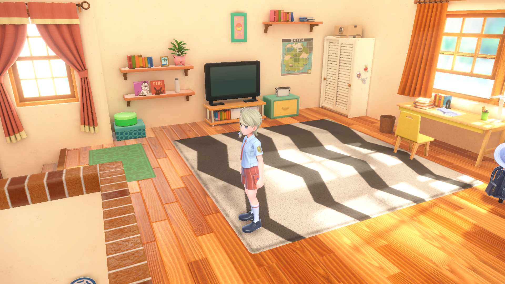
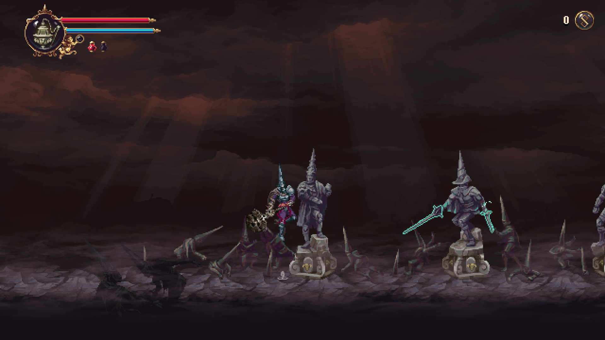
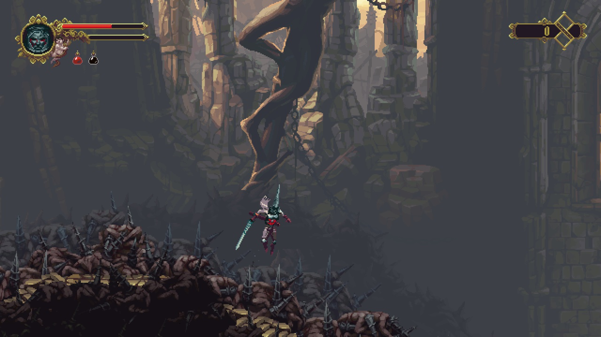
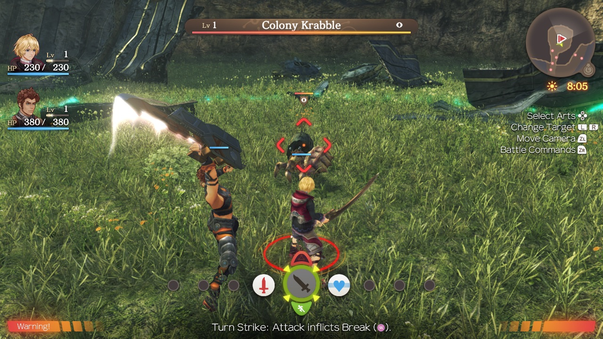

# Games

Every game this fork has a profile for, with the update NSP each one needs. The player's page is [README.md](README.md), and [dm/games/README.md](dm/games/README.md) lists the same games with the engine's own notes on each. This page is the full list, so the README stays short. 中文：[GAMES.zh-CN.md](GAMES.zh-CN.md).

## Gallery

Screenshots and IPA sizes. The block between the markers is written by `dm/tools/docs_gallery.py` from `docs/images/gallery.tsv` (add a row there, then run the script). Do not edit it by hand.

<!-- gallery: written by dm/tools/docs_gallery.py from docs/images/gallery.tsv; change the table, then run it -->
<table>
<tr>
<td align="center" valign="top" width="33%"> <b>Mario Kart 8 Deluxe</b> ~11.9 GB · no Mii heads</td>
<td align="center" valign="top" width="33%"> <b>Mario vs. Donkey Kong</b> ~1.6 GB</td>
<td align="center" valign="top" width="33%"> <b>Paper Mario: The Thousand-Year Door</b> ~5 GB · 60 fps with 1.0.1</td>
</tr>
<tr>
<td align="center" valign="top" width="33%"> <b>Super Mario 3D World + Bowser's Fury</b> ~3 GB</td>
<td align="center" valign="top" width="33%"> <b>Super Mario Bros. Wonder</b> ~4 GB</td>
<td align="center" valign="top" width="33%"> <b>Super Mario Galaxy</b> ~3 GB</td>
</tr>
<tr>
<td align="center" valign="top" width="33%"> <b>Super Mario Galaxy 2</b> ~3 GB</td>
<td align="center" valign="top" width="33%"> <b>Super Mario Odyssey</b> ~6 GB</td>
<td align="center" valign="top" width="33%"> <b>The Legend of Zelda: Breath of the Wild</b> ~16 GB · 60 fps with 1.9.0</td>
</tr>
<tr>
<td align="center" valign="top" width="33%"> <b>The Legend of Zelda: Link's Awakening</b> ~6 GB</td>
<td align="center" valign="top" width="33%"> <b>The Legend of Zelda: Tears of the Kingdom</b> ~17 GB · 60 fps with 1.4.3</td>
<td align="center" valign="top" width="33%"> <b>13 Sentinels: Aegis Rim</b> ~5 GB</td>
</tr>
<tr>
<td align="center" valign="top" width="33%"> <b>Absolum</b> ~2 GB</td>
<td align="center" valign="top" width="33%"> <b>Ace Attorney Investigations Collection</b> ~7 GB</td>
<td align="center" valign="top" width="33%"> <b>Advance Wars 1+2: Re-Boot Camp</b> ~7.1 GB</td>
</tr>
<tr>
<td align="center" valign="top" width="33%"> <b>AI: THE SOMNIUM FILES</b> ~8.3 GB</td>
<td align="center" valign="top" width="33%"> <b>AI: THE SOMNIUM FILES - nirvanA Initiative</b> ~11.6 GB</td>
<td align="center" valign="top" width="33%"> <b>Animal Crossing: New Horizons</b> ~10.5 GB</td>
</tr>
<tr>
<td align="center" valign="top" width="33%"> <b>ANIMAL WELL</b> ~54 MB</td>
<td align="center" valign="top" width="33%"> <b><a href="dm/games/01007300020FA000/README.md">ASTRAL CHAIN</a></b> ~9.7 GB · 60 fps target with 1.0.1</td>
<td align="center" valign="top" width="33%"> <b>Balatro</b> ~82 MB · played by touch</td>
</tr>
<tr>
<td align="center" valign="top" width="33%"> <b>BALL x PIT</b> ~1.1 GB</td>
<td align="center" valign="top" width="33%"> <b>Bayonetta</b> ~8.8 GB</td>
<td align="center" valign="top" width="33%"> <b>Bayonetta 2</b> ~12.5 GB</td>
</tr>
<tr>
<td align="center" valign="top" width="33%"> <b>Bayonetta 3</b> ~14.2 GB</td>
<td align="center" valign="top" width="33%"> <b>Big Brain Academy: Brain vs. Brain</b> ~0.8 GB</td>
<td align="center" valign="top" width="33%"> <b>Brain Memory Training Academy</b> ~0.1 GB</td>
</tr>
<tr>
<td align="center" valign="top" width="33%"> <b>Captain Toad: Treasure Tracker</b> ~2 GB</td>
<td align="center" valign="top" width="33%"> <b>Catherine: Full Body</b> ~14 GB</td>
<td align="center" valign="top" width="33%"> <b>Celeste</b> ~0.9 GB</td>
</tr>
<tr>
<td align="center" valign="top" width="33%"> <b>Cuphead</b> ~5 GB</td>
<td align="center" valign="top" width="33%"> <b>DARK SOULS: REMASTERED</b> ~4 GB · 60 fps with 1.0.3</td>
<td align="center" valign="top" width="33%"> <b>Digimon Story Cyber Sleuth: Complete Edition</b> ~5 GB</td>
</tr>
<tr>
<td align="center" valign="top" width="33%"> <b>Donkey Kong Country: Tropical Freeze</b> ~7.3 GB</td>
<td align="center" valign="top" width="33%"> <b>DRAGON QUEST VII Reimagined</b> ~5.9 GB</td>
<td align="center" valign="top" width="33%"> <b>DRAGON QUEST XI S: Echoes of an Elusive Age – Definitive Edition</b> ~15 GB · 60 fps with 1.0.4</td>
</tr>
<tr>
<td align="center" valign="top" width="33%"> <b>FINAL FANTASY RESONANCE</b> ~10 GB · 60 fps with 1.0.1</td>
<td align="center" valign="top" width="33%"> <b>FINAL FANTASY TACTICS - The Ivalice Chronicles</b> ~11 GB</td>
<td align="center" valign="top" width="33%"> <b>Fire Emblem Engage</b> ~15 GB · 60 fps with 2.0.0</td>
</tr>
<tr>
<td align="center" valign="top" width="33%"> <b>Fire Emblem: Three Houses</b> ~13 GB · 60 fps with 1.2.0</td>
<td align="center" valign="top" width="33%"> <b>Ghost Trick: Phantom Detective</b> ~3 GB</td>
<td align="center" valign="top" width="33%"> <b>The Great Ace Attorney Chronicles</b> ~4 GB</td>
</tr>
<tr>
<td align="center" valign="top" width="33%"> <b>Hades</b> ~4 GB</td>
<td align="center" valign="top" width="33%"> <b>Hades II</b> ~4 GB</td>
<td align="center" valign="top" width="33%"> <b>Hollow Knight: Silksong</b> ~6.4 GB</td>
</tr>
<tr>
<td align="center" valign="top" width="33%"> <b>Hyrule Warriors: Age of Calamity</b> ~15 GB · 60 fps with 1.3.0</td>
<td align="center" valign="top" width="33%"> <b>Kirby and the Forgotten Land</b> ~6.4 GB</td>
<td align="center" valign="top" width="33%"> <b>Luigi's Mansion 3</b> ~7.5 GB · 60 fps with 1.4.0</td>
</tr>
<tr>
<td align="center" valign="top" width="33%"> <b>Metroid Dread</b> ~5 GB</td>
<td align="center" valign="top" width="33%"> <b>Monster Hunter Rise</b> ~22 GB · 60 fps with 16.0.2</td>
<td align="center" valign="top" width="33%"> <b>Monster Train 2</b> ~1.6 GB · 60 fps with 1.1.1</td>
</tr>
<tr>
<td align="center" valign="top" width="33%"> <b>OCTOPATH TRAVELER</b> ~3.6 GB</td>
<td align="center" valign="top" width="33%"> <b>Octopath Traveler 0</b> ~4 GB · 60 fps with 1.0.5</td>
<td align="center" valign="top" width="33%"> <b>Octopath Traveler II</b> ~5.9 GB · 60 fps with 1.1.1</td>
</tr>
<tr>
<td align="center" valign="top" width="33%"> <b>Patrick's Parabox</b> ~0.2 GB</td>
<td align="center" valign="top" width="33%"> <b>Persona 5 Royal</b> ~14.9 GB</td>
<td align="center" valign="top" width="33%"> <b>Pikmin 4</b> ~10.8 GB</td>
</tr>
<tr>
<td align="center" valign="top" width="33%"> <b>Pokémon Brilliant Diamond</b> ~4.6 GB · 60 fps with 1.3.0</td>
<td align="center" valign="top" width="33%"> <b>Pokémon Legends: Z-A</b> ~6 GB</td>
<td align="center" valign="top" width="33%"> <b>Pokémon Scarlet</b> ~7.0 GB</td>
</tr>
<tr>
<td align="center" valign="top" width="33%"> <b>Pokémon Sword</b> ~12.4 GB</td>
<td align="center" valign="top" width="33%"> <b>Pokémon Shield</b> ~12.4 GB</td>
<td align="center" valign="top" width="33%"> <b>Portal</b> ~2.6 GB</td>
</tr>
<tr>
<td align="center" valign="top" width="33%"> <b>Raging Loop</b> ~0.9 GB</td>
<td align="center" valign="top" width="33%"> <b>Rhythm Heaven Groove</b> ~3 GB</td>
<td align="center" valign="top" width="33%"> <b>ROMANCE OF THE THREE KINGDOMS 8 REMAKE</b> ~16.8 GB · controller only</td>
</tr>
<tr>
<td align="center" valign="top" width="33%"> <b>Sea of Stars</b> ~5.1 GB</td>
<td align="center" valign="top" width="33%"> <b>SHIN MEGAMI TENSEI V: Vengeance</b> ~14.6 GB · 60 fps with 1.0.3</td>
<td align="center" valign="top" width="33%"> <b>Stardew Valley</b> ~0.6 GB</td>
</tr>
<tr>
<td align="center" valign="top" width="33%"> <b>STEINS;GATE RE:BOOT</b> ~6 GB</td>
<td align="center" valign="top" width="33%"> <b>Super Smash Bros. Ultimate</b> ~17.5 GB · offline</td>
<td align="center" valign="top" width="33%"> <b>Taiko Risshiden V DX</b> ~3.3 GB · Japanese · played by touch</td>
</tr>
<tr>
<td align="center" valign="top" width="33%"> <b>Unicorn Overlord</b> ~4 GB</td>
<td align="center" valign="top" width="33%"> <b><a href="dm/games/01006000040C2000/README.md">Yoshi's Crafted World</a></b> ~6.1 GB</td>
<td align="center" valign="top" width="33%"> <b>NieR:Automata The End of YoRHa Edition</b> ~10.9 GB · 60 fps with 1.0.3</td>
</tr>
<tr>
<td align="center" valign="top" width="33%"> <b>The Legend of Zelda: Echoes of Wisdom</b> ~7.8 GB</td>
<td align="center" valign="top" width="33%"> <b>Donkey Kong Country Returns HD</b> ~11.6 GB</td>
<td align="center" valign="top" width="33%"> <b>Mario + Rabbids Sparks of Hope</b> ~9.8 GB</td>
</tr>
<tr>
<td align="center" valign="top" width="33%"> <b>Xenoblade Chronicles 2</b> ~17.1 GB</td>
<td align="center" valign="top" width="33%"> <b>Xenoblade Chronicles 3</b> ~19.2 GB</td>
<td align="center" valign="top" width="33%"> <b>FINAL FANTASY CRYSTAL CHRONICLES Remastered Edition</b></td>
</tr>
<tr>
<td align="center" valign="top" width="33%"> <b><a href="dm/games/010032E00E6E2000/README.md">Return of the Obra Dinn</a></b> ~0.9 GB</td>
<td align="center" valign="top" width="33%"> <b><a href="dm/games/010040801A4C8000/README.md">Blasphemous 2</a></b> ~1.5 GB</td>
<td align="center" valign="top" width="33%"> <b><a href="dm/games/0100D5B026844000/README.md">Silver Pines</a></b></td>
</tr>
<tr>
<td align="center" valign="top" width="33%"> <b><a href="dm/games/0100698009C6E000/README.md">Blasphemous</a></b> ~0.9 GB</td>
<td align="center" valign="top" width="33%"> <b><a href="dm/games/0100BC300CB48000/README.md">FINAL FANTASY X/X-2 HD Remaster</a></b> ~26.5 GB</td>
<td align="center" valign="top" width="33%"> <b><a href="dm/games/010067300059A000/README.md">Mario + Rabbids Kingdom Battle</a></b> ~5 GB</td>
</tr>
<tr>
<td align="center" valign="top" width="33%"> <b><a href="dm/games/010062B01525C000/README.md">Persona 4 Golden</a></b></td>
<td align="center" valign="top" width="33%"> <b><a href="dm/games/0100FF500E34A000/README.md">Xenoblade Chronicles: Definitive Edition</a></b> ~13.2 GB</td>
<td></td>
</tr>
</table>
<!-- end of gallery -->

## Verified games

**3 verified end to end on this fork** (build → install → play on a real iPhone), **45 reported
playable upstream**, **94 profiles** in total. The full table with the exact update version each
game needs is [below](#profiles).

| Game | Verified here | Notes |
|---|---|---|
| **Tears of the Kingdom** | ✅ | 304,243 files → 127 archive shards, byte-verified |
| **Hades II** | ✅ | 33-file archive |
| **Animal Crossing: New Horizons** | ✅ | 103,645 files → 72 shards, runs smoothly |

---

## Profiles

94 game profiles ship with this repository. A profile is what makes a build possible —
the game's build IDs, memory layout, shader tables and per-game switches — and this fork adds the
RomFS archive layer on top, so a large game can be installed at all.

The update column is the version the build actually checks: the update NSP's display version
must match the profile's registered build (the base game's own version does not matter — the
update layers over it). "无（v0）" = the base game alone is enough.

| Game | Title ID | Update required | Status |
|---|---|---|---|
| Super Mario Odyssey | `0100000000010000` | 1.4.1 (v393216) | Playable on an iPhone (upstream) |
| Pokémon Brilliant Diamond | `0100000011D90000` | 1.3.0 (v393216) | Playable on an iPhone (upstream) |
| Ace Attorney Investigations Collection | `010005501E68C000` | 1.0.0.2 (v131072) | Profile present, not verified on a phone |
| Hollow Knight: Silksong | `010013C00E930000` | 1.0.30000 (v655360) | Profile present, not verified on a phone |
| Digimon Story Cyber Sleuth: Complete Edition | `010014E00DB56000` | 1.0.3 (v196608) | Profile present, not verified on a phone |
| Super Mario Bros. Wonder | `010015100B514000` | 1.2.1 (v327680) | Playable on an iPhone (upstream) |
| Mario Kart 8 Deluxe | `0100152000022000` | 4.0.1 (v1507328) | Playable on an iPhone (upstream) |
| Raging Loop | `010020400E1C2000` | 无（v0） | Profile present, not verified on a phone |
| ANIMAL WELL | `010020D01AD24000` | 1.0.10 (v655360) | Playable on an iPhone (upstream) |
| Super Mario 3D World + Bowser's Fury | `010028600EBDA000` | 1.2.2 (v262144) | Playable on an iPhone (upstream) |
| Ghost Trick: Phantom Detective | `010029B018432000` | 无（v0） | Playable on an iPhone (upstream) |
| Hyrule Warriors: Age of Calamity | `01002B00111A2000` | 1.3.0 (v327680) | Playable on an iPhone (upstream) |
| Celeste | `01002B30028F6000` | 1.4.1.1 (v589824) | Profile present, not verified on a phone |
| Advance Wars 1+2: Re-Boot Camp | `0100300012F2A000` | 无（v0） | Playable on an iPhone (upstream) |
| Mario + Rabbids® Sparks of Hope | `0100317013770000` | 1.6.2225577 (v393216) | Profile present, not verified on a phone |
| Return of the Obra Dinn | `010032E00E6E2000` | 1.0.1 (v65536) | Profile present, not verified on a phone |
| Taiko Risshiden V DX | `0100346017304000` | 1.1.1 (v131072) | Playable on an iPhone by touch (upstream) |
| The Great Ace Attorney Chronicles | `010036E00FB20000` | 无（v0） | Playable on an iPhone (upstream) |
| FINAL FANTASY TACTICS - The Ivalice Chronicles | `010038B015560000` | 1.4.0 (v393216) | Profile present, not verified on a phone |
| 13 Sentinels: Aegis Rim | `01003FC01670C000` | 1.10 (v65536) | Playable on an iPhone (upstream) |
| Blasphemous 2 | `010040801A4C8000` | 1.0.8 (v524288) | Profile present, not verified on a phone |
| 13 Sentinels: Aegis Rim (Japan) | `010045C014650000` | 无（v0） | Profile present, not verified on a phone |
| Bayonetta 3 | `01004A4010FEA000` | 1.2.0 (v131072) | Playable on an iPhone (upstream) |
| DARK SOULS: REMASTERED | `01004AB00A260000` | 1.0.3 (v196608) | Profile present, not verified on a phone |
| Kirby and the Forgotten Land | `01004D300C5AE000` | 1.1.0 (v65536) | Profile present, not verified on a phone |
| Monster Train 2 | `010051701FB46000` | 1.1.1 (v131072) | Playable on an iPhone (upstream) |
| OCTOPATH TRAVELER 0 | `01005270232F2000` | 1.0.5 (v327680) | Profile present, not verified on a phone |
| Hades | `0100535012974000` | 1.0.38233 (v589824) | Playable on an iPhone (upstream) |
| Unicorn Overlord (Asia) | `010054B01AD92000` | 1.05 (v262144) | Profile present, not verified on a phone |
| Fire Emblem: Three Houses | `010055D009F78000` | 1.2.0 (v327680) | Playable on an iPhone (upstream) |
| NieR:Automata The End of YoRHa Edition | `010056B015FE8000` | 1.0.3 (v131072) | Playable on an iPhone (upstream) |
| OCTOPATH TRAVELER | `010057D006492000` | 1.0.5 (v327680) | Profile present, not verified on a phone |
| Persona 5 Royal | `01005CA01580E000` | 1.0.2 (v65536) | Playable on an iPhone (upstream) |
| Yoshi's Crafted World | `01006000040C2000` | 1.0.1 (v65536) | Profile present, not verified on a phone |
| FINAL FANTASY RESONANCE | `0100606026F12000` | 1.0.1 (v65536) | Playable on an iPhone (upstream) |
| Big Brain Academy: Brain vs. Brain | `0100620012D6E000` | 1.2.0 (v131072) | Profile present, not verified on a phone |
| Persona 4 Golden | `010062B01525C000` | 1.0.2 (v131072) | Profile present, not verified on a phone |
| Mario + Rabbids Kingdom Battle | `010067300059A000` | 1.9.589692 (v589824) | Profile present, not verified on a phone |
| Unicorn Overlord | `010069401ADB8000` | 1.05 (v262144) | Profile present, not verified on a phone |
| Blasphemous | `0100698009C6E000` | 1.0.8 (v524288) | Profile present, not verified on a phone |
| SHIN MEGAMI TENSEI V: Vengeance | `010069C01AB82000` | 1.0.3 (v196608) | Playable on an iPhone (upstream) |
| Super Smash Bros. Ultimate | `01006A800016E000` | 13.0.5 (v2031616) | Playable on an iPhone (upstream) |
| The Legend of Zelda: Link's Awakening | `01006BB00C6F0000` | 1.1.0 (v131072) | Playable on an iPhone (upstream) |
| DRAGON QUEST XI S: Echoes of an Elusive Age – Definitive Edition | `01006C300E9F0000` | 1.0.4 (v262144) | Profile present, not verified on a phone |
| Animal Crossing: New Horizons | `01006F8002326000` | 3.0.3 (v2228224) | **Verified here** — builds, installs and runs smoothly on an iPhone, 103,645 files into 72 archive shards |
| AI: THE SOMNIUM FILES - nirvanA Initiative | `0100713016CCC000` | 1.0.2 (v131072) | Playable on an iPhone (upstream) |
| ASTRAL CHAIN | `01007300020FA000` | 1.0.1 (v65536) | Playable on an iPhone (upstream) |
| Xenoblade Chronicles 3 | `010074F013262000` | 2.2.1 (v720896) | Profile present, not verified on a phone |
| Bayonetta | `010076F0049A2000` | 1.1 (v65536) | Playable on an iPhone (upstream) |
| Bayonetta 2 | `01007960049A0000` | 1.2 (v131072) | Playable on an iPhone (upstream) |
| Portal | `01007BB017812000` | 1.0.3 (v196608) | Playable on an iPhone (upstream) |
| The Legend of Zelda: Breath of the Wild | `01007EF00011E000` | 1.9.0 (v1114112) | Playable on an iPhone (upstream) |
| BALL x PIT | `010086A022444000` | 1.293 (v393216) | Playable on an iPhone (upstream) |
| AI: THE SOMNIUM FILES | `010089B00D09C000` | 1.0.1 (v65536) | Playable on an iPhone (upstream) |
| STEINS;GATE RE:BOOT | `01008BC024FDE000` | 1.0.3 (v131072) | Profile present, not verified on a phone |
| Sea of Stars | `01008C0016544000` | 2.0.59001 (v786432) | Playable on an iPhone (upstream) |
| The Legend of Zelda: Echoes of Wisdom | `01008CF01BAAC000` | 1.1.0 (v196608) | Playable on an iPhone (upstream) |
| 13 Sentinels: Aegis Rim (Asia) | `01008D7016438000` | 无（v0） | Playable on an iPhone (upstream) |
| Pokémon Shield | `01008DB008C2C000` | 1.3.2 (v458752) | Playable on an iPhone (upstream) |
| Metroid Dread | `010093801237C000` | 2.1.0 (v327680) | Playable on an iPhone (upstream) |
| Super Mario Galaxy | `010099C022B96000` | 1.3.1 (v327680) | Playable on an iPhone (upstream) |
| Captain Toad: Treasure Tracker | `01009BF0072D4000` | 1.4.2 (v393216) | Profile present, not verified on a phone |
| Donkey Kong Country Returns HD | `01009D901BC56000` | 1.1.0 (v65536) | Profile present, not verified on a phone |
| Hades II | `0100A00019DE0000` | 1.0.137848 (v1) | **Verified here** — builds, installs and runs on an iPhone, 33-file archive |
| OCTOPATH TRAVELER II | `0100A3501946E000` | 1.1.1 (v131072) | Playable on an iPhone (upstream) |
| Pokémon Scarlet | `0100A3D008C5C000` | 无（v0） | Profile present, not verified on a phone |
| Cuphead | `0100A5C00D162000` | 1.3.7 (v655360) | Profile present, not verified on a phone |
| Fire Emblem Engage | `0100A6301214E000` | 2.0.0 (v327680) | Playable on an iPhone (upstream) |
| Absolum | `0100A83022A22000` | 1.1.2 (v458752) | Profile present, not verified on a phone |
| DRAGON QUEST VII Reimagined | `0100A9D01C446000` | 1.2.0 (v131072) | Profile present, not verified on a phone |
| Pokémon Sword | `0100ABF008968000` | 1.3.2 (v458752) | Playable on an iPhone (upstream) |
| Monster Hunter Rise | `0100B04011742000` | 16.0.2 (v2228224) | Profile present, not verified on a phone |
| Pikmin 4 | `0100B7C00933A000` | 1.1.1 (v262144) | Playable on an iPhone (upstream) |
| FINAL FANTASY RESONANCE (Asian release) | `0100B8A026F14000` | 1.0.1 (v65536) | Profile present, not verified on a phone |
| NieR:Automata The End of YoRHa Edition | `0100B8E016F76000` | 1.0.3 (v131072) | Profile present, not verified on a phone |
| Mario vs. Donkey Kong | `0100B99019412000` | 1.0.1 (v65536) | Playable on an iPhone (upstream) |
| FINAL FANTASY X/X-2 HD Remaster | `0100BC300CB48000` | 无（v0） | Profile present, not verified on a phone |
| Catherine: Full Body | `0100BF00112C0000` | 1.0.1a (v131072) | Profile present, not verified on a phone |
| Donkey Kong Country: Tropical Freeze | `0100C1F0051B6000` | 1.0.2 (v131072) | Profile present, not verified on a phone |
| ROMANCE OF THE THREE KINGDOMS 8 REMAKE | `0100C2A01A730000` | 1.1.3 (v851968) | Playable on an iPhone with a controller (upstream) |
| Balatro | `0100CD801CE5E000` | 1.1.3 (v851968) | Playable on an iPhone (upstream) |
| FINAL FANTASY CRYSTAL CHRONICLES Remastered Edition | `0100CE4010AAC000` | 1.0.3 (v196608) | Profile present, not verified on a phone |
| Silver Pines | `0100D5B026844000` | 无（v0） | Profile present, not verified on a phone |
| Rhythm Heaven Groove | `0100D9F01D474000` | 无（v0） | Profile present, not verified on a phone |
| Luigi's Mansion 3 | `0100DCA0064A6000` | 1.4.0 (v327680) | Playable on an iPhone (upstream) |
| Patrick's Parabox | `0100E44016C22000` | 1.0.1 (v65536) | Profile present, not verified on a phone |
| Stardew Valley | `0100E65002BB8000` | 1.6.15.13 (v1310720) | Playable on an iPhone (upstream) |
| Xenoblade Chronicles 2 | `0100E95004038000` | 2.1.0 (v983040) | Profile present, not verified on a phone |
| Paper Mario: The Thousand-Year Door | `0100ECD018EBE000` | 1.0.1 (v65536) | Profile present, not verified on a phone |
| The Legend of Zelda: Tears of the Kingdom | `0100F2C0115B6000` | 1.4.3 (v720896) | **Verified here** — builds, installs and runs on an iPhone, 304,243 files into 127 archive shards, byte-verified |
| Pokémon Legends: Z-A | `0100F43008C44000` | 2.0.2 (v393216) | Profile present, not verified on a phone |
| Brain Memory Training Academy | `0100F5D01DA3A000` | 无（v0） | Profile present, not verified on a phone |
| Super Mario Galaxy 2 | `0100FD8022DAA000` | 1.4.0 (v393216) | Profile present, not verified on a phone |
| Xenoblade Chronicles: Definitive Edition | `0100FF500E34A000` | 1.1.2 (v196608) | Profile present, not verified on a phone |

## Verified on

- **Tears of the Kingdom** (0100F2C0115B6000, v1.0.0 + update 1.4.3): 304,243 files packed into 127
  files, and all 304,243 byte-compared against the source (`verify: OK`). The game runs from the archive
  on macOS (1,905 frames at 30 fps).
- **Hades II** (0100A00019DE0000, base + update 1.0.137848): 5,258 files packed into 33 files,
  byte-compare OK, and the game runs from the archive on macOS (2,100 frames, 1,772 archive reads).
  The update needs no special handling: `nx_extract` already layers the update NCA over the base
  with `OpenFileSystemWithPatch`, so the extracted RomFS — and therefore the archive — is the merge.
  **Playable on an iPhone** (12 GB device, AltStore Classic 2.3) once the memory entitlement is in
  effect — see below.
- The C reader walks all 304,243 Tears of the Kingdom files and 2,667 directories in 7.6 s.

**The jetsam budget is the limit on big titles, and it can be raised.** Without
`com.apple.developer.kernel.increased-memory-limit` an iPhone gives this app ~3,375 MB (measured on
a 12 GB device: Tears of the Kingdom was killed entering the world map at 3,342 MB resident with
33 MB of headroom. Lowering the render scale to 0.5 did not change it, so the limit is the guest
heap, not the GPU). The app requests the entitlement and `build_ipa.sh` embeds it in a placeholder
ad-hoc signature — an unsigned binary has no signature for a sideloader to read entitlements from,
so without that step the request would be lost. **AltStore Classic 2.2+**, **Impactor** and **Xcode
with a Personal Team** keep it. **SideStore** with a free Apple ID needs a one-time App ID fix,
but **Sideloadly** does not. See [dm/ios/ENTITLEMENTS.md](dm/ios/ENTITLEMENTS.md) for the steps and how
to tell from `Documents/log.txt` (resident + headroom: ~3,375 MB = not in effect, 6–8 GB = it is).

