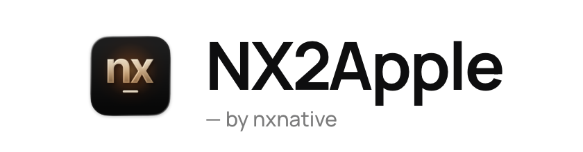
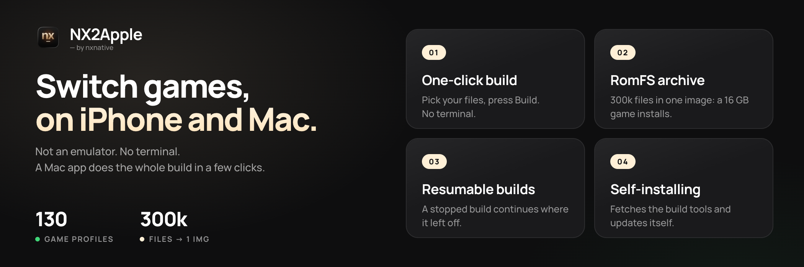
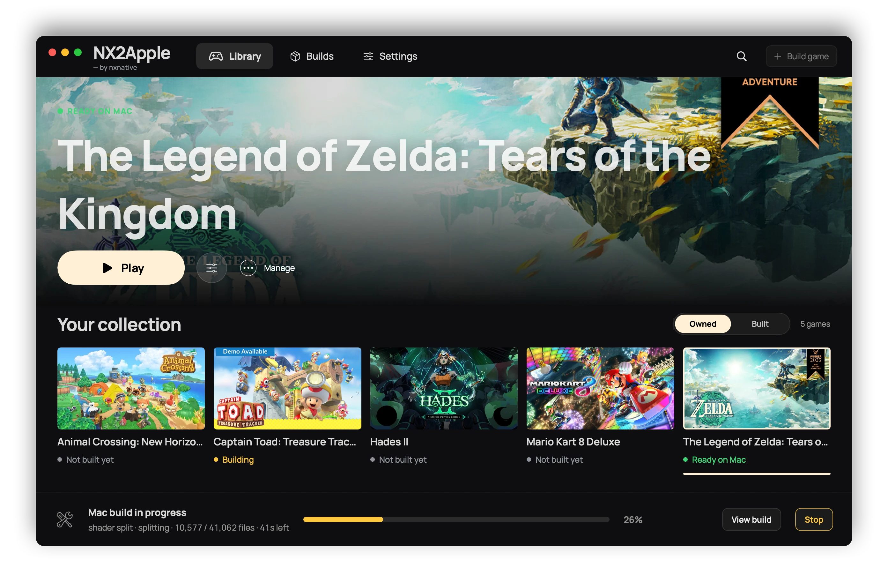
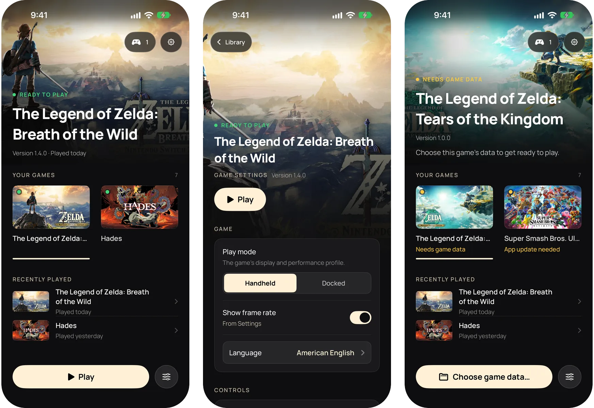
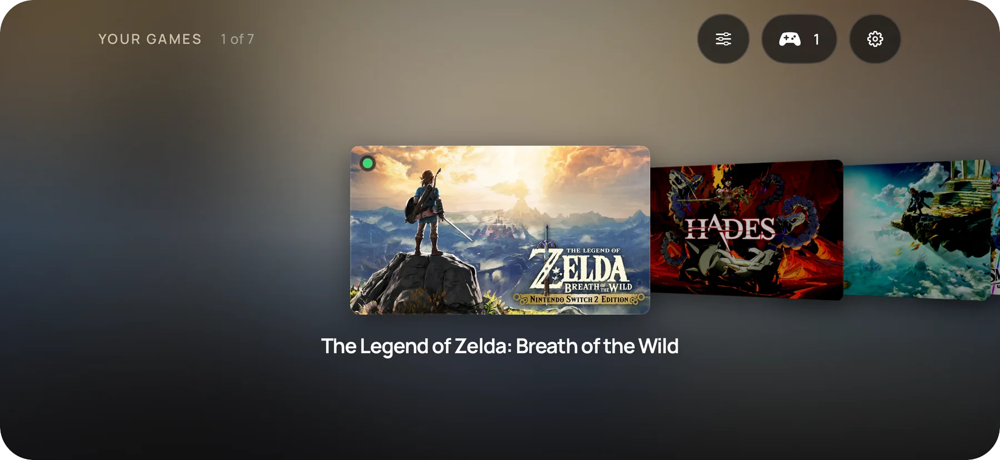

<picture>
  <source media="(prefers-color-scheme: dark)" srcset="frontend/screenshots/logo-dark.png">
  
</picture>

**Deine Switch-Spiele, direkt auf deinem iPhone.**

**Kein Emulator. Kein Terminal. Eine macOS- oder Windows-App erledigt den ganzen Build in wenigen Klicks.**

#### 🆕 Die wichtigsten Neuerungen

- **Windows-Launcher (`NX2Apple-windows-x64.zip`)**: Baue iPhone- und iPad-IPAs unter Windows mit derselben 1.2-Oberfläche, einem mitgelieferten Engine-Verzeichnis (kein git nötig), geführter Ersteinrichtung, mehrkernigem NSO-Rewriting und integriertem Selbst-Update (`NX2Apple.exe`).
- **Switch-2-Spiele**: Wähle im Mac- oder Windows-Launcher einen Switch-2-Spielordner oder eine `.nup`-Datei ohne `prod.keys` aus und spiele auf Mac, iPhone oder iPad.
- **Eigene Touch-Steuerung, geteilte Joy-Con und Steam Controller (2026)**: Ändere die Tastengröße, verschiebe den linken Stick oder platziere jede Taste im visuellen Layout-Editor auf iPhone und iPad. Physische Controller unterstützen eine Tastenbelegung pro Spiel oder global, die Aufteilung eines Bluetooth-Joy-Con-Paars in zwei quer gehaltene Controller auf dem Mac sowie den Steam Controller (2026).
- **Eine App für iPhone und iPad**: Alle deine Spiele landen in einer einzigen Shell-App (oder als unsignierte IPA für AltStore und SideStore), jedes mit seinem eigenen Host-Framework, sodass Engine-Updates keinen Neubau erzwingen, mit Cover Flow im Querformat, Einstellungen und Mods pro Spiel, Löschen unter Beibehaltung der Spielstände und 6 Sprachen.
- **Konsolenmodus**: Schließe einen Controller an und drücke Select oder starte direkt im Konsolenmodus. Die Bibliothek wird zum Vollbild-Menü wie auf einer Switch, und 2 Sekunden Home beendet ein Spiel.

Alle Versionen stehen im [Changelog](CHANGELOG.md).

---

## Was NX2Apple ist

NX2Apple führt Nintendo-Switch-Spiele aus deinen eigenen Spiele-Dumps auf deinem Mac und iPhone aus. Es
ist kein Emulator: Der eigene Code des Spiels läuft nativ auf Apple Silicon, und Metal zeichnet ihn. Eine
Mac-App, der Launcher, erledigt den Build in wenigen Klicks (entpacken, umschreiben, die Shader übersetzen,
packen) und verwaltet deine Spiele danach in einer Bibliothek, die du mit **Spielen** startest, so wie
bei einer Switch.

Es ist ein Community-Fork von **[nxnative](https://github.com/seedds/nxnative)**, das die eigentliche
Arbeit leistet (den Code-Rewriter, den Horizon-Host, NVN auf Metal und das Profil jedes Spiels). Dieser
Fork ergänzt den Launcher und eine kurze Liste von Patches und folgt nxnative jeden Tag.

## Voraussetzungen

- **Ein Mac mit Apple Silicon.** Der Launcher startet ab **macOS 13**. Zum Bauen brauchst du Xcode mit
  dem iOS SDK, und NVN-Spiele brauchen [Xcode](https://developer.apple.com/download/all/?q=Xcode%2027.2) 27.2 (macOS 26.6
  oder neuer), außer du baust mit `--allow-other-metal`. Nimm 27.2 von Apples Download-Seite, nicht das
  neuere Xcode aus dem App Store. Ist zusätzlich ein neueres Xcode installiert, benenne 27.2 in `Xcode-27.2.app` um und wähle es aus:
  `sudo xcode-select -s /Applications/Xcode-27.2.app`.
- **Deine eigenen Spiele-Dumps** (NSP oder XCI) und **deine eigene `prod.keys`** von deiner eigenen
  Konsole. Nichts davon liegt bei, wird heruntergeladen oder für dich nachgeschlagen. Dieselbe `prod.keys`
  öffnet alle deine Switch-Spiele. Ein aktueller Dump deckt alle Retail-Titel ab. Switch-2-Spiele (ein
  Spielordner oder eine `.nup`-Datei) brauchen keine `prod.keys`.
- Für ein iPhone oder iPad: iOS oder iPadOS 26 oder neuer und ein aktuelles Gerät. Ältere Geräte sind ungetestet.

Die App bringt ihre eigenen Build-Werkzeuge und ihr eigenes Python mit, also brauchst du weder Homebrew
noch eine Python-Installation. Das .NET SDK 10 ist das einzige Werkzeug, das sie dir noch installiert.
Die Seite „Abhängigkeiten“ des Launchers prüft jede Voraussetzung und installiert, was sie kann, mit einem Klick.

## Installation

1. **Lade die App herunter**: `NX2Apple-macOS-arm64.zip` vom
   [neuesten Release](https://github.com/LNPANDY/NX2Apple/releases/latest). Entpacke sie.
2. **Öffne sie einmal mit Rechtsklick und dann Öffnen.** Die App ist nicht mit einem kostenpflichtigen
   Apple-Entwicklerzertifikat signiert, daher fragt macOS vor dem ersten Start nach. Danach öffnet sie sich ganz normal.
3. **Folge der Einrichtung.** Der Launcher holt das Projekt, mit dem er baut (ein Button **Repository laden**
   auf der Einrichtungsseite, ein flacher Klon nach `~/NX2Apple`. Ist GitHub langsam, zeigt die Seite den
   Weg über das manuelle ZIP), prüft die oben genannten Werkzeuge und aktualisiert sich später selbst. Git brauchst du nie.
4. **Baue ein Spiel.** Wähle den Ordner des Spiels (oder nacheinander Basisspiel, Update, DLC und
   `prod.keys`), wähle **Dieser Mac** oder **iPhone / iPad** und starte den Build. Die Seite zeigt die echten
   Phasen und die verbleibende Zeit, und ein gestoppter Build macht dort weiter, wo er aufgehört hat. Das Ziel
   **iPhone / iPad** ist eine App auf dem Gerät für alle deine Spiele. Der Launcher signiert sie mit Xcode,
   installiert sie und kopiert das Spiel hinein. Dafür muss ein Gerät mit dem Mac gekoppelt sein.

Von Hand im Terminal zu bauen ist in [BUILDING.md](BUILDING.md) beschrieben.

## Die iPhone- und iPad-App

Das Ziel **iPhone / iPad** baut eine Shell-App, die alle deine Spiele enthält, so wie es der Mac-Launcher
tut. Ihre Bibliothek zeigt jedes Spiel mit seinem Key Art. Im Hochformat ist es eine Spalte, in der das
gewählte Spiel oben steht. Auf der Seite liegend ist es ein Cover Flow. Ein iPad zeigt ein Raster.

- **Spiele vom Mac hinzufügen.** Baue ein Spiel mit dem Ziel **iPhone / iPad**, und der Launcher kopiert es
  in die App. Die App neu zu signieren und neu zu installieren behält deine Spieldaten und Spielstände.
- **Spielen.** Wähle ein Spiel und tippe auf **Spielen**. Fehlen einem Spiel seine Daten oder braucht es eine
  neuere App, steht das auf seiner Karte, und sie bietet die Lösung an.
- **Einstellungen für jedes Spiel.** Der Einstellungen-Button (oder X auf einem Controller) öffnet die
  Startoptionen dieses Spiels. **Zurücksetzen** stellt jede Wahl wieder auf den Standard.
- **Controller oder Tastatur.** Die ganze App lässt sich mit einem Controller bedienen: Steuerkreuz und
  Stick bewegen, A wählt aus, B geht zurück, X öffnet die Einstellungen und Y listet die Controller auf. Eine
  Hardware-Tastatur funktioniert genauso.
- **Spieldaten-Ordner.** Jedes Spiel kann seine Daten aus einem Ordner lesen, den du in der Dateien-App
  wählst, zum Beispiel auf einer externen Festplatte, oder aus dem eigenen Ordner der App.
- **Cloud-Spielstände.** Wähle einen iCloud-Drive-Ordner, damit die Spielstände eines Spiels mit dem Mac
  im Gleichschritt bleiben.
- **Sprache.** Die App folgt der Systemsprache, Englisch oder vereinfachtes Chinesisch.

Die App braucht iOS oder iPadOS 26 oder neuer. Die Cover sind die eShop-Banner, die der Mac-Launcher für
deine eigenen Spiele zwischenspeichert.

## So spielst du

**Auf dem Mac** erscheint ein fertiges Spiel mit seinem Key Art in der Bibliothek. **Spielen** startet es.
Die **Startoptionen** (pro Spiel, bleiben bei Neubauten erhalten) legen die Bildrate, den Konsolenmodus (angedockt
oder Handheld), die Render-Skalierung und das Upscaling, die Spielsprache, die Steuerung und mehr fest. Was
jede Option bewirkt, steht in
[docs/settings.md](https://github.com/seedds/nxnative/blob/f25fa9562ee96d06f1e6412dbb91aab2b7035ec1/docs/settings.md). Ein Controller steuert den Launcher ebenso wie die Spiele.

**Auf dem iPhone** zeigt die App dieselben Einstellungen, bevor das Spiel startet. Tippe auf **Spielen**.
Die Touch-Steuerung gibt es in einem 2D- und einem 3D-Layout (tippe auf den Button oben in der Mitte), und ein
verbundener Controller (Xbox, PlayStation, Switch Pro, MFi) ersetzt sie.
[docs/playing.md](https://github.com/seedds/nxnative/blob/f25fa9562ee96d06f1e6412dbb91aab2b7035ec1/docs/playing.md) behandelt Touch,
Vibration und Bewegung. Kurze Ruckler, wenn eine Szene zum ersten Mal erscheint, sind normal: Die App
kompiliert die Grafik dafür einmal und merkt sie sich. Die Daten des Spiels (`romfs.img`) können auf einer
externen Festplatte liegen, die die Dateien-App auswählt.

**Spielsprache.** Englisch ist der Standard. Auf dem Mac nimmst du die Zeile **Spielsprache** in den
Startoptionen. Für alles, was das Blatt nicht bietet, schreibe eine `env.txt` mit Zeilen der Form `KEY=VALUE`
(zum Beispiel `DM_LANG=zh-Hans`) an einen von zwei Orten: `~/Library/Application Support/nxnative/<title ID>/env.txt`
hat Vorrang und übersteht Neubauten, `<App>.app/Contents/Resources/dm/env.txt` gehört der App selbst. Eine
Mac-App, die vor der Sprachzeile gebaut wurde, braucht einen Neubau, um sie zu bekommen. Auf dem iPhone kommen
dieselben Zeilen in `Documents/env.txt` (`DM_FPS_TARGET=30` begrenzt die Bildrate und spart Akku, `DM_OPMODE=0`
wählt den Handheld-Modus). Diese Datei gilt für jedes Spiel in der gemeinsamen App. Für eine Zeile, die zu einem
einzelnen Spiel gehört (zum Beispiel das `DM_ROMFS_OVERLAY` einer Mod), schreibe sie in
`Documents/games/<title ID>/env.txt`. Setzen beide Dateien denselben Schlüssel, gewinnt die Datei des Spiels.
Eine Mod geht einfacher: Lege ihren Ordner in `Documents/games/<title ID>/mods/<Modname>/` ab (die RomFS-Dateien in
einem Ordner `romfs/` darin oder im Ordner selbst). Die Shell setzt dann `DM_ROMFS_OVERLAY` nur für dieses Spiel.
Bei mehreren Mods gewinnt die nach Namen erste, wo sie dieselbe Datei ersetzen. Ist derselbe Schlüssel mehrfach
gesetzt, gilt diese Reihenfolge: die eigenen Einstellungen der Shell, die `env.txt` des Spiels, der Ordner `mods/`
des Spiels, die gemeinsame `Documents/env.txt`.

**Spielstände und Logs.** Ein Mac-Spiel in einem Bibliotheksordner legt seine Spielstände und sein Log neben
der App ab (`log/<title ID>.log`). Sonst liegen sie in `~/Library/Application Support/nxnative/<title ID>/` und
`~/Library/Logs/nxnative/<title ID>.log`. Auf dem iPhone liegen sie in der Dateien-App unter dem Namen der
App: `save/` und `log.txt` (der vorige Lauf ist `log.prev.txt`).

**Einen Fehler melden.** Nutze die [Issue-Formulare](https://github.com/LNPANDY/NX2Apple/issues/new/choose)
(Spielproblem, Build-Problem, Launcher-Problem). Jedes fragt nach dem Spiel und seiner Title ID, deinen
Versionen und deinem Gerät, nach **Einstellungen > Diagnose kopieren** und nach dem Log des Spiels.
[CONTRIBUTING.md](CONTRIBUTING.md) sagt, warum. Eine Meldung mit dem vollständigen `log.txt` wird zuerst
angesehen. Hänge niemals Schlüssel, Spieldateien oder etwas aus einem Spiel Extrahiertes an.

## Spiele

147 Spiele haben ein Profil. Einige gelten upstream auf einem iPhone als spielbar, und die meisten haben
ein Profil, das noch nicht auf einem Handy ausprobiert wurde. Einige davon:

| | Spiel | Wo es läuft | Status |
|---|---|---|---|
|  | The Legend of Zelda: Tears of the Kingdom | Mac und iPhone | **Hier verifiziert**: 304.243 Dateien, Byte für Byte geprüft, ca. 17 GB |
|  | Hades II | Mac und iPhone | **Hier verifiziert** |
|  | Animal Crossing: New Horizons | iPhone | **Hier verifiziert**: läuft flüssig |
|  | Super Mario Odyssey | iPhone | Upstream als spielbar gemeldet |
|  | The Legend of Zelda: Breath of the Wild | iPhone | Upstream als spielbar gemeldet, 60 fps mit 1.9.0 |
|  | Mario Kart 8 Deluxe | iPhone | Upstream als spielbar gemeldet |

**[GAMES.md](GAMES.md)** enthält die Screenshot-Galerie mit der Installationsgröße jedes Spiels und die
vollständige Tabelle mit der Update-Version, die jedes Spiel braucht: Die angezeigte Version der Update-NSP
muss zu der des Profils passen, sonst sagt dir das der Build.

## Einschränkungen

- **Nur die Spiele mit einem Profil.** Ein Titel außerhalb der Liste braucht eigene Bring-up-Arbeit. Der
  Einstieg ist [docs/agents](https://github.com/seedds/nxnative/blob/f25fa9562ee96d06f1e6412dbb91aab2b7035ec1/docs/agents/README.md), der Leitfaden von upstream für einen weiteren Switch-Titel.
- **Große Spiele stoßen auf dem iPhone an ein Speicherlimit.** Ohne das Entitlement Increased Memory Limit
  gibt iOS der App etwa 3,4 GB, was für Tears of the Kingdom nicht reicht. Die App fordert es an, und
  AltStore Classic 2.2+, Impactor und Xcode mit einem Personal Team behalten es. SideStore mit einer
  kostenlosen Apple-ID braucht einmalig eine Korrektur der App-ID, und Sideloadly entfernt es ([die Schritte](ENTITLEMENTS.md)).
  Die vollständigen Messungen stehen in [GAMES.md](GAMES.md#verified-on).
- **Nicht signierter Launcher.** Der Launcher wird nicht für dich signiert, du installierst ihn also per
  Sideloading. Die iPhone-App signiert Xcode mit deinem eigenen Team, wenn der Launcher sie installiert.
- **Deine eigenen Dateien.** Es sind keine Spieldaten, keine Firmware und keine Schlüssel enthalten oder werden heruntergeladen.
- **Ältere Shard-Archive werden nicht mehr gelesen.** Die ersten iPhone-Builds packten Tears of the Kingdom
  in ein RomFS-Shard-Archiv (`romfs.idx`). Der Build schreibt jetzt eine einzelne `romfs.img`. Ein iPhone, das
  noch ein altes Archiv enthält, braucht die Spieldaten einmal neu, als `romfs.img` über den Launcher.

## Für Entwickler

- **Aus dem Quellcode bauen:** [BUILDING.md](BUILDING.md). **Etwas melden oder beheben:** [CONTRIBUTING.md](CONTRIBUTING.md).
- **Wo Hilfe gebraucht wird:** Die [Meilensteine](https://github.com/LNPANDY/NX2Apple/milestones) sind der Plan, und [CONTRIBUTING.md](CONTRIBUTING.md#where-we-would-love-help) sagt, wie du dir daraus ein Issue nimmst.
- **Was dieser Fork an upstream ändert:** Die Engine (`dm/`, `scripts/`, `docs/`, `ref/`) ist hier nicht
  eingecheckt. Sie ist nxnative an einem festgelegten Commit (`.upstream-ref`) plus eine Warteschlange von
  Patches, die jeweils sagen, warum der Fork sie trägt, und `python3 tools/engine.py sync` baut sie in `engine/`.
  [patches/README.md](patches/README.md) erklärt das, und `python3 tools/engine.py status` listet auf, was
  mitgetragen wird. Ein täglicher Job verschiebt den Pin und öffnet einen Pull Request, oder ein Issue, das den Patch
  nennt, der nicht mehr passt. Die Links zu den Dokumenten der Engine in dieser README zeigen auf nxnative am festgelegten Commit.
- **Ein anderes Switch-Spiel:** [docs/agents](https://github.com/seedds/nxnative/blob/f25fa9562ee96d06f1e6412dbb91aab2b7035ec1/docs/agents/README.md) (Extraktion, Binärübersicht, Bring-up).
- **Versionsverlauf:** [CHANGELOG.md](CHANGELOG.md).

## Danksagung

**Community-Mitwirkende**: Der Code dieses Projekts stammt nicht von einem einzelnen Maintainer:

- **[v0lumehi](https://github.com/v0lumehi)**: **der Launcher des Mac-Frontends** (PR [#27](https://github.com/LNPANDY/NX2Apple/pull/27), 40 Dateien): eine Spielebibliothek mit Key Art, Startoptionen pro Spiel, ein echter Fortschritts-Stream und ein Stopp, der die ganze Prozessgruppe des Builds beendet. Aus der Mac-App wurde von „einem Build-Formular“ die erste Version eines Launchers, der sich wie eine Switch öffnet.
- **[m1guelpf](https://github.com/m1guelpf)** (Miguel Piedrafita): zwei HLE-Fixes (PRs [#24](https://github.com/LNPANDY/NX2Apple/pull/24) und [#26](https://github.com/LNPANDY/NX2Apple/pull/26)): die fehlenden Einträge `EnableAlbumImageTakenNotification` und `CreateWithAdjustableSystemClock` samt ihrem Snapshot-Typ-Byte. Jeder hätte in Spielen, die sie aufrufen, ein Null gelesen, und jeder kam mit einem Test.

Willst du auf diese Liste? [Mitmachen](CONTRIBUTING.md#helping-with-games) sagt, wie du anfängst. Meldungen mit vollständigem Log und Fixes mit einem Test gehen am schnellsten.

**Community-Projekte**: von ihren Autoren gepflegt, außerhalb dieses Repositorys:

- **[widmonstertony/nxnative](https://github.com/widmonstertony/nxnative)** (Branch `ios16-pokemon-za-port`): Kompatibilität mit iOS/iPadOS 16.1 bis 17 und tvOS, mit einem Legacy-Metal-Renderer-Pfad, getestet auf einem iPad mit A10X und einem iPad mit M2. Für Geräte, die die Releases dieses Forks nicht unterstützen.

Die gesamte Arbeit an der Engine stammt von anderen. Dieses Repository ergänzt darüber den Launcher und die Patch-Warteschlange:

- **[nxnative](https://github.com/seedds/nxnative)** (MIT): die Toolchain für native Ausführung, aus der dieses
  Repository gebaut ist: der NSO-Rewriter, die Horizon-Host-Schicht, NVN auf Metal, die Profile der einzelnen Spiele und die iOS-Shell.
- **[d2r-mobile](https://github.com/jhaizhou-ops/d2r-mobile)** (MIT): der ursprüngliche Ansatz der nativen
  Ausführung, aus dem nxnative hervorging.
- **Ryujinx** (MIT): der Shader-Übersetzer, der Maxwell-Shader in SPIR-V umwandelt.
- **[Atmosphère](https://github.com/Atmosphere-NX/Atmosphere)**: die Referenz für die Synchronisationssemantik von Horizon.
- **[LibHac](https://github.com/Thealexbarney/LibHac)**: liest NSPs und schichtet Updates in `nx_extract`.
- **[SPIRV-Cross](https://github.com/KhronosGroup/SPIRV-Cross)**: SPIR-V zu Metal Shading Language.
- **yuzu**, **deko3d**, **libvpx**, **stb_vorbis**, **libdeflate**: in der Danksagungsliste von upstream steht, was jedes beiträgt.

`dm/third_party` enthält andere Projekte mit ihren Lizenzen ([Liste](https://github.com/seedds/nxnative/blob/f25fa9562ee96d06f1e6412dbb91aab2b7035ec1/dm/third_party/README.md)).

## Rechtliches

**Was dieses Projekt ist.** Ein Build-Werkzeug für Spiele, die du bereits besitzt. Es liest Dumps, die du von
deinen eigenen Spielmodulen und Käufen gemacht hast, auf deinem eigenen Rechner und erzeugt ein Paket für dein
eigenes Gerät. Nichts in diesem Repository, in der App oder in einem Release enthält oder verbreitet Code,
Grafiken, Texte, Daten, Shader, Firmware, Schlüssel oder anderes urheberrechtlich geschütztes Material von Nintendo.

**Was es nicht kann.** Die Pipeline hat keine Quelle für Spiele oder Schlüssel: Sie verlangt die eigene
`prod.keys` und die eigenen NSP/XCI-Dumps des Nutzers und spricht mit keinem Server. Sie umgeht, entfernt
oder verbreitet keinen Schutz. LibHac öffnet die eigenen Dumps des Nutzers mit seinen eigenen Schlüsseln, also
dieselbe Operation, die eine Konsole mit einem Spielmodul ausführt.

**Marken.** Nicht mit Nintendo verbunden, von Nintendo nicht gesponsert und nicht von Nintendo unterstützt.
„Nintendo Switch“ und Spieltitel sind Marken der Nintendo Co., Ltd. Alle anderen Marken gehören ihren jeweiligen Inhabern.

**Deine Verantwortung.** Die Gesetze zu privaten Sicherungskopien unterscheiden sich von Land zu Land, manche
Orte erlauben sie gar nicht. Du bist dafür verantwortlich, das Recht an deinem Wohnort zu kennen und
einzuhalten und niemals Spieldateien, Schlüssel oder daraus gebaute Pakete zu verbreiten. Die Ergebnisse des
Projekts sind nur für den privaten Gebrauch auf deiner eigenen Hardware gedacht. Wenn dir ein Spiel gefällt, kauf es.

**Takedowns.** Glaubst du, dass etwas in diesem Repository deine Rechte verletzt, öffne ein Issue oder
kontaktiere den Maintainer direkt. Berechtigte Ansprüche werden umgehend bearbeitet, bis hin zum Entfernen von Inhalten oder des Repositorys.

**Keine Gewährleistung.** Die Software wird „wie besehen“ unter den Lizenzen in [LICENSE](LICENSE) bereitgestellt
(dieser Fork ergänzt die von upstream, siehe die Danksagung), ohne Gewährleistung jeder Art, weder
ausdrücklich noch stillschweigend. Die Nutzung erfolgt auf eigene Gefahr.
