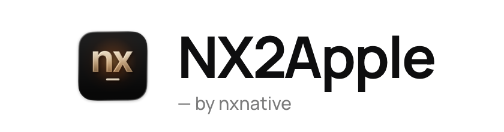
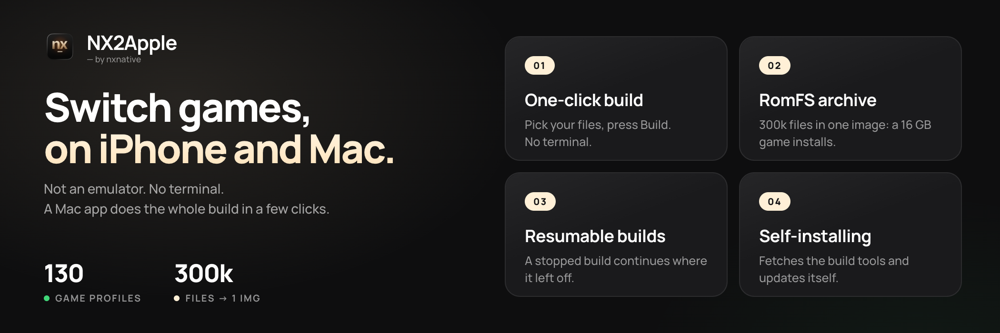
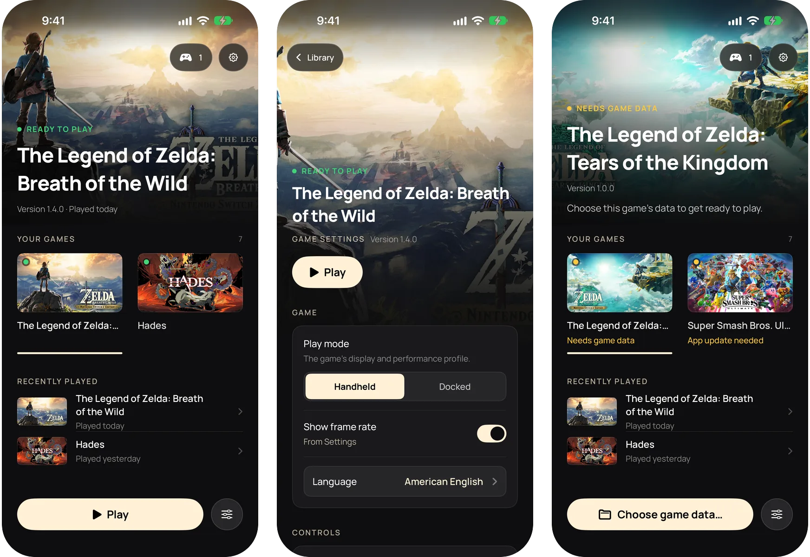
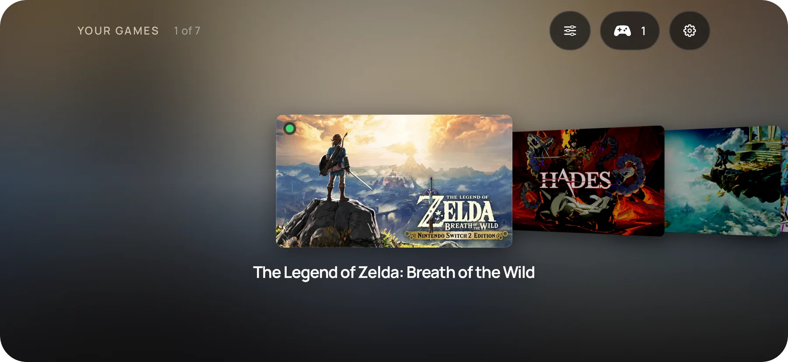

<picture>
  <source media="(prefers-color-scheme: dark)" srcset="frontend/screenshots/logo-dark.png">
  
</picture>

**Vos jeux Switch, directement sur votre iPhone.**

**Pas un émulateur. Pas de terminal. Une app macOS ou Windows fait toute la compilation en quelques clics.**

#### 🆕 Les nouveautés

- **Lanceur Windows (`NX2Apple-windows-x64.zip`)** : compilez des IPA pour iPhone et iPad sous Windows avec la même interface 1.2, une arborescence du moteur embarquée (pas besoin de git), une configuration initiale guidée, une réécriture NSO multicœur et une mise à jour automatique intégrée (`NX2Apple.exe`).
- **Jeux Switch 2** : choisissez un dossier de jeu Switch 2 ou un fichier `.nup` dans le lanceur Mac ou Windows, sans `prod.keys`, et jouez sur Mac, iPhone ou iPad.
- **Commandes tactiles personnalisées, Joy-Con séparés et Steam Controller (2026)** : redimensionnez les boutons, déplacez le stick gauche ou placez chaque commande dans l’éditeur visuel sur iPhone et iPad. Les manettes physiques prennent en charge la réattribution par jeu ou globale, la séparation d’une paire de Joy-Con Bluetooth en deux manettes tenues à l’horizontale sur Mac et le Steam Controller (2026).
- **Une seule app pour iPhone et iPad** : tous vos jeux sont réunis dans une seule app coque (ou exportés en IPA non signé pour AltStore et SideStore), chacun embarquant son propre framework hôte pour que les mises à jour du moteur n’imposent jamais de recompiler, avec Cover Flow en paysage, réglages et mods par jeu, suppression du jeu en gardant les sauvegardes et 6 langues.
- **Mode console** : branchez une manette et appuyez sur Select, ou démarrez directement en mode console. La bibliothèque passe en plein écran comme sur une Switch, et maintenir Home 2 secondes quitte un jeu.

Toutes les versions sont dans le [journal des modifications](CHANGELOG.md).

---

## Ce qu’est NX2Apple

NX2Apple fait tourner des jeux Nintendo Switch sur votre Mac et votre iPhone à partir de vos propres dumps de
jeux. Ce n’est pas un émulateur : le code du jeu lui-même s’exécute nativement sur Apple silicon, et Metal
l’affiche. Une app Mac, le lanceur, fait la compilation en quelques clics (extraire, réécrire, traduire les
shaders, empaqueter) puis garde vos jeux dans une bibliothèque que vous démarrez avec **Jouer**, comme sur une Switch.

C’est un fork communautaire de **[nxnative](https://github.com/seedds/nxnative)**, qui fait le vrai travail
(le réécrivain de code, l’hôte Horizon, NVN sur Metal et le profil de chaque jeu). Ce fork ajoute le lanceur
et une courte liste de correctifs, et suit nxnative chaque jour.

## Prérequis

- **Un Mac Apple silicon.** Le lanceur s’ouvre sur **macOS 13 ou plus récent**. Pour compiler, il faut Xcode avec
  le SDK iOS, et les jeux NVN demandent [Xcode](https://developer.apple.com/download/all/?q=Xcode%2027.2) 27.2 (macOS 26.6
  ou plus récent), sauf compilation avec `--allow-other-metal`. Prenez la version 27.2 sur la page de téléchargement
  d’Apple, pas le Xcode plus récent de l’App Store. Si un Xcode plus récent est aussi installé, renommez 27.2 en `Xcode-27.2.app` et sélectionnez-le :
  `sudo xcode-select -s /Applications/Xcode-27.2.app`.
- **Vos propres dumps de jeux** (NSP ou XCI) et **votre propre `prod.keys`**, issu de votre propre console. Rien
  n’est fourni, téléchargé ou recherché pour vous. Le même `prod.keys` ouvre tous vos jeux Switch. Un dump
  récent couvre tous les titres du commerce. Les jeux Switch 2 (un dossier de jeu ou un fichier `.nup`)
  n’ont pas besoin de `prod.keys`.
- Pour un iPhone ou un iPad : iOS ou iPadOS 26 ou plus récent et un appareil récent. Les appareils plus anciens ne sont pas testés.

L’app embarque ses propres outils de compilation et son propre Python, donc pas besoin de Homebrew ni d’installer
Python. Le SDK .NET 10 est le seul outil qu’elle installe encore pour vous. La page des dépendances du lanceur
vérifie chaque prérequis et installe ce qu’elle peut en un clic.

## Installation

1. **Téléchargez l’app** : `NX2Apple-macOS-arm64.zip` depuis la
   [dernière version](https://github.com/LNPANDY/NX2Apple/releases/latest). Décompressez-la.
2. **Ouvrez-la une première fois par clic droit, puis Ouvrir.** L’app n’est pas signée avec un certificat
   développeur Apple payant, donc macOS demande confirmation avant le premier démarrage. Ensuite, elle s’ouvre normalement.
3. **Suivez la configuration.** Le lanceur récupère le projet avec lequel il compile (un bouton **Télécharger le dépôt**
   sur la page de configuration, un clone superficiel dans `~/NX2Apple`. Si GitHub est lent, la page montre la
   voie du ZIP manuel), vérifie les outils ci-dessus et se met à jour ensuite tout seul. Vous n’avez jamais besoin de git.
4. **Compilez un jeu.** Choisissez le dossier du jeu (ou le jeu de base, la mise à jour, les DLC et `prod.keys`
   un par un), choisissez **Ce Mac** ou **iPhone / iPad** et lancez la compilation. La page montre les vraies
   étapes et le temps restant, et une compilation arrêtée reprend là où elle s’était arrêtée. La cible
   **iPhone / iPad** est une seule app sur l’appareil pour tous vos jeux. Le lanceur la signe avec Xcode, l’installe
   et y copie le jeu. Il faut pour cela un appareil jumelé avec le Mac.

La compilation à la main depuis un terminal est décrite dans [BUILDING.md](BUILDING.md).

## L’app iPhone et iPad

La cible **iPhone / iPad** compile une app coque qui contient tous vos jeux, comme le fait le lanceur Mac. Sa
bibliothèque montre chaque jeu avec son visuel. En portrait, c’est une colonne avec le jeu choisi en haut. À
l’horizontale, c’est un Cover Flow. Un iPad affiche une grille.

- **Ajoutez des jeux depuis le Mac.** Compilez un jeu avec la cible **iPhone / iPad** et le lanceur le copie
  dans l’app. Signer et réinstaller l’app de nouveau conserve vos données de jeu et vos sauvegardes.
- **Jouez.** Choisissez un jeu et touchez **Jouer**. Un jeu auquel il manque ses données, ou qui demande une app
  plus récente, le dit sur sa carte et propose la solution.
- **Des réglages pour chaque jeu.** Le bouton des réglages (ou X sur une manette) ouvre les options de lancement
  de ce jeu. **Rétablir les valeurs par défaut** remet chaque choix à sa valeur par défaut.
- **Manette ou clavier.** Toute l’app se pilote à la manette : la croix directionnelle et le stick déplacent,
  A valide, B revient en arrière, X ouvre les réglages et Y liste les manettes. Un clavier matériel fonctionne de la même façon.
- **Dossier des données du jeu.** Chaque jeu peut lire ses données depuis un dossier choisi dans l’app Fichiers,
  par exemple sur un disque externe, ou depuis le dossier propre de l’app.
- **Sauvegardes dans le cloud.** Choisissez un dossier iCloud Drive pour garder les sauvegardes d’un jeu en phase avec le Mac.
- **Langue.** L’app suit la langue du système, anglais ou chinois simplifié.

L’app demande iOS ou iPadOS 26 ou plus récent. Les jaquettes sont les bannières de l’eShop que le lanceur Mac
met en cache pour vos propres jeux.

## Comment jouer

**Sur le Mac**, un jeu terminé apparaît dans la bibliothèque avec son visuel. **Jouer** le démarre.
Les **Options de lancement** (par jeu, conservées d’une compilation à l’autre) règlent la fréquence d’images, le
mode de la console (TV ou portable), l’échelle de rendu et la mise à l’échelle, la langue du jeu, les commandes et
plus encore. Ce que fait chaque option est décrit dans
[docs/settings.md](https://github.com/seedds/nxnative/blob/f25fa9562ee96d06f1e6412dbb91aab2b7035ec1/docs/settings.md). Une manette pilote le lanceur aussi bien que les jeux.

**Sur l’iPhone**, l’app montre les mêmes réglages avant le démarrage du jeu. Touchez **Jouer**. Les commandes
tactiles existent en disposition 2D et 3D (touchez le bouton en haut au centre), et une manette connectée
(Xbox, PlayStation, Switch Pro, MFi) les remplace.
[docs/playing.md](https://github.com/seedds/nxnative/blob/f25fa9562ee96d06f1e6412dbb91aab2b7035ec1/docs/playing.md) traite du tactile, des vibrations et du mouvement. De courtes saccades la première fois
qu’une scène apparaît sont normales : l’app compile les graphismes pour elle une fois et s’en souvient. Les
données du jeu (`romfs.img`) peuvent se trouver sur un disque externe choisi dans l’app Fichiers.

**Langue du jeu.** L’anglais est la langue par défaut. Sur le Mac, utilisez la ligne **Langue du jeu** des
Options de lancement. Pour tout ce que la feuille ne propose pas, écrivez un `env.txt` de lignes `KEY=VALUE`
(par exemple `DM_LANG=zh-Hans`) à l’un de deux endroits : `~/Library/Application Support/nxnative/<title ID>/env.txt`
a la priorité et survit aux compilations, `<App>.app/Contents/Resources/dm/env.txt` est celui de l’app. Une app
Mac compilée avant l’existence de la ligne de langue demande une nouvelle compilation pour l’obtenir. Sur
l’iPhone, les mêmes lignes vont dans `Documents/env.txt` (`DM_FPS_TARGET=30` plafonne la fréquence d’images pour
économiser la batterie, `DM_OPMODE=0` choisit le mode portable). Ce fichier s’applique à tous les jeux de l’app
partagée. Pour une ligne qui concerne un seul jeu (le `DM_ROMFS_OVERLAY` d’un mod, par exemple), écrivez-la dans
`Documents/games/<title ID>/env.txt`. Quand les deux fichiers définissent une même clé, celui du jeu l’emporte.
Un mod est plus simple : placez son dossier dans `Documents/games/<title ID>/mods/<nom du mod>/` (les fichiers RomFS
dans un dossier `romfs/` à l’intérieur, ou dans le dossier lui-même). La coque définit alors `DM_ROMFS_OVERLAY`
pour ce jeu seulement. Avec plusieurs mods, celui qui vient en premier par le nom l’emporte quand ils remplacent le
même fichier. Quand une même clé est définie plusieurs fois, l’ordre est : les réglages propres de la coque, le
`env.txt` du jeu, le dossier `mods/` du jeu, le `Documents/env.txt` partagé.

**Sauvegardes et journaux.** Un jeu Mac placé dans un dossier de bibliothèque garde ses sauvegardes et son journal
à côté de l’app (`log/<title ID>.log`). Sinon, ils se trouvent dans `~/Library/Application Support/nxnative/<title ID>/`
et `~/Library/Logs/nxnative/<title ID>.log`. Sur l’iPhone, ils sont dans l’app Fichiers sous le nom de l’app :
`save/` et `log.txt` (l’exécution précédente est `log.prev.txt`).

**Signaler un bug.** Utilisez les [formulaires de ticket](https://github.com/LNPANDY/NX2Apple/issues/new/choose)
(problème de jeu, de compilation, de lanceur). Chacun demande le jeu et son title ID, vos versions et votre
appareil, **Réglages > Copier les diagnostics** et le journal du jeu. [CONTRIBUTING.md](CONTRIBUTING.md) explique
pourquoi. Un signalement avec le `log.txt` complet est examiné en premier. Ne joignez jamais de clés, de fichiers
de jeu ni rien d’extrait d’un jeu.

## Jeux

147 jeux ont un profil. Plusieurs sont signalés jouables sur un iPhone en amont, et la plupart ont un
profil qui n’a pas encore été essayé sur un téléphone. En voici quelques-uns :

| | Jeu | Où il tourne | Statut |
|---|---|---|---|
|  | The Legend of Zelda: Tears of the Kingdom | Mac et iPhone | **Vérifié ici** : 304 243 fichiers, vérifiés octet par octet, environ 17 Go |
|  | Hades II | Mac et iPhone | **Vérifié ici** |
|  | Animal Crossing: New Horizons | iPhone | **Vérifié ici** : tourne de façon fluide |
|  | Super Mario Odyssey | iPhone | Signalé jouable en amont |
|  | The Legend of Zelda: Breath of the Wild | iPhone | Signalé jouable en amont, 60 fps avec 1.9.0 |
|  | Mario Kart 8 Deluxe | iPhone | Signalé jouable en amont |

**[GAMES.md](GAMES.md)** contient la galerie de captures avec la taille d’installation de chaque jeu, et le
tableau complet avec la version de mise à jour dont chaque jeu a besoin : la version affichée du NSP de mise à
jour doit correspondre à celle du profil, sinon la compilation le signale.

## Limites

- **Seulement les jeux qui ont un profil.** Un titre hors de la liste demande son propre travail de mise en route.
  Le point de départ est [docs/agents](https://github.com/seedds/nxnative/blob/f25fa9562ee96d06f1e6412dbb91aab2b7035ec1/docs/agents/README.md), le guide du projet en amont pour un autre titre Switch.
- **Les gros jeux atteignent une limite de mémoire sur iPhone.** Sans l’entitlement Increased Memory Limit, iOS
  donne à l’app environ 3,4 Go, ce qui ne suffit pas pour Tears of the Kingdom. L’app le demande, et
  AltStore Classic 2.2+, Impactor et Xcode avec une Personal Team le conservent. SideStore avec un identifiant
  Apple gratuit demande une correction unique de l’App ID, et Sideloadly le supprime ([les étapes](ENTITLEMENTS.md)).
  Les mesures complètes sont dans [GAMES.md](GAMES.md#verified-on).
- **Lanceur non signé.** Le lanceur n’est pas signé pour vous, vous l’installez donc par sideloading. L’app iPhone
  est signée par Xcode avec votre propre équipe quand le lanceur l’installe.
- **Vos propres fichiers.** Aucune donnée de jeu, aucun firmware ni aucune clé n’est inclus ou téléchargé.
- **Les anciennes archives en shards ne sont plus lues.** Les premières compilations iPhone empaquetaient Tears
  of the Kingdom dans une archive RomFS en shards (`romfs.idx`). La compilation écrit désormais un seul `romfs.img`.
  Un iPhone qui contient encore une ancienne archive a besoin que les données du jeu soient renvoyées une fois,
  sous forme de `romfs.img` par le lanceur.

## Pour les développeurs

- **Compiler depuis les sources :** [BUILDING.md](BUILDING.md). **Signaler ou corriger quelque chose :** [CONTRIBUTING.md](CONTRIBUTING.md).
- **Où l’aide est la bienvenue :** les [jalons](https://github.com/LNPANDY/NX2Apple/milestones) sont le plan, et [CONTRIBUTING.md](CONTRIBUTING.md#where-we-would-love-help) explique comment prendre un ticket dans l’un d’eux.
- **Ce que ce fork change en amont :** le moteur (`dm/`, `scripts/`, `docs/`, `ref/`) n’est pas commité ici. C’est
  nxnative à un commit épinglé (`.upstream-ref`) plus une file de correctifs, chacun disant pourquoi le fork le
  porte, et `python3 tools/engine.py sync` le construit dans `engine/`. [patches/README.md](patches/README.md)
  l’explique, et `python3 tools/engine.py status` liste ce qui est porté. Une tâche quotidienne déplace l’épingle
  et ouvre une pull request, ou un ticket qui nomme le correctif qui ne s’applique plus. Les liens vers les
  documents du moteur dans ce README pointent vers nxnative au commit épinglé.
- **Un autre jeu Switch :** [docs/agents](https://github.com/seedds/nxnative/blob/f25fa9562ee96d06f1e6412dbb91aab2b7035ec1/docs/agents/README.md) (extraction, analyse du binaire, mise en route).
- **Historique des versions :** [CHANGELOG.md](CHANGELOG.md).

## Remerciements

**Contributeurs de la communauté** : le code de ce projet n’est pas le fruit d’un seul mainteneur :

- **[v0lumehi](https://github.com/v0lumehi)** : **le lanceur du front end Mac** (PR [#27](https://github.com/LNPANDY/NX2Apple/pull/27), 40 fichiers) : une bibliothèque de jeux avec visuels, des options de lancement par jeu, un vrai flux de progression et un Arrêter qui termine tout le groupe de processus de la compilation. L’app Mac est passée d’« un formulaire de compilation » à la première version d’un lanceur qui s’ouvre comme une Switch.
- **[m1guelpf](https://github.com/m1guelpf)** (Miguel Piedrafita) : deux corrections HLE (PR [#24](https://github.com/LNPANDY/NX2Apple/pull/24) et [#26](https://github.com/LNPANDY/NX2Apple/pull/26)) : les entrées manquantes `EnableAlbumImageTakenNotification` et `CreateWithAdjustableSystemClock` ainsi que leur octet de type d’instantané. Chacune aurait lu un null dans les jeux qui les appellent, et chacune est venue avec un test.

Envie de figurer sur cette liste ? [Contribuer](CONTRIBUTING.md#helping-with-games) explique comment commencer. Les signalements avec un journal complet et les corrections avec un test avancent le plus vite.

**Projets de la communauté** : maintenus par leurs auteurs, en dehors de ce dépôt :

- **[widmonstertony/nxnative](https://github.com/widmonstertony/nxnative)** (branche `ios16-pokemon-za-port`) : compatibilité avec iOS/iPadOS 16.1 à 17 et tvOS, avec un chemin de rendu Metal hérité, testé sur un iPad A10X et un iPad M2. Pour les appareils que les versions de ce fork ne prennent pas en charge.

Tout le travail sur le moteur est celui d’autres personnes. Ce dépôt ajoute par-dessus le lanceur et la file de correctifs :

- **[nxnative](https://github.com/seedds/nxnative)** (MIT) : la chaîne d’outils d’exécution native dont ce dépôt
  est issu : le réécrivain NSO, la couche hôte Horizon, NVN sur Metal, les profils de chaque jeu et la coque iOS.
- **[d2r-mobile](https://github.com/jhaizhou-ops/d2r-mobile)** (MIT) : l’approche d’exécution native d’origine
  dont nxnative est issu.
- **Ryujinx** (MIT) : le traducteur de shaders qui convertit les shaders Maxwell en SPIR-V.
- **[Atmosphère](https://github.com/Atmosphere-NX/Atmosphere)** : la référence pour la sémantique de synchronisation de Horizon.
- **[LibHac](https://github.com/Thealexbarney/LibHac)** : lit les NSP et superpose les mises à jour dans `nx_extract`.
- **[SPIRV-Cross](https://github.com/KhronosGroup/SPIRV-Cross)** : de SPIR-V vers Metal Shading Language.
- **yuzu**, **deko3d**, **libvpx**, **stb_vorbis**, **libdeflate** : la liste de remerciements du projet en amont dit ce que chacun apporte.

`dm/third_party` contient d’autres projets avec leurs licences ([liste](https://github.com/seedds/nxnative/blob/f25fa9562ee96d06f1e6412dbb91aab2b7035ec1/dm/third_party/README.md)).

## Mentions légales

**Ce qu’est ce projet.** Un outil de compilation pour des jeux que vous possédez déjà. Il lit des dumps que vous
avez faits de vos propres cartouches et achats, sur votre propre machine, et produit un paquet pour votre propre
appareil. Rien dans ce dépôt, dans l’app ou dans une version ne contient ni ne distribue de code, d’illustrations,
de textes, de données, de shaders, de firmware, de clés ni aucun autre contenu protégé de Nintendo.

**Ce qu’il ne peut pas faire.** La chaîne n’a aucune source de jeux ou de clés : elle exige le `prod.keys` et les
dumps NSP/XCI de l’utilisateur et ne parle à aucun serveur. Elle ne contourne, ne retire et ne redistribue aucune
protection. LibHac ouvre les dumps de l’utilisateur avec ses propres clés, la même opération qu’une console
effectue sur une cartouche.

**Marques.** Sans lien avec Nintendo, non sponsorisé et non approuvé par Nintendo. « Nintendo Switch » et les
titres de jeux sont des marques de Nintendo Co., Ltd. Toutes les autres marques appartiennent à leurs propriétaires respectifs.

**Votre responsabilité.** Les lois sur la copie de sauvegarde personnelle diffèrent selon les pays, certains ne
l’autorisent pas du tout. Il vous revient de connaître et de respecter la loi là où vous vivez, et de ne jamais
distribuer de fichiers de jeu, de clés ni les paquets qui en sont construits. Les résultats du projet sont
réservés à un usage personnel sur votre propre matériel. Si vous aimez un jeu, achetez-le.

**Retraits.** Si vous pensez que quelque chose dans ce dépôt porte atteinte à vos droits, ouvrez un ticket ou
contactez directement le mainteneur. Les demandes valables seront traitées rapidement, jusqu’au retrait de
contenu ou du dépôt.

**Aucune garantie.** Le logiciel est fourni « tel quel » sous les licences de [LICENSE](LICENSE) (ce fork ajoute
à celles du projet en amont, voir les remerciements), sans garantie d’aucune sorte, expresse ou implicite.
Utilisez-le à vos propres risques.
