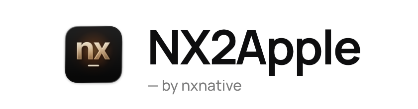
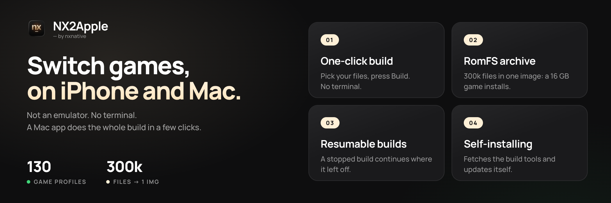
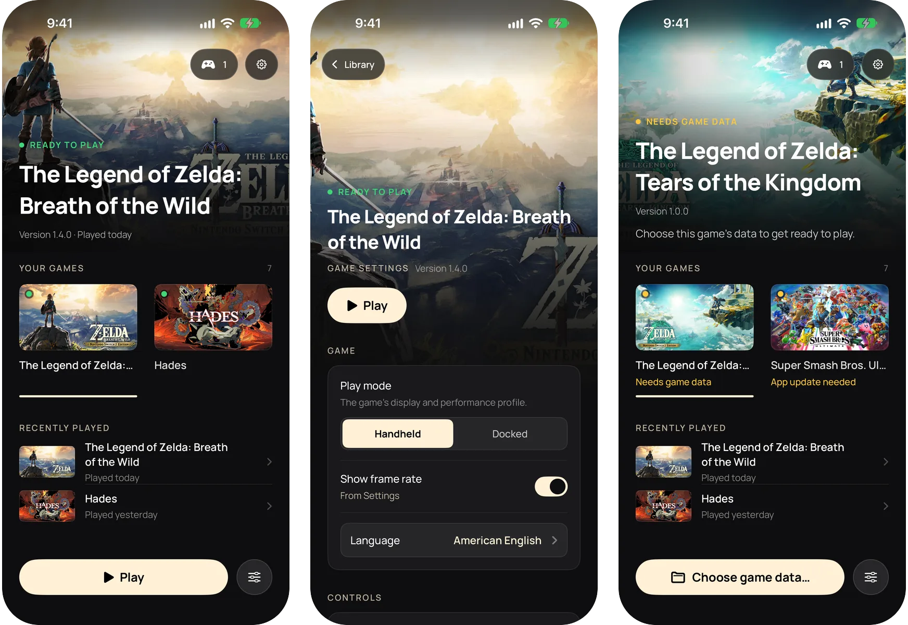
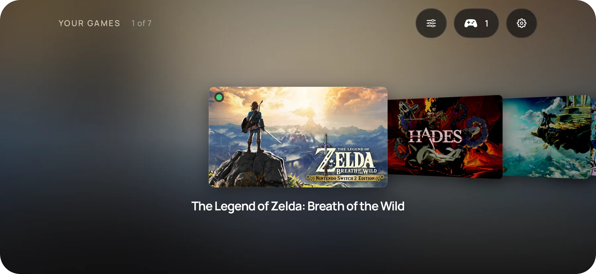

Follows [README.md](README.md) as of v1.2.2

<picture>
  <source media="(prefers-color-scheme: dark)" srcset="frontend/screenshots/logo-dark.png">
  
</picture>

**I tuoi giochi Switch, in esecuzione sul tuo iPhone.**

**Non è un emulatore. Nessun terminale. Un'app per macOS o Windows esegue l'intera build in pochi clic.**

#### 🆕 Ultime novità in evidenza

- **Launcher per Windows (`NX2Apple-windows-x64.zip`)**: compila IPA per iPhone e iPad su Windows con la stessa interfaccia 1.2, un albero del motore già incluso (non serve git), configurazione iniziale guidata, riscrittura NSO multi-core e aggiornamento automatico integrato (`NX2Apple.exe`).
- **Giochi Switch 2**: scegli una cartella di gioco Switch 2 o un file `.nup` nel launcher per Mac o Windows, senza bisogno di `prod.keys`, e gioca su Mac, iPhone o iPad.
- **Controlli touch personalizzati, Joy-Con separati e Steam Controller (2026)**: ridimensiona i pulsanti, sposta la levetta sinistra o disponi ogni comando nell'editor visivo su iPhone e iPad. I controller fisici supportano la rimappatura per singolo gioco o globale, la divisione di una coppia di Joy-Con Bluetooth in due controller impugnati in orizzontale su Mac e lo Steam Controller (2026).
- **Un'unica app per iPhone e iPad**: tutti i tuoi giochi vivono in un'unica app contenitore (o in un IPA non firmato per AltStore e SideStore), ciascuno con il proprio framework host integrato così gli aggiornamenti del motore non obbligano mai a ricompilare, con Cover Flow in orizzontale, impostazioni e mod per gioco, eliminazione del gioco mantenendo i salvataggi e 6 lingue.
- **Modalità console**: collega un controller e premi Select, oppure avvia direttamente in modalità console. La libreria passa a schermo intero come il menu di una Switch e tenere premuto Home per 2 secondi chiude il gioco.

Ogni versione è elencata nel [changelog](CHANGELOG.it.md).

---

## Cos'è NX2Apple

NX2Apple esegue i giochi Nintendo Switch sul tuo Mac e sul tuo iPhone a partire dai dump dei tuoi giochi. Non è un
emulatore: il codice stesso del gioco gira nativamente su Apple Silicon ed è disegnato da Metal. Un'app per Mac, il
launcher, esegue la compilazione in pochi clic (estrazione, riscrittura del codice, traduzione degli shader, creazione del pacchetto) e
raccoglie i tuoi giochi in una libreria da cui avviarli con **Play**, proprio come su una Switch.

È un fork della community di **[nxnative](https://github.com/seedds/nxnative)**, che svolge il lavoro vero e proprio
(il rewriter del codice, l'host Horizon, NVN su Metal e il profilo di ogni singolo gioco). Questo fork aggiunge il
launcher e una breve serie di patch, seguendo gli aggiornamenti di nxnative ogni giorno.

## Requisiti

- **Un Mac con Apple Silicon.** Il launcher si apre su **macOS 13 o successivo**. La compilazione richiede Xcode con
  l'SDK di iOS, mentre i giochi NVN richiedono [Xcode](https://developer.apple.com/download/all/?q=Xcode%2027.2) 27.2 (macOS 26.6
  o successivo), a meno che non vengano compilati con `--allow-other-metal`. Scarica la versione 27.2 dalla pagina di download di Apple, non la versione più recente di
  Xcode presente sull'App Store. Se hai installato anche una versione più recente di Xcode, rinomina la 27.2 in `Xcode-27.2.app` e selezionala con:
  `sudo xcode-select -s /Applications/Xcode-27.2.app`.
- **I dump dei tuoi giochi** (NSP o XCI) e **il tuo file `prod.keys`** estratto dalla tua console. Nulla è
  incluso, scaricato o cercato automaticamente per te. Lo stesso file `prod.keys` apre tutti i tuoi giochi
  Switch. Un dump recente copre tutti i titoli commerciali. I giochi Switch 2 (una cartella di gioco o un file
  `.nup`) non hanno bisogno di `prod.keys`.
- Per iPhone o iPad: iOS o iPadOS 26 o successivo e un dispositivo recente. I dispositivi più datati non sono stati testati.

L'app include al suo interno gli strumenti di compilazione e Python, per cui non serve installare né Homebrew né Python. Il .NET SDK 10
è l'unico strumento che viene ancora installato automaticamente per te. La pagina delle dipendenze del launcher verifica ogni requisito e
installa tutto ciò che può con un solo clic.

## Installazione

1. **Scarica l'app**: scarica `NX2Apple-macOS-arm64.zip` dall'[ultima versione](https://github.com/LNPANDY/NX2Apple/releases/latest) ed estrailo.
2. **Aprila la prima volta facendo clic con il tasto destro e scegliendo Apri.** L'app non è firmata con un certificato
   sviluppatore Apple a pagamento, quindi macOS chiede conferma prima del primo avvio, dopodiché si aprirà normalmente.
3. **Segui la configurazione iniziale.** Il launcher scarica il progetto con cui compila (tramite il pulsante **Scarica repository**
   nella pagina di configurazione, che effettua un clone leggero in `~/NX2Apple`, o mostrando la procedura manuale tramite file ZIP se GitHub è lento),
   controlla gli strumenti indicati sopra e si aggiorna da solo in seguito. Non avrai mai bisogno di usare git manualmente.
4. **Compila un gioco.** Scegli la cartella del gioco (oppure seleziona singolarmente il gioco base, l'aggiornamento, i DLC e `prod.keys`),
   scegli **Questo Mac** o **iPhone / iPad** e premi il pulsante di compilazione. La pagina mostra le fasi reali e
   il tempo rimanente, mentre una compilazione interrotta riprende da dove si era fermata. La destinazione **iPhone / iPad** crea un'unica
   app sul dispositivo per tutti i tuoi giochi. Il launcher la firma tramite Xcode, la installa e vi copia dentro
   il gioco. Richiede un dispositivo associato al Mac.

La compilazione manuale da terminale è descritta in [BUILDING.it.md](BUILDING.it.md).

## L'app per iPhone e iPad

La destinazione **iPhone / iPad** compila un'unica app contenitore che raccoglie tutti i tuoi giochi, proprio come fa il launcher su Mac.
La sua libreria mostra ogni gioco con la propria copertina. In verticale è disposta su una singola colonna con il gioco selezionato
in alto. In orizzontale diventa un Cover Flow. Su iPad mostra una griglia.

- **Aggiungi i giochi dal Mac.** Compila un gioco con la destinazione **iPhone / iPad** e il launcher lo copierà
  all'interno dell'app. La nuova firma e la reinstallazione dell'app mantengono intatti i dati di gioco e i salvataggi.
- **Gioca.** Scegli un gioco e tocca **Play**. Se a un gioco mancano i dati o serve una versione più recente dell'app,
  la sua scheda lo segnala e propone direttamente la soluzione.
- **Impostazioni per ogni gioco.** Il pulsante delle impostazioni (o il tasto X sul controller) apre le opzioni di avvio
  di quel gioco. **Ripristina** riporta ogni scelta ai valori predefiniti.
- **Controller o tastiera.** L'intera app si può usare con il controller: la croce direzionale e la levetta spostano la selezione, A
  conferma, B torna indietro, X apre le impostazioni e Y elenca i controller connessi. Una tastiera fisica funziona allo
  stesso modo.
- **Cartella dei dati di gioco.** Ogni gioco può leggere i propri dati da una cartella scelta nell'app File, ad
  esempio su un'unità esterna, oppure dalla cartella interna dell'app stessa.
- **Salvataggi in cloud.** Scegli una cartella su iCloud Drive per i salvataggi di un gioco in modo da mantenerli sincronizzati con il Mac.
- **Lingua.** L'app segue la lingua di sistema, inglese o cinese semplificato.

L'app richiede iOS o iPadOS 26 o successivo. Le copertine sono i banner dell'eShop che il launcher su Mac salva in cache
per i tuoi giochi.

## Come giocare

**Sul Mac**, un gioco completato compare nella libreria con la sua copertina. **Play** lo avvia.
Le **Opzioni di avvio** (specifiche per ogni gioco e mantenute anche dopo nuove compilazioni) regolano il frame rate, la modalità console (dock o
portatile), la scala di rendering e l'upscaling, la lingua del gioco, i controlli e altro ancora. La spiegazione dettagliata di ogni opzione si trova in
[docs/settings.md](https://github.com/seedds/nxnative/blob/f25fa9562ee96d06f1e6412dbb91aab2b7035ec1/docs/settings.md). Un controller può comandare sia il launcher sia i giochi.

**Sull'iPhone**, l'app mostra le stesse impostazioni prima dell'avvio del gioco: tocca **Play**. I controlli touch
sono disponibili in un layout 2D e uno 3D (tocca il pulsante in alto al centro per cambiare) e vengono sostituiti automaticamente quando colleghi un controller
(Xbox, PlayStation, Switch Pro, MFi). [docs/playing.md](https://github.com/seedds/nxnative/blob/f25fa9562ee96d06f1e6412dbb91aab2b7035ec1/docs/playing.md) illustra i controlli touch,
la vibrazione e i sensori di movimento. Brevi incertezze la prima volta che compare una nuova scena sono normali: l'app compila
la grafica per quella scena una sola volta e poi la memorizza. I dati del gioco (`romfs.img`) possono risiedere anche su un'unità esterna
selezionata tramite l'app File.

**Lingua del gioco.** L'inglese è l'impostazione predefinita. Sul Mac, usa la riga **Lingua del gioco** nelle Opzioni di avvio.
Per qualsiasi impostazione non presente nel pannello, puoi creare un file `env.txt` con righe nel formato `KEY=VALUE` (ad esempio
`DM_LANG=zh-Hans`) in una di queste due posizioni: `~/Library/Application Support/nxnative/<title ID>/env.txt`
ha la precedenza e sopravvive alle ricompilazioni, mentre `<App>.app/Contents/Resources/dm/env.txt` è quello interno all'app. Un'app per Mac
compilata prima che esistesse la riga della lingua richiede una nuova compilazione per mostrarla. Sull'iPhone, le stesse righe vanno inserite
in `Documents/env.txt` (`DM_FPS_TARGET=30` limita il frame rate per risparmiare batteria, `DM_OPMODE=0` seleziona la
modalità portatile).

**Salvataggi e log.** Un gioco per Mac situato in una cartella della libreria conserva i propri salvataggi e il file di log accanto all'app
(`log/<title ID>.log`), altrimenti si trovano in `~/Library/Application Support/nxnative/<title ID>/` e
`~/Library/Logs/nxnative/<title ID>.log`. Sull'iPhone si trovano nell'app File sotto il nome dell'app:
`save/` e `log.txt` (l'esecuzione precedente è salvata come `log.prev.txt`).

**Segnalare un bug.** Usa gli appositi [moduli per le segnalazioni](https://github.com/LNPANDY/NX2Apple/issues/new/choose)
(problema di gioco, problema di compilazione, problema del launcher). Ciascun modulo richiede il nome del gioco e il suo Title ID, le versioni in uso
e il dispositivo, l'output di **Impostazioni > Copia diagnostica** e il log del gioco. Il file [CONTRIBUTING.it.md](CONTRIBUTING.it.md)
spiega il motivo di queste richieste. Le segnalazioni accompagnate dal file `log.txt` completo vengono esaminate per prime. Non allegare mai chiavi, file di gioco o
qualsiasi elemento estratto da un gioco.

## Giochi

147 giochi dispongono di un profilo. Diversi sono segnalati come giocabili su iPhone nel progetto upstream e la maggior
parte ha un profilo che non è ancora stato provato su un telefono. Eccone alcuni:

| | Gioco | Dove gira | Stato |
|---|---|---|---|
|  | The Legend of Zelda: Tears of the Kingdom | Mac e iPhone | **Verificato qui**: 304.243 file controllati byte per byte, circa 17 GB |
|  | Hades II | Mac e iPhone | **Verificato qui** |
|  | Animal Crossing: New Horizons | iPhone | **Verificato qui**: gira in modo fluido |
|  | Super Mario Odyssey | iPhone | Segnalato come giocabile upstream |
|  | The Legend of Zelda: Breath of the Wild | iPhone | Segnalato come giocabile upstream, 60 fps con la versione 1.9.0 |
|  | Mario Kart 8 Deluxe | iPhone | Segnalato come giocabile upstream |

**[GAMES.it.md](GAMES.it.md)** contiene la galleria di screenshot con le dimensioni di installazione
di ciascun gioco e la tabella completa con la versione dell'aggiornamento richiesta da ogni titolo: la versione visualizzata dell'NSP di aggiornamento
deve corrispondere a quella prevista dal profilo, altrimenti il processo di compilazione lo segnalerà.

## Limitazioni

- **Solo i giochi dotati di un profilo.** Un titolo non presente nell'elenco richiede un lavoro di adattamento dedicato, e il
  punto di partenza è [docs/agents](https://github.com/seedds/nxnative/blob/f25fa9562ee96d06f1e6412dbb91aab2b7035ec1/docs/agents/README.md), la guida upstream per aggiungere il supporto a un altro titolo Switch.
- **I giochi di grandi dimensioni su iPhone incontrano un limite di memoria.** Senza l'entitlement Increased Memory Limit, iOS
  mette a disposizione dell'app circa 3,4 GB, che non bastano per Tears of the Kingdom. L'app lo richiede automaticamente e
  AltStore Classic 2.2+, Impactor e Xcode con un Personal Team lo mantengono. SideStore con un ID Apple gratuito
  richiede invece una correzione una tantum sull'App ID, mentre Sideloadly lo rimuove ([le istruzioni](ENTITLEMENTS.it.md)). Le
  misurazioni complete si trovano in [GAMES.it.md](GAMES.it.md#verificati-su).
- **Launcher non firmato.** Il launcher non è pre-firmato per te, quindi va aperto consentendone l'esecuzione su macOS. L'app per iPhone viene invece firmata
  da Xcode con il tuo team personale quando il launcher la installa.
- **I tuoi file personali.** Nessun dato di gioco, firmware o chiave è incluso o scaricato dal progetto.
- **I vecchi archivi frammentati non vengono più letti.** Le prime build per iPhone impacchettavano Tears of the Kingdom
  in un archivio RomFS diviso in frammenti (`romfs.idx`), mentre ora la compilazione scrive un singolo file `romfs.img`. Un iPhone
  che conserva ancora un vecchio archivio richiede che i dati di gioco vengano inviati nuovamente una volta sola come `romfs.img` tramite il launcher.

## Per gli sviluppatori

- **Compilare dal codice sorgente:** [BUILDING.it.md](BUILDING.it.md). **Segnalare o correggere un problema:** [CONTRIBUTING.it.md](CONTRIBUTING.it.md).
- **Dove serve aiuto:** le [milestone](https://github.com/LNPANDY/NX2Apple/milestones) rappresentano la tabella di marcia e [CONTRIBUTING.it.md](CONTRIBUTING.it.md#dove-ci-farebbe-piacere-ricevere-aiuto) spiega come prendere in carico una issue.
- **Cosa modifica questo fork rispetto a upstream:** il motore (`dm/`, `scripts/`, `docs/`, `ref/`) non è
  salvato direttamente in questo repository. È costituito da nxnative a un commit fissato (`.upstream-ref`) più una coda di patch, ciascuna
  accompagnata dal motivo per cui il fork la mantiene, e `python3 tools/engine.py sync` assembla il tutto nella cartella `engine/`.
  [patches/README.md](patches/README.md) ne spiega il funzionamento e `python3 tools/engine.py status` elenca le patch attualmente
  applicate. Un'operazione automatica giornaliera aggiorna il commit di riferimento e apre una pull request, oppure apre una issue indicando la patch che non
  si applica più correttamente. I collegamenti ai documenti del motore presenti in questo README puntano a nxnative al commit fissato.
- **Aggiungere un altro gioco Switch:** [docs/agents](https://github.com/seedds/nxnative/blob/f25fa9562ee96d06f1e6412dbb91aab2b7035ec1/docs/agents/README.md) (estrazione, analisi dei binari, bring-up).
- **Cronologia delle versioni:** [CHANGELOG.it.md](CHANGELOG.it.md).

## Riconoscimenti

**Collaboratori della community** — il codice di questo progetto non è il frutto di un singolo manutentore:

- **[v0lumehi](https://github.com/v0lumehi)** — **il launcher del front-end per Mac** (PR [#27](https://github.com/LNPANDY/NX2Apple/pull/27), 40 file): una libreria di giochi con copertine, opzioni di avvio per singolo gioco, un flusso di avanzamento reale e un pulsante Stop che termina l'intero gruppo di processi della compilazione. L'app per Mac è passata da "un modulo di compilazione" alla prima versione di un vero launcher che si apre come una Switch.
- **[m1guelpf](https://github.com/m1guelpf)** (Miguel Piedrafita) — due correzioni HLE (PR [#24](https://github.com/LNPANDY/NX2Apple/pull/24) e [#26](https://github.com/LNPANDY/NX2Apple/pull/26)): le voci mancanti `EnableAlbumImageTakenNotification` e `CreateWithAdjustableSystemClock` più il relativo byte del tipo di snapshot — ciascuna avrebbe causato la lettura di un puntatore nullo nei giochi che le richiamano, ed entrambe sono state accompagnate da un test.

Vuoi entrare in questa lista? La guida [Contribuire](CONTRIBUTING.it.md#aiutare-con-i-giochi) spiega come iniziare: le segnalazioni con un log completo e le correzioni accompagnate da un test procedono più rapidamente.

**Progetti della community** — mantenuti dai rispettivi autori, all'esterno di questo repository:

- **[widmonstertony/nxnative](https://github.com/widmonstertony/nxnative)** (branch `ios16-pokemon-za-port`) — compatibilità con iOS/iPadOS 16.1–17 e tvOS, con un percorso di rendering Metal legacy, testato su iPad con chip A10X e iPad con chip M2. Pensato per i dispositivi non supportati dalle release di questo fork.

Tutto il lavoro sul motore sottostante è opera di altri sviluppatori. Questo repository vi aggiunge sopra il launcher e la coda di patch:

- **[nxnative](https://github.com/seedds/nxnative)** (MIT) — la toolchain di esecuzione nativa su cui
  si basa questo repository: il rewriter NSO, il livello host Horizon, NVN su Metal, i profili per singolo gioco
  e l'app contenitore per iOS.
- **[d2r-mobile](https://github.com/jhaizhou-ops/d2r-mobile)** (MIT) — l'approccio originale di esecuzione
  nativa da cui è nato nxnative.
- **Ryujinx** (MIT) — il traduttore di shader che converte gli shader Maxwell in SPIR-V.
- **[Atmosphère](https://github.com/Atmosphere-NX/Atmosphere)** — il riferimento per la semantica di
  sincronizzazione di Horizon.
- **[LibHac](https://github.com/Thealexbarney/LibHac)** — legge i file NSP e applica i livelli di aggiornamento in
  `nx_extract`.
- **[SPIRV-Cross](https://github.com/KhronosGroup/SPIRV-Cross)** — converte SPIR-V in Metal Shading Language.
- **yuzu**, **deko3d**, **libvpx**, **stb_vorbis**, **libdeflate** — consulta l'elenco dei ringraziamenti upstream
  per scoprire il contributo di ciascun progetto.

La cartella `dm/third_party` include altri progetti con le rispettive licenze ([elenco](https://github.com/seedds/nxnative/blob/f25fa9562ee96d06f1e6412dbb91aab2b7035ec1/dm/third_party/README.md)).

## Note legali

**Cos'è questo progetto.** Uno strumento di compilazione per i giochi che possiedi già. Legge i dump che hai effettuato dalle tue
cartucce e dai tuoi acquisti personali, sul tuo computer, e produce un pacchetto destinato al tuo dispositivo personale.
Nulla in questo repository, nell'app o in alcuna release contiene o distribuisce codice,
grafica, testi, dati, shader, firmware, chiavi o qualsiasi altro materiale protetto da copyright appartenente a Nintendo.

**Cosa non può fare.** La pipeline non dispone di alcuna fonte di giochi o di chiavi: richiede il file
`prod.keys` e i dump NSP/XCI personali dell'utente, e non comunica con alcun server per ottenerli. Non aggira, non rimuove e non
ridistribuisce alcuna protezione — LibHac apre i dump personali dell'utente utilizzando le chiavi personali dell'utente stesso, eseguendo la medesima
operazione che una console compie su una cartuccia.

**Marchi registrati.** Questo progetto non è affiliato, sponsorizzato o approvato da Nintendo. "Nintendo Switch" e
i titoli dei giochi sono marchi registrati di Nintendo Co., Ltd., mentre tutti gli altri marchi appartengono ai rispettivi
proprietari.

**La tua responsabilità.** Le leggi relative alla creazione di una copia di backup personale variano da paese a paese e alcune giurisdizioni non
la consentono affatto. Sei responsabile di conoscere e rispettare le leggi vigenti nel paese in cui vivi e di
non distribuire mai file di gioco, chiavi o i pacchetti compilati a partire da essi — i risultati prodotti dal progetto sono destinati
esclusivamente all'uso personale sul tuo hardware. Se un gioco ti piace, acquistalo.

**Rimozioni (Takedown).** Se ritieni che qualsiasi contenuto presente in questo repository violi i tuoi diritti, apri una issue o
contatta direttamente il manutentore: le richieste valide verranno gestite tempestivamente, fino alla rimozione del contenuto o
dell'intero repository.

**Nessuna garanzia.** Il software viene fornito "così com'è" ("as is") secondo i termini delle licenze presenti in [LICENSE](LICENSE) (questo
fork aggiunge il proprio codice a quello upstream, vedi i riconoscimenti) — senza garanzie di alcun tipo, esplicite o implicite. L'utilizzo
avviene a tuo esclusivo rischio.
