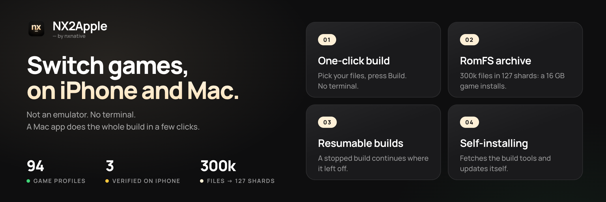

<div align="center">

<picture>
  <source media="(prefers-color-scheme: dark)" srcset="frontend/screenshots/logo-dark.png">
  
</picture>

**Your Switch games, running on your iPhone.**

**Not an emulator. No terminal. A macOS app does the whole build in a few clicks.**

[](https://github.com/LNPANDY/NX2Apple/stargazers)
[](https://github.com/LNPANDY/NX2Apple/network/members)
[](https://github.com/LNPANDY/NX2Apple/issues)
[](LICENSE)
[](docs/badges/games.json)
[](docs/badges/verified.json)

[](README.md)
[](README.zh-CN.md)



#### 🆕 Latest highlights

- **A brand-new GUI** — the Mac launcher is here: manage your game library the way you manage a Switch.
- **Saves, freed** — every Mac game's saves and logs live together in the game library folder.
- **iPhone game data, freed** — the game's `.img` data finally loads straight from an external drive on iOS.

A macOS app takes your own game dumps and does the whole thing with a few clicks — unpack, rewrite
the game's code for Apple silicon, translate its shaders to Metal, pack a slim IPA plus a sharded
RomFS archive that a phone can actually install (even a 16 GB game), and then tells you the three
steps to get it onto the device.

**中文用户请看这里**：[简体中文 README](README.zh-CN.md)

**Formerly `nxnative-romfs-archive`** — old links redirect here.

</div>

---

## What this is

This is a community fork of **[nxnative](https://github.com/seedds/nxnative)** — the NSO rewriter,
the Horizon host, the NVN-on-Metal layer and the per-game profiles are upstream work, and this fork
follows upstream automatically. What it adds:

- **A GUI app for everyone.** [nxnative for Mac](frontend/README.md) is a game library and a
  build tool in one window: pick a game's folder, choose *This Mac* or *iPhone / iPad*, and the build
  runs with live progress from the script's own counts. Finished Mac games appear in the library with
  their eShop key art, start with **Play**, and keep per-game launch options (the iPhone launcher's
  settings: frame rate, console mode, upscaling, …). Device dependencies are detected and installed
  with one click; English or Chinese, following the system. **It also downloads the repository for you
  and updates itself** — no git knowledge needed.
- **A RomFS archive.** Tears of the Kingdom's 304,243 files become 127 shards — the difference
  between an iOS install that fails with `PackageExtractionFailed` and one that works (details
  below).
- **⏸️ Interrupted builds resume.** Extraction, DLC, module rewrite and shader compilation are kept
  and reused: a failed or stopped build continues where it left off, and a rebuild after a tweak
  reuses everything unchanged (upstream's pipeline; the app drives it with its own build folder).
- **Follows upstream automatically.** A daily GitHub Actions job re-applies the fork's features
  onto upstream's tree, verifies the result (script parse, archive reader test, a macOS host build)
  and pushes — or opens an issue with the log when a patch no longer fits.
- **94 game profiles** with the required update version listed per game. Three are verified end
  to end on this fork; 45 are reported playable on an iPhone upstream.

---

## Games gallery

<!-- gallery: written by dm/tools/docs_gallery.py from docs/images/gallery.tsv; change the table, then run it -->
<table>
<tr>
<td align="center" valign="top" width="33%"><br><sub><b>Mario Kart 8 Deluxe</b><br>~11.9 GB · no Mii heads</sub></td>
<td align="center" valign="top" width="33%"><br><sub><b>Mario vs. Donkey Kong</b><br>~1.6 GB</sub></td>
<td align="center" valign="top" width="33%"><br><sub><b>Paper Mario: The Thousand-Year Door</b><br>~5 GB · 60 fps with 1.0.1</sub></td>
</tr>
<tr>
<td align="center" valign="top" width="33%"><br><sub><b>Super Mario 3D World + Bowser's Fury</b><br>~3 GB</sub></td>
<td align="center" valign="top" width="33%"><br><sub><b>Super Mario Bros. Wonder</b><br>~4 GB</sub></td>
<td align="center" valign="top" width="33%"><br><sub><b>Super Mario Galaxy</b><br>~3 GB</sub></td>
</tr>
<tr>
<td align="center" valign="top" width="33%"><br><sub><b>Super Mario Galaxy 2</b><br>~3 GB</sub></td>
<td align="center" valign="top" width="33%"><br><sub><b>Super Mario Odyssey</b><br>~6 GB</sub></td>
<td align="center" valign="top" width="33%"><br><sub><b>The Legend of Zelda: Breath of the Wild</b><br>~16 GB · 60 fps with 1.9.0</sub></td>
</tr>
<tr>
<td align="center" valign="top" width="33%"><br><sub><b>The Legend of Zelda: Link's Awakening</b><br>~6 GB</sub></td>
<td align="center" valign="top" width="33%"><br><sub><b>The Legend of Zelda: Tears of the Kingdom</b><br>~17 GB · 60 fps with 1.4.3</sub></td>
<td align="center" valign="top" width="33%"><br><sub><b>13 Sentinels: Aegis Rim</b><br>~5 GB</sub></td>
</tr>
<tr>
<td align="center" valign="top" width="33%"><br><sub><b>Absolum</b><br>~2 GB</sub></td>
<td align="center" valign="top" width="33%"><br><sub><b>Ace Attorney Investigations Collection</b><br>~7 GB</sub></td>
<td align="center" valign="top" width="33%"><br><sub><b>Advance Wars 1+2: Re-Boot Camp</b><br>~7.1 GB</sub></td>
</tr>
<tr>
<td align="center" valign="top" width="33%"><br><sub><b>AI: THE SOMNIUM FILES</b><br>~8.3 GB</sub></td>
<td align="center" valign="top" width="33%"><br><sub><b>AI: THE SOMNIUM FILES - nirvanA Initiative</b><br>~11.6 GB</sub></td>
<td align="center" valign="top" width="33%"><br><sub><b>Animal Crossing: New Horizons</b><br>~10.5 GB</sub></td>
</tr>
<tr>
<td align="center" valign="top" width="33%"><br><sub><b>ANIMAL WELL</b><br>~54 MB</sub></td>
<td align="center" valign="top" width="33%"><br><sub><b><a href="dm/games/01007300020FA000/README.md">ASTRAL CHAIN</a></b><br>~9.7 GB · 60 fps target with 1.0.1</sub></td>
<td align="center" valign="top" width="33%"><br><sub><b>Balatro</b><br>~82 MB · played by touch</sub></td>
</tr>
<tr>
<td align="center" valign="top" width="33%"><br><sub><b>BALL x PIT</b><br>~1.1 GB</sub></td>
<td align="center" valign="top" width="33%"><br><sub><b>Bayonetta</b><br>~8.8 GB</sub></td>
<td align="center" valign="top" width="33%"><br><sub><b>Bayonetta 2</b><br>~12.5 GB</sub></td>
</tr>
<tr>
<td align="center" valign="top" width="33%"><br><sub><b>Bayonetta 3</b><br>~14.2 GB</sub></td>
<td align="center" valign="top" width="33%"><br><sub><b>Big Brain Academy: Brain vs. Brain</b><br>~0.8 GB</sub></td>
<td align="center" valign="top" width="33%"><br><sub><b>Brain Memory Training Academy</b><br>~0.1 GB</sub></td>
</tr>
<tr>
<td align="center" valign="top" width="33%"><br><sub><b>Captain Toad: Treasure Tracker</b><br>~2 GB</sub></td>
<td align="center" valign="top" width="33%"><br><sub><b>Catherine: Full Body</b><br>~14 GB</sub></td>
<td align="center" valign="top" width="33%"><br><sub><b>Celeste</b><br>~0.9 GB</sub></td>
</tr>
<tr>
<td align="center" valign="top" width="33%"><br><sub><b>Cuphead</b><br>~5 GB</sub></td>
<td align="center" valign="top" width="33%"><br><sub><b>DARK SOULS: REMASTERED</b><br>~4 GB · 60 fps with 1.0.3</sub></td>
<td align="center" valign="top" width="33%"><br><sub><b>Digimon Story Cyber Sleuth: Complete Edition</b><br>~5 GB</sub></td>
</tr>
<tr>
<td align="center" valign="top" width="33%"><br><sub><b>Donkey Kong Country: Tropical Freeze</b><br>~7.3 GB</sub></td>
<td align="center" valign="top" width="33%"><br><sub><b>DRAGON QUEST VII Reimagined</b><br>~5.9 GB</sub></td>
<td align="center" valign="top" width="33%"><br><sub><b>DRAGON QUEST XI S: Echoes of an Elusive Age – Definitive Edition</b><br>~15 GB · 60 fps with 1.0.4</sub></td>
</tr>
<tr>
<td align="center" valign="top" width="33%"><br><sub><b>FINAL FANTASY RESONANCE</b><br>~10 GB · 60 fps with 1.0.1</sub></td>
<td align="center" valign="top" width="33%"><br><sub><b>FINAL FANTASY TACTICS - The Ivalice Chronicles</b><br>~11 GB</sub></td>
<td align="center" valign="top" width="33%"><br><sub><b>Fire Emblem Engage</b><br>~15 GB · 60 fps with 2.0.0</sub></td>
</tr>
<tr>
<td align="center" valign="top" width="33%"><br><sub><b>Fire Emblem: Three Houses</b><br>~13 GB · 60 fps with 1.2.0</sub></td>
<td align="center" valign="top" width="33%"><br><sub><b>Ghost Trick: Phantom Detective</b><br>~3 GB</sub></td>
<td align="center" valign="top" width="33%"><br><sub><b>The Great Ace Attorney Chronicles</b><br>~4 GB</sub></td>
</tr>
<tr>
<td align="center" valign="top" width="33%"><br><sub><b>Hades</b><br>~4 GB</sub></td>
<td align="center" valign="top" width="33%"><br><sub><b>Hades II</b><br>~4 GB</sub></td>
<td align="center" valign="top" width="33%"><br><sub><b>Hollow Knight: Silksong</b><br>~6.4 GB</sub></td>
</tr>
<tr>
<td align="center" valign="top" width="33%"><br><sub><b>Hyrule Warriors: Age of Calamity</b><br>~15 GB · 60 fps with 1.3.0</sub></td>
<td align="center" valign="top" width="33%"><br><sub><b>Kirby and the Forgotten Land</b><br>~6.4 GB</sub></td>
<td align="center" valign="top" width="33%"><br><sub><b>Luigi's Mansion 3</b><br>~7.5 GB · 60 fps with 1.4.0</sub></td>
</tr>
<tr>
<td align="center" valign="top" width="33%"><br><sub><b>Metroid Dread</b><br>~5 GB</sub></td>
<td align="center" valign="top" width="33%"><br><sub><b>Monster Hunter Rise</b><br>~22 GB · 60 fps with 16.0.2</sub></td>
<td align="center" valign="top" width="33%"><br><sub><b>Monster Train 2</b><br>~1.6 GB · 60 fps with 1.1.1</sub></td>
</tr>
<tr>
<td align="center" valign="top" width="33%"><br><sub><b>OCTOPATH TRAVELER</b><br>~3.6 GB</sub></td>
<td align="center" valign="top" width="33%"><br><sub><b>Octopath Traveler 0</b><br>~4 GB · 60 fps with 1.0.5</sub></td>
<td align="center" valign="top" width="33%"><br><sub><b>Octopath Traveler II</b><br>~5.9 GB · 60 fps with 1.1.1</sub></td>
</tr>
<tr>
<td align="center" valign="top" width="33%"><br><sub><b>Patrick's Parabox</b><br>~0.2 GB</sub></td>
<td align="center" valign="top" width="33%"><br><sub><b>Persona 5 Royal</b><br>~14.9 GB</sub></td>
<td align="center" valign="top" width="33%"><br><sub><b>Pikmin 4</b><br>~10.8 GB</sub></td>
</tr>
<tr>
<td align="center" valign="top" width="33%"><br><sub><b>Pokémon Brilliant Diamond</b><br>~4.6 GB · 60 fps with 1.3.0</sub></td>
<td align="center" valign="top" width="33%"><br><sub><b>Pokémon Legends: Z-A</b><br>~6 GB</sub></td>
<td align="center" valign="top" width="33%"><br><sub><b>Pokémon Scarlet</b><br>~7.0 GB</sub></td>
</tr>
<tr>
<td align="center" valign="top" width="33%"><br><sub><b>Pokémon Sword</b><br>~12.4 GB</sub></td>
<td align="center" valign="top" width="33%"><br><sub><b>Pokémon Shield</b><br>~12.4 GB</sub></td>
<td align="center" valign="top" width="33%"><br><sub><b>Portal</b><br>~2.6 GB</sub></td>
</tr>
<tr>
<td align="center" valign="top" width="33%"><br><sub><b>Raging Loop</b><br>~0.9 GB</sub></td>
<td align="center" valign="top" width="33%"><br><sub><b>Rhythm Heaven Groove</b><br>~3 GB</sub></td>
<td align="center" valign="top" width="33%"><br><sub><b>ROMANCE OF THE THREE KINGDOMS 8 REMAKE</b><br>~16.8 GB · controller only</sub></td>
</tr>
<tr>
<td align="center" valign="top" width="33%"><br><sub><b>Sea of Stars</b><br>~5.1 GB</sub></td>
<td align="center" valign="top" width="33%"><br><sub><b>SHIN MEGAMI TENSEI V: Vengeance</b><br>~14.6 GB · 60 fps with 1.0.3</sub></td>
<td align="center" valign="top" width="33%"><br><sub><b>Stardew Valley</b><br>~0.6 GB</sub></td>
</tr>
<tr>
<td align="center" valign="top" width="33%"><br><sub><b>STEINS;GATE RE:BOOT</b><br>~6 GB</sub></td>
<td align="center" valign="top" width="33%"><br><sub><b>Super Smash Bros. Ultimate</b><br>~17.5 GB · offline</sub></td>
<td align="center" valign="top" width="33%"><br><sub><b>Taiko Risshiden V DX</b><br>~3.3 GB · Japanese · played by touch</sub></td>
</tr>
<tr>
<td align="center" valign="top" width="33%"><br><sub><b>Unicorn Overlord</b><br>~4 GB</sub></td>
<td align="center" valign="top" width="33%"><br><sub><b><a href="dm/games/01006000040C2000/README.md">Yoshi's Crafted World</a></b><br>~6.1 GB</sub></td>
<td align="center" valign="top" width="33%"><br><sub><b>NieR:Automata The End of YoRHa Edition</b><br>~10.9 GB · 60 fps with 1.0.3</sub></td>
</tr>
<tr>
<td align="center" valign="top" width="33%"><br><sub><b>The Legend of Zelda: Echoes of Wisdom</b><br>~7.8 GB</sub></td>
<td align="center" valign="top" width="33%"><br><sub><b>Donkey Kong Country Returns HD</b><br>~11.6 GB</sub></td>
<td align="center" valign="top" width="33%"><br><sub><b>Mario + Rabbids Sparks of Hope</b><br>~9.8 GB</sub></td>
</tr>
<tr>
<td align="center" valign="top" width="33%"><br><sub><b>Xenoblade Chronicles 2</b><br>~17.1 GB</sub></td>
<td align="center" valign="top" width="33%"><br><sub><b>Xenoblade Chronicles 3</b><br>~19.2 GB</sub></td>
<td align="center" valign="top" width="33%"><br><sub><b>FINAL FANTASY CRYSTAL CHRONICLES Remastered Edition</b></sub></td>
</tr>
<tr>
<td align="center" valign="top" width="33%"><br><sub><b><a href="dm/games/010032E00E6E2000/README.md">Return of the Obra Dinn</a></b><br>~0.9 GB</sub></td>
<td align="center" valign="top" width="33%"><br><sub><b><a href="dm/games/010040801A4C8000/README.md">Blasphemous 2</a></b><br>~1.5 GB</sub></td>
<td align="center" valign="top" width="33%"><br><sub><b><a href="dm/games/0100D5B026844000/README.md">Silver Pines</a></b></sub></td>
</tr>
<tr>
<td align="center" valign="top" width="33%"><br><sub><b><a href="dm/games/0100698009C6E000/README.md">Blasphemous</a></b><br>~0.9 GB</sub></td>
<td align="center" valign="top" width="33%"><br><sub><b><a href="dm/games/0100BC300CB48000/README.md">FINAL FANTASY X/X-2 HD Remaster</a></b><br>~26.5 GB</sub></td>
<td align="center" valign="top" width="33%"><br><sub><b><a href="dm/games/010067300059A000/README.md">Mario + Rabbids Kingdom Battle</a></b><br>~5 GB</sub></td>
</tr>
<tr>
<td align="center" valign="top" width="33%"><br><sub><b><a href="dm/games/010062B01525C000/README.md">Persona 4 Golden</a></b></sub></td>
<td align="center" valign="top" width="33%"><br><sub><b><a href="dm/games/0100FF500E34A000/README.md">Xenoblade Chronicles: Definitive Edition</a></b><br>~13.2 GB</sub></td>
<td></td>
</tr>
</table>
<!-- end of gallery -->

## Contents

- [Features at a glance](#features-at-a-glance)
- [Quick start](#quick-start)
- [Supported games](#games) — the full table; [verified here](#verified-games) first
- [How it works](#how-it-works)
- [Update history](#update-history)
- [Contributing shaders and game support](#contributing-shaders-and-game-support)
- [Limitations](#limitations)
- [Credits](#credits)
- [Legal](#legal)

---

## Features at a glance

| Feature | Notes |
|---|---|
| **One-click build** | Pick your files, press build. No command line, ever |
| **RomFS archiving** | 300,000 files → ~100 shards, so a 16 GB game installs |
| **Resumable builds** | A stopped build continues; unchanged work is reused |
| **94 game profiles** | Each with the exact update version it needs |
| **Install guide** | The three steps to the phone, with Reveal-in-Finder |
| **Bilingual** | English / 简体中文, picked from the device language |
| **Self-installing** | Downloads the repository and updates itself |
| **Auto upstream sync** | Daily, verified, with a fallback issue if a patch breaks |

---

## Quick start

1. **Download the app** — [latest release](https://github.com/LNPANDY/NX2Apple/releases/latest)
   (`NS-Port-Builder-macOS-arm64.zip`). Unzip, right-click → Open the first time.
2. **Let it fetch the project** — the repository group has a **Download repository** button (a
   shallow clone into `~/NX2Apple`). Slow GitHub? The panel shows the manual ZIP route.
3. **Pick your game files** — base game, update, DLC and `prod.keys`, separately or as one folder.
4. **Press build**, then follow the three install steps it prints.

> Requirements: an Apple Silicon Mac on macOS 26.6+, [Xcode](https://apps.apple.com/app/xcode/id497799835) 27.1 with the iOS SDK, Python 3.9+, .NET SDK 10.
> The app's dependency panel detects each of these and installs what it can. Your own game files and
> `prod.keys` — nothing is bundled.

---

## Verified games

**3 verified end to end on this fork** (build → install → play on a real iPhone), **29 reported
playable upstream**, **58 profiles** in total. The full table with the exact update version each
game needs is [below](#games).

| Game | Verified here | Notes |
|---|---|---|
| **Tears of the Kingdom** | ✅ | 304,243 files → 127 archive shards, byte-verified |
| **Hades II** | ✅ | 33-file archive |
| **Animal Crossing: New Horizons** | ✅ | 103,645 files → 72 shards, runs smoothly |

---

## How it works

### The GUI front end

`frontend/` is a macOS app that does steps 2–5 below with a window instead of a terminal, for
people who would rather not read a build log: four inputs picked separately (base game, update,
DLC, `prod.keys`), a dependency panel that detects and installs what is missing, the script's real
stage list with live percentages, and the archive shards produced at the end.

<details>
<summary><b>The problem, the fix, and the archive format (click to expand)</b></summary>

### The problem

A RomFS like Tears of the Kingdom's is **304,243 files / 15.9 GiB**. Two things break:

- **The IPA does not install.** A 16.6 GB package with 372,660 entries fails on iOS with
  `PackageExtractionFailed (Could not extract archive)`. The install daemon's extractor gives up —
  one directory holds 75,941 files and the ZIP64 central directory starts at 17.8 GB.
- **Copying the tree to the phone takes hours.** The Files app and Finder do one round trip per
  file. 300,000 small files also produce roughly 1 GB of filesystem block overhead.

Packing the tree into ~100 shard files solves both: the package stays small, and the game files move
to the phone as one folder of large files.

### The fix

A **ROMFSARC** archive: one index file plus N shard files.

```
romfs.idx        28 MB   header, name pool, file table, directory table
romfs.00 ... .125        126 shards, 200 MiB each, source bytes verbatim
```

Measured on Tears of the Kingdom (v1.0.0 + 1.4.3):

| | Plain RomFS | ROMFSARC |
|---|---|---|
| Files | 304,243 | **127** |
| Largest directory | 75,941 entries | 126 shards, none over 200 MiB |
| IPA with the game inside | 16.6 GB (fails to install) | — |
| Slim IPA (the default, no RomFS inside) | — | **743 MB, installs** |
| Copy to the phone | hours | one folder of 127 files |

Path lookup is a binary search over the sorted file table; a directory listing walks one contiguous
child range. The index is `mmap`ed, shards are opened lazily, and reads go straight to `pread` on
the shard, so the page cache still works.

</details>

### The GUI front end

`frontend/` is a macOS app that does the build steps with a window instead of a terminal, for
people who would rather not read a build log: a library of your games with their key art, a build
page (one game folder, or base game, update, DLC and `prod.keys` picked separately; Mac or iPhone),
the script's real stage list with live counts and time left, per-game launch options for Mac builds,
and a settings page that detects and installs what is missing.


<details>
<summary>Build page and launch options</summary>

 

</details>

```bash
cd frontend && swift run          # or double-click frontend/nxnative.app
```

The interface is bilingual: it follows the system language (Chinese for any Chinese variant, **English
for everything else**).

It runs the same scripts the command line does, so everything below still applies; see
[frontend/README.md](frontend/README.md). The prebuilt app, and the release notes in English and
Chinese (including which games are verified), are on the
[releases page](https://github.com/LNPANDY/NX2Apple/releases) and in
[docs/RELEASE_NOTES.md](docs/RELEASE_NOTES.md).

## Update history

Newest first. The fork follows upstream daily, so its game list and host fixes arrive automatically.

| Date | Version | What changed |
|---|---|---|
| 2026-10-27 | v0.4.9 | **The library follows the folder**: a Mac game's saves and log live beside the .app and migrate from `~/Library` on first run; **the iPhone's game data can live anywhere** (Files-app picker, remembered); **all eight tracker features landed** (#77–#84: key pre-check, drag & drop, build notifications, older-tools flag, free space, saves between Mac and device, copy diagnostics, controller layouts); Windows: Chinese UI fixed, the Metal probe works under a Chinese user name, the failed-install crash is gone, the Vulkan SDK is found by itself |
| 2026-10-27 | v0.4.8 | **The Mac launcher becomes usable**: install an iPhone build on a paired device (#28), a controller drives the whole launcher (#56), launch options split into basic and advanced (#54) with Display mode and the render scale in real pixels (#55) and a Mods section through `DM_ROMFS_OVERLAY` (#57), keys and controller buttons remappable (#39); **the build tools update when the app opens** (#60) and **a new version says what it changes** before installing; fixes: every rewrite of every game crashed (`patch_nso.py`'s `TEXT_LO` used before assignment, #59), the Mac app refused every build with "requires Python 3.12" (#53), a ROMs folder holding several games could not build any of them (#58), a failed build pointed at a log that was off screen (#52), a Chinese Windows showed an English interface, CI could not open issues |
| 2026-10-27 | v0.4.7 | **94 game profiles** (+7: Octopath Traveler, Donkey Kong Country Returns HD, Donkey Kong Country: Tropical Freeze, Mario + Rabbids Sparks of Hope, Kirby and the Forgotten Land, Yoshi's Crafted World, Xenoblade Chronicles 3) from the daily sync; **one host binary, any game's memory layout** (runtime profiles — the foundation for the universal launcher, which has not been built yet); **the language toggle translates the whole interface**; **Xcode betas count** (the check asks xcode-select); a loud notice when an upstream update invalidates cached shaders; the output folder documented as the build cache's home; Windows front end: in-app Python 3.12, SDK clone past Windows' path-length limit, LLVM verified by compiling rather than --version, no more black console windows; rebuilding on an external exFAT work folder no longer crashes |
| 2026-10-26 | v0.4.6 | **Windows app fixed against real hardware reports**: the missing .NET SDK row (it never appeared, so nothing could install it), no more black console windows stealing the foreground, download mirrors chosen by a speed probe (a 974 s LLVM download on a mainland connection), tools installed outside the app folder so updates stop deleting them, and repository checks that say what git is doing |
| 2026-10-26 | v0.4.5 | **Mac app output** (a double-clickable .app from the same build); **A15/A16 and earlier devices** via CPU BC decode, as an app switch; per-game data folders (`Documents/games/<id>/`) so an external drive works; NRO header no longer scanned as code; the nightly sync can no longer fail silently |
| 2026-10-26 | v0.4.4 | **Fixes a build failure that hit every app build in v0.4.3** (`work` read before it was assigned); 72 games (+3) |
| 2026-10-26 | v0.4.3 | NSZ/XCZ dumps work out of the box; a fresh Xcode now reports its missing iOS SDK; three environment traps closed |
| 2026-10-25 | v0.4.2 | The app downloads and updates the repository itself, and updates itself; 58 games (+10); save-loading deadlock fixed; NuGet failures self-heal |
| 2026-10-24 | v0.4.1 | Animal Crossing: New Horizons verified on an iPhone (103,645 files → 72 shards); archive packing reuses unchanged work |
| 2026-10-23 | v0.4.0 | The archive folder is copy-ready with an install guide; dependency list collapses; per-game update versions in the table; renamed to NX2Apple |
| 2026-10-23 | v0.3.1 | Fixes for Homebrew Python 3.15 and `DOTNET_ROOT` (#1, #2) |
| 2026-10-22 | v0.3.0 | App icon, 46 games |
| 2026-10-21 | v0.2.1 | Python 3.9 build fix |
| 2026-10-20 | v0.2.0 | Bilingual (English / 中文) |
| 2026-10-20 | v0.1.0 | First release: GUI front end, RomFS archiving |

## Contributing shaders and game support

Each new game needs its own bring-up: a profile (build IDs, memory layout, texture slots), a shader
reader if it packs them in a form we do not read, and patch points. **Two ways to help, both
useful:**

- **Report a game that works** — if you got a title outside the verified list running, open an issue
  with the title ID, the update version, and what you did. It becomes a profile others can use.
- **Send the shaders that are missing** — if a game runs but stutters on first use of an effect, its
  shader variants are missing from the map. The host can dump what it cannot find
  (`DM_NVN_SHDUMP=<dir>`); attach those and we add them to `shader_map.tsv` for everyone.

Issues with a full `Documents/log.txt` get looked at first — that log usually names the exact
missing piece.

Open an issue with one of the [issue forms](https://github.com/LNPANDY/NX2Apple/issues/new/choose) (game problem, build problem, launcher); [CONTRIBUTING.md](CONTRIBUTING.md) says what a report needs.

## Staying current with upstream

The engine (`dm/`, `scripts/`, `docs/`, `ref/`, `AGENTS.md`) is [seedds/nxnative](https://github.com/seedds/nxnative)
at the commit in `.upstream-ref`, plus a queue of patches in [`patches/`](patches/README.md): one
`git format-patch` file per change, each saying why the fork carries it and where it stands upstream.
A scheduled GitHub Actions workflow (`.github/workflows/sync-upstream.yml`, daily 21:30 UTC, also
runnable by hand) moves the pin with `scripts/patches.py bump`, re-applies the patches with a
three-way merge, drops the ones upstream has taken, verifies the result (the patch queue check, the
tests, a macOS host build) and opens a pull request on `sync/upstream` — or an issue naming the
patch when one no longer applies. Nothing is pushed to `main`. `scripts/patches.py status` lists
what the fork carries.

## How to play

### 1. Build the app (as upstream)

The archive feature does not change the normal build. Follow upstream's
[README](https://github.com/seedds/nxnative) to install Xcode, Homebrew tools and the Python
packages, then pack an IPA.

```bash
git clone https://github.com/<you>/NX2Apple.git
cd NX2Apple
brew bundle --file=Brewfile                       # xcodegen, zstd, spirv-cross, glslang (the NSP script checks for it), .NET SDK
python3 -m venv .venv                             # Homebrew's Python refuses global pip installs (PEP 668)
.venv/bin/python -m pip install lz4 capstone fonttools nsz "backports.zstd; python_version < '3.14'"
source .venv/bin/activate                         # so that python3 below is the venv's (in each new terminal)
```

### 2. What you need on disk

Three things, none of which ship with the repository:

| What | Where it comes from | Used by |
|---|---|---|
| **`prod.keys`** | dumped from **your own console** (see below) | the extractor, to decrypt your game |
| **The game's NSPs** | dumped from your own cartridge or eShop purchases | the extractor |
| **Xcode + iOS SDK** | the App Store | the app build |

`prod.keys` is the console's key set — a text file of `name = hex value` lines (~230 entries:
`master_key_xx`, `titlekek_xx`, `header_key`, `key_area_key_application_xx`, …). Every Switch
homebrew tool reads this format. It is **not** tied to a specific game: one `prod.keys` decrypts
any of your games. The only requirement is that the file contains keys for the key generation
(firmware era) the game was packaged with — a current dump covers every retail game.

Where to put it is up to you; you pass the path with `-k`:

```bash
# any layout works, e.g.
~/keys/prod.keys
# or keep it beside the game's NSPs
~/Games/Hades2/prod.keys
```

```bash
python3 scripts/build_ipa_from_nsp.py ~/Games/Hades2 -k ~/keys/prod.keys
```

How keys are dumped is documented across the Switch homebrew community (Lockpick_RCM from a
hacked console is the usual route); this repository does not cover that step and ships none of
it. Two practical notes from real dumps:

- **Malformed lines.** Some dumpers emit lines whose hex value has the wrong length (33 bad
  `master_kek_source_*` lines in one real dump), which makes the extraction tool refuse the whole
  file. Delete the offending lines and keep a backup of the original.
- **Updates.** An update NSP's ticket may carry a newer key generation than the base game's. The
  extractor reads the title key straight from the common ticket inside each NSP, so in practice
  both decrypt fine as long as `prod.keys` is reasonably current — verified here with a base
  game on generation 15 and its update on 16, using a keys file that only reached 15.

`backports.zstd` is needed for Tears of the Kingdom's zstd dictionaries; other games do not use it.

### 3. Pack the RomFS into an archive

```bash
python3 dm/tools/romfs_arc.py pack <RomFS dir> <output base> --shard-mib 200
```

`<RomFS dir>` is the directory `nx_extract` wrote (the one holding `Pack/`, `Banc/`, `Sound/`, …).
The tool writes `<base>.idx` and `<base>.00`, `<base>.01`, … Files are grouped by top-level
directory and cut so no shard passes `--shard-mib`, so one shard holds one kind of content.

Check the result before copying anything:

```bash
python3 dm/tools/romfs_arc.py verify <base> <RomFS dir>   # byte-compares every file
python3 dm/tools/romfs_arc.py list   <base> [path]        # list one directory
```

### 4. Build the IPA

The main build script packs a **slim IPA by default** (no RomFS inside; the app reads the game
files from `Documents/romfs`), so step 1 already produced it. To re-pack just the package later:

```bash
GAME=<title id> W=<work dir> PATCHED=<patched dir> \
  ROMFS=<RomFS dir> MSL_IOS=<shader dir> \
  dm/ios/tools/build_ipa.sh <output.ipa>
```

`--full-romfs` (or `DM_FULL_ROMFS=1`) packs the RomFS into the package instead — upstream's
behaviour, only sensible for small games.

### 5. Copy the archive to the phone

Put the whole set in the app's `Documents/romfs/`, keeping the base name:

```
Documents/romfs/romfs.idx
Documents/romfs/romfs.00
...
Documents/romfs/romfs.125
```

The app looks for `romfs.idx` first (`dm/ios/Sources/main.m`, `romfs_locate`). A plain directory
tree is still accepted when there is no index, so nothing changes for existing games.

The index may sit at any of these places; the reader tries them in order:

```
<DM_ROMFS>.idx
<DM_ROMFS>/romfs.idx
<DM_ROMFS>/romfs/romfs.idx
```

## Playing

**Touch controls.** Two layouts (tap the button at the top centre to switch): 2D (left stick,
A/B/X/Y, shoulders, − / +) and 3D (adds a D-pad, a right stick and L3 / R3). With no controller
connected, touches outside the controls go to the game's touch screen.

**Physical controllers** (GameController framework: Xbox, PlayStation, Switch Pro and MFi pads all
work) hide the touch controls entirely while connected and bring them back when disconnected;
meanwhile every touch goes to the game's touch screen. Buttons map by position, as on a Switch
controller: bottom = B, right = A, left = Y, top = X, and the D-pad and right stick are kept.

**Settings without rebuilding:** `Documents/env.txt`, one `KEY=VALUE` per line. Common ones:

```
DM_LANG=zh-Hans        # Chinese (en-US by default)
DM_FPS_TARGET=30       # cap the frame rate (saves battery; the profile's fps_target by default)
DM_OPMODE=0            # handheld mode: 720p render instead of the docked 1080p
```

**On the Mac,** the launcher's *Launch options* sheet has the same choices (game language, frame
rate, console mode, ...). They are kept per game and survive rebuilds. For a setting the sheet does
not have, or to fix one, write an `env.txt` with the same `KEY=VALUE` lines (`DM_LANG=zh-Hans`) in
one of two places: `~/Library/Application Support/nxnative/<title ID>/env.txt` wins and survives
rebuilds; `<App>.app/Contents/Resources/dm/env.txt` is the app's own. Apps built before the
language row was added need one rebuild to get it.

**Saves and logs** are in the Files app under the app's name: `save/` and `log.txt`. When something
goes wrong, send `log.txt` (the previous run is `log.prev.txt`). Short stutters the first time a new
scene appears are normal: the app compiles graphics for it once and remembers them.

## Using it for another game

The archive format has nothing game-specific in it: the packer walks whatever directory you give it
and the reader looks paths up in that tree. To switch games:

1. Extract the new game's NSPs with `nx_extract` as usual (upstream's script does this).
2. Pack that game's `RomFS` with `romfs_arc.py`.
3. Rebuild the IPA with the new `GAME=` profile (the slim package is the default).
4. Copy the new archive into `Documents/romfs/`.

Three things to watch for:

- **The shard count must stay at or below 256.** The reader keeps one fd slot per shard
  (`MAX_SHARDS` in `romfs_arc.h`). The packer now refuses to write an index above that and tells you
  which `--shard-mib` would fit. Tears of the Kingdom needs 126 at 200 MiB; a game about twice its
  size would need 256 MiB shards.
- **DLC is not archived.** Add-on content still goes into the package (`DmIOS.app/aoc/<index>/`) and
  is mounted as a directory. Most DLC is small enough that this does not affect installation; if you
  hit the installer limit again, drop the DLC from the package and it stays unowned.
- **`zip_store` is per game.** The profile lists extensions that are already compressed and should be
  stored rather than deflated (`.zs`, `.bwav`, `.mc`, `.webm`, `.metallib` for Tears of the Kingdom).
  This only affects the package the shader libraries and tables go into, not the archive.

Games from upstream's tested list (4–6 GB) need roughly 20–30 shards at 200 MiB, well inside the
limit, and their memory footprint is far below the per-app budget that stops Tears of the Kingdom.

## What changed against upstream

Five files added, four modified. The fs layer keeps its normal path handling: when an archive is
open, `host_path_ex` hands out a synthetic path (`@romfsarc:<guest path>`) for entries on the
archive mount, and `OpenFile` / `GetEntryType` / `OpenDirectory` / the directory calls route those
to the archive. File handles for archive entries are tagged with bit 63 so they never collide with
real fds, and `ReadFile` clamps to the file size (a shard is a flat container, so an unclamped read
past the end would return the next file's bytes).

| File | Change |
|---|---|
| `dm/host/romfs_arc.h` | new — archive format and reader interface |
| `dm/host/romfs_arc.c` | new — mmap index, binary-search lookup, lazy shard fds |
| `dm/tools/romfs_arc.py` | new — pack / verify / list |
| `dm/host/tests/t_romfs_arc.c` | new — walks a whole archive, checks every file |
| `docs/ROMFS_ARCHIVE.md` | new — format and design notes |
| `dm/host/hle_fs.c` | mount and route archive-backed paths |
| `dm/host/Makefile` | build `romfs_arc.c` |
| `dm/ios/Sources/main.m` | `romfs_locate` accepts `romfs.idx` |
| `dm/ios/tools/build_ipa.sh` | slim by default (`DM_FULL_ROMFS=1` = upstream full package) |
| `scripts/build_ipa_from_nsp.py` | `--work-dir` (build folder away from the NSPs); derives `DOTNET_ROOT` (a framework-dependent `nx_extract` will not start from a plain shell without it) |
| `frontend/` | new — macOS GUI front end (see [The GUI front end](#the-gui-front-end)) |

The mount is recognised by its **directory**, not its name: titles differ (`rom` for most games,
`content` for Tears of the Kingdom).

## Games

79 game profiles ship with this repository. A profile is what makes a build possible —
the game's build IDs, memory layout, shader tables and per-game switches — and this fork adds the
RomFS archive layer on top, so a large game can be installed at all.

The update column is the version the build actually checks: the update NSP's display version
must match the profile's registered build (the base game's own version does not matter — the
update layers over it). "无（v0）" = the base game alone is enough.

| Game | Title ID | Update required | Status |
|---|---|---|---|
| Super Mario Odyssey | `0100000000010000` | 1.4.1 (v393216) | Playable on an iPhone (upstream) |
| Pokémon Brilliant Diamond | `0100000011D90000` | 1.3.0 (v393216) | Playable on an iPhone (upstream) |
| Ace Attorney Investigations Collection | `010005501E68C000` | 1.0.0.2 (v131072) | Profile present; not verified on a phone |
| Hollow Knight: Silksong | `010013C00E930000` | 1.0.30000 (v655360) | Profile present; not verified on a phone |
| Digimon Story Cyber Sleuth: Complete Edition | `010014E00DB56000` | 1.0.3 (v196608) | Profile present; not verified on a phone |
| Super Mario Bros. Wonder | `010015100B514000` | 1.2.1 (v327680) | Playable on an iPhone (upstream) |
| Mario Kart 8 Deluxe | `0100152000022000` | 4.0.1 (v1507328) | Playable on an iPhone (upstream) |
| Raging Loop | `010020400E1C2000` | 无（v0） | Profile present; not verified on a phone |
| ANIMAL WELL | `010020D01AD24000` | 1.0.10 (v655360) | Playable on an iPhone (upstream) |
| Super Mario 3D World + Bowser's Fury | `010028600EBDA000` | 1.2.2 (v262144) | Playable on an iPhone (upstream) |
| Ghost Trick: Phantom Detective | `010029B018432000` | 无（v0） | Playable on an iPhone (upstream) |
| Hyrule Warriors: Age of Calamity | `01002B00111A2000` | 1.3.0 (v327680) | Playable on an iPhone (upstream) |
| Celeste | `01002B30028F6000` | 1.4.1.1 (v589824) | Profile present; not verified on a phone |
| Advance Wars 1+2: Re-Boot Camp | `0100300012F2A000` | 无（v0） | Playable on an iPhone (upstream) |
| Mario + Rabbids® Sparks of Hope | `0100317013770000` | 1.6.2225577 (v393216) | Profile present; not verified on a phone |
| Return of the Obra Dinn | `010032E00E6E2000` | 1.0.1 (v65536) | Profile present; not verified on a phone |
| Taiko Risshiden V DX | `0100346017304000` | 1.1.1 (v131072) | Playable on an iPhone by touch (upstream) |
| The Great Ace Attorney Chronicles | `010036E00FB20000` | 无（v0） | Playable on an iPhone (upstream) |
| FINAL FANTASY TACTICS - The Ivalice Chronicles | `010038B015560000` | 1.4.0 (v393216) | Profile present; not verified on a phone |
| 13 Sentinels: Aegis Rim | `01003FC01670C000` | 1.10 (v65536) | Playable on an iPhone (upstream) |
| Blasphemous 2 | `010040801A4C8000` | 1.0.8 (v524288) | Profile present; not verified on a phone |
| 13 Sentinels: Aegis Rim (Japan) | `010045C014650000` | 无（v0） | Profile present; not verified on a phone |
| Bayonetta 3 | `01004A4010FEA000` | 1.2.0 (v131072) | Playable on an iPhone (upstream) |
| DARK SOULS: REMASTERED | `01004AB00A260000` | 1.0.3 (v196608) | Profile present; not verified on a phone |
| Kirby and the Forgotten Land | `01004D300C5AE000` | 1.1.0 (v65536) | Profile present; not verified on a phone |
| Monster Train 2 | `010051701FB46000` | 1.1.1 (v131072) | Playable on an iPhone (upstream) |
| OCTOPATH TRAVELER 0 | `01005270232F2000` | 1.0.5 (v327680) | Profile present; not verified on a phone |
| Hades | `0100535012974000` | 1.0.38233 (v589824) | Playable on an iPhone (upstream) |
| Unicorn Overlord (Asia) | `010054B01AD92000` | 1.05 (v262144) | Profile present; not verified on a phone |
| Fire Emblem: Three Houses | `010055D009F78000` | 1.2.0 (v327680) | Playable on an iPhone (upstream) |
| NieR:Automata The End of YoRHa Edition | `010056B015FE8000` | 1.0.3 (v131072) | Playable on an iPhone (upstream) |
| OCTOPATH TRAVELER | `010057D006492000` | 1.0.5 (v327680) | Profile present; not verified on a phone |
| Persona 5 Royal | `01005CA01580E000` | 1.0.2 (v65536) | Playable on an iPhone (upstream) |
| Yoshi's Crafted World | `01006000040C2000` | 1.0.1 (v65536) | Profile present; not verified on a phone |
| FINAL FANTASY RESONANCE | `0100606026F12000` | 1.0.1 (v65536) | Playable on an iPhone (upstream) |
| Big Brain Academy: Brain vs. Brain | `0100620012D6E000` | 1.2.0 (v131072) | Profile present; not verified on a phone |
| Persona 4 Golden | `010062B01525C000` | 1.0.2 (v131072) | Profile present; not verified on a phone |
| Mario + Rabbids Kingdom Battle | `010067300059A000` | 1.9.589692 (v589824) | Profile present; not verified on a phone |
| Unicorn Overlord | `010069401ADB8000` | 1.05 (v262144) | Profile present; not verified on a phone |
| Blasphemous | `0100698009C6E000` | 1.0.8 (v524288) | Profile present; not verified on a phone |
| SHIN MEGAMI TENSEI V: Vengeance | `010069C01AB82000` | 1.0.3 (v196608) | Playable on an iPhone (upstream) |
| Super Smash Bros. Ultimate | `01006A800016E000` | 13.0.5 (v2031616) | Playable on an iPhone (upstream) |
| The Legend of Zelda: Link's Awakening | `01006BB00C6F0000` | 1.1.0 (v131072) | Playable on an iPhone (upstream) |
| DRAGON QUEST XI S: Echoes of an Elusive Age – Definitive Edition | `01006C300E9F0000` | 1.0.4 (v262144) | Profile present; not verified on a phone |
| Animal Crossing: New Horizons | `01006F8002326000` | 3.0.3 (v2228224) | **Verified here** — builds, installs and runs smoothly on an iPhone; 103,645 files into 72 archive shards |
| AI: THE SOMNIUM FILES - nirvanA Initiative | `0100713016CCC000` | 1.0.2 (v131072) | Playable on an iPhone (upstream) |
| ASTRAL CHAIN | `01007300020FA000` | 1.0.1 (v65536) | Playable on an iPhone (upstream) |
| Xenoblade Chronicles 3 | `010074F013262000` | 2.2.1 (v720896) | Profile present; not verified on a phone |
| Bayonetta | `010076F0049A2000` | 1.1 (v65536) | Playable on an iPhone (upstream) |
| Bayonetta 2 | `01007960049A0000` | 1.2 (v131072) | Playable on an iPhone (upstream) |
| Portal | `01007BB017812000` | 1.0.3 (v196608) | Playable on an iPhone (upstream) |
| The Legend of Zelda: Breath of the Wild | `01007EF00011E000` | 1.9.0 (v1114112) | Playable on an iPhone (upstream) |
| BALL x PIT | `010086A022444000` | 1.293 (v393216) | Playable on an iPhone (upstream) |
| AI: THE SOMNIUM FILES | `010089B00D09C000` | 1.0.1 (v65536) | Playable on an iPhone (upstream) |
| STEINS;GATE RE:BOOT | `01008BC024FDE000` | 1.0.3 (v131072) | Profile present; not verified on a phone |
| Sea of Stars | `01008C0016544000` | 2.0.59001 (v786432) | Playable on an iPhone (upstream) |
| The Legend of Zelda: Echoes of Wisdom | `01008CF01BAAC000` | 1.1.0 (v196608) | Playable on an iPhone (upstream) |
| 13 Sentinels: Aegis Rim (Asia) | `01008D7016438000` | 无（v0） | Playable on an iPhone (upstream) |
| Pokémon Shield | `01008DB008C2C000` | 1.3.2 (v458752) | Playable on an iPhone (upstream) |
| Metroid Dread | `010093801237C000` | 2.1.0 (v327680) | Playable on an iPhone (upstream) |
| Super Mario Galaxy | `010099C022B96000` | 1.3.1 (v327680) | Playable on an iPhone (upstream) |
| Captain Toad: Treasure Tracker | `01009BF0072D4000` | 1.4.2 (v393216) | Profile present; not verified on a phone |
| Donkey Kong Country Returns HD | `01009D901BC56000` | 1.1.0 (v65536) | Profile present; not verified on a phone |
| Hades II | `0100A00019DE0000` | 1.0.137848 (v1) | **Verified here** — builds, installs and runs on an iPhone; 33-file archive |
| OCTOPATH TRAVELER II | `0100A3501946E000` | 1.1.1 (v131072) | Playable on an iPhone (upstream) |
| Pokémon Scarlet | `0100A3D008C5C000` | 无（v0） | Profile present; not verified on a phone |
| Cuphead | `0100A5C00D162000` | 1.3.7 (v655360) | Profile present; not verified on a phone |
| Fire Emblem Engage | `0100A6301214E000` | 2.0.0 (v327680) | Playable on an iPhone (upstream) |
| Absolum | `0100A83022A22000` | 1.1.2 (v458752) | Profile present; not verified on a phone |
| DRAGON QUEST VII Reimagined | `0100A9D01C446000` | 1.2.0 (v131072) | Profile present; not verified on a phone |
| Pokémon Sword | `0100ABF008968000` | 1.3.2 (v458752) | Playable on an iPhone (upstream) |
| Monster Hunter Rise | `0100B04011742000` | 16.0.2 (v2228224) | Profile present; not verified on a phone |
| Pikmin 4 | `0100B7C00933A000` | 1.1.1 (v262144) | Playable on an iPhone (upstream) |
| FINAL FANTASY RESONANCE (Asian release) | `0100B8A026F14000` | 1.0.1 (v65536) | Profile present; not verified on a phone |
| NieR:Automata The End of YoRHa Edition | `0100B8E016F76000` | 1.0.3 (v131072) | Profile present; not verified on a phone |
| Mario vs. Donkey Kong | `0100B99019412000` | 1.0.1 (v65536) | Playable on an iPhone (upstream) |
| FINAL FANTASY X/X-2 HD Remaster | `0100BC300CB48000` | 无（v0） | Profile present; not verified on a phone |
| Catherine: Full Body | `0100BF00112C0000` | 1.0.1a (v131072) | Profile present; not verified on a phone |
| Donkey Kong Country: Tropical Freeze | `0100C1F0051B6000` | 1.0.2 (v131072) | Profile present; not verified on a phone |
| ROMANCE OF THE THREE KINGDOMS 8 REMAKE | `0100C2A01A730000` | 1.1.3 (v851968) | Playable on an iPhone with a controller (upstream) |
| Balatro | `0100CD801CE5E000` | 1.1.3 (v851968) | Playable on an iPhone (upstream) |
| FINAL FANTASY CRYSTAL CHRONICLES Remastered Edition | `0100CE4010AAC000` | 1.0.3 (v196608) | Profile present; not verified on a phone |
| Silver Pines | `0100D5B026844000` | 无（v0） | Profile present; not verified on a phone |
| Rhythm Heaven Groove | `0100D9F01D474000` | 无（v0） | Profile present; not verified on a phone |
| Luigi's Mansion 3 | `0100DCA0064A6000` | 1.4.0 (v327680) | Playable on an iPhone (upstream) |
| Patrick's Parabox | `0100E44016C22000` | 1.0.1 (v65536) | Profile present; not verified on a phone |
| Stardew Valley | `0100E65002BB8000` | 1.6.15.13 (v1310720) | Playable on an iPhone (upstream) |
| Xenoblade Chronicles 2 | `0100E95004038000` | 2.1.0 (v983040) | Profile present; not verified on a phone |
| Paper Mario: The Thousand-Year Door | `0100ECD018EBE000` | 1.0.1 (v65536) | Profile present; not verified on a phone |
| The Legend of Zelda: Tears of the Kingdom | `0100F2C0115B6000` | 1.4.3 (v720896) | **Verified here** — builds, installs and runs on an iPhone; 304,243 files into 127 archive shards, byte-verified |
| Pokémon Legends: Z-A | `0100F43008C44000` | 2.0.2 (v393216) | Profile present; not verified on a phone |
| Brain Memory Training Academy | `0100F5D01DA3A000` | 无（v0） | Profile present; not verified on a phone |
| Super Mario Galaxy 2 | `0100FD8022DAA000` | 1.4.0 (v393216) | Profile present; not verified on a phone |
| Xenoblade Chronicles: Definitive Edition | `0100FF500E34A000` | 1.1.2 (v196608) | Profile present; not verified on a phone |

## Verified on

- **Tears of the Kingdom** (0100F2C0115B6000, v1.0.0 + update 1.4.3): 304,243 files packed into 127
  files; all 304,243 byte-compared against the source (`verify: OK`); the game runs from the archive
  on macOS (1,905 frames at 30 fps).
- **Hades II** (0100A00019DE0000, base + update 1.0.137848): 5,258 files packed into 33 files,
  byte-compare OK, and the game runs from the archive on macOS (2,100 frames, 1,772 archive reads).
  The update needs no special handling: `nx_extract` already layers the update NCA over the base
  with `OpenFileSystemWithPatch`, so the extracted RomFS — and therefore the archive — is the merge.
  **Playable on an iPhone** (12 GB device, AltStore Classic 2.3) once the memory entitlement is in
  effect — see below.
- The C reader walks all 304,243 Tears of the Kingdom files and 2,667 directories in 7.6 s.

**The jetsam budget is the limit on big titles, and it can be raised.** Without
`com.apple.developer.kernel.increased-memory-limit` an iPhone gives this app ~3,375 MB (measured on
a 12 GB device: Tears of the Kingdom was killed entering the world map at 3,342 MB resident with
33 MB of headroom; lowering the render scale to 0.5 did not change it, so the limit is the guest
heap, not the GPU). The app requests the entitlement and `build_ipa.sh` embeds it in a placeholder
ad-hoc signature — an unsigned binary has no signature for a sideloader to read entitlements from,
so without that step the request would be lost. **AltStore Classic 2.2+**, **Impactor** and **Xcode
with a Personal Team** keep it; **SideStore** with a free Apple ID needs a one-time App ID fix;
**Sideloadly** does not. See [dm/ios/ENTITLEMENTS.md](dm/ios/ENTITLEMENTS.md) for the steps and how
to tell from `Documents/log.txt` (resident + headroom: ~3,375 MB = not in effect, 6–8 GB = it is).

<a id="limitations"></a>

## Limitations

**What to expect before you start:**

- **Verified ≠ all 58 games.** Three are verified end to end here; the rest are profiles, most
  reported playable upstream. A title outside the table needs bring-up work of its own.
- **Apple Silicon Mac required.** The build pipeline is macOS-only (Xcode, Metal).
- **iOS 26+ and a recent iPhone.** The host targets current iOS; older devices are untested.
- **Your own files.** No game data, firmware or keys are included or downloaded.

**About the archive:**

- **Read-only.** The archive is never written; saves and temp data go to their own mounts as before.
- **Case-sensitive lookup.** Names are stored as the source tree had them, so the host's
  case-insensitive alias machinery (for APFS) is bypassed for archive entries.
- **Symlinks are followed at pack time.** No supported game's RomFS has any.
- **The index is held in memory.** 28 MB for Tears of the Kingdom (17.9 MB of it names). Shards are
  not.
- **No dedup or compression.** Shards are the source bytes verbatim, so `verify` is a plain
  comparison and a repack is deterministic.

## Credits

**Community contributors** — this project's code is not one maintainer's output:

- **[v0lumehi](https://github.com/v0lumehi)** — **the Mac front end's launcher** (PR [#27](https://github.com/LNPANDY/NX2Apple/pull/27), 40 files): a game library with key art, per-game launch options, a real progress stream, and a Stop that ends the whole build's process group. The Mac app went from "a build form" to the first version of a launcher that opens like a Switch.
- **[m1guelpf](https://github.com/m1guelpf)** (Miguel Piedrafita) — two HLE fixes (PRs [#24](https://github.com/LNPANDY/NX2Apple/pull/24) and [#26](https://github.com/LNPANDY/NX2Apple/pull/26)): the missing `EnableAlbumImageTakenNotification` and `CreateWithAdjustableSystemClock` entries plus their snapshot type byte — each would have read a null in games that call them, and each came with a test.

Want on this list? [Contributing](#contributing-shaders-and-game-support) says how to start; reports with a full log and fixes with a test move fastest.

All of the emulation work is other people's. This repository adds the archive subsystem on top:

- **[nxnative](https://github.com/seedds/nxnative)** (MIT) — the native-execution toolchain this
  repository is built from: the NSO rewriter, the Horizon host layer, NVN-on-Metal, the per-game
  profiles and the iOS shell.
- **[d2r-mobile](https://github.com/jhaizhou-ops/d2r-mobile)** (MIT) — the original native-execution
  approach that nxnative grew out of.
- **Ryujinx** (MIT) — the shader translator that turns Maxwell shaders into SPIR-V.
- **[Atmosphère](https://github.com/Atmosphere-NX/Atmosphere)** — the reference for Horizon's
  synchronization semantics.
- **[LibHac](https://github.com/Thealexbarney/LibHac)** — reads NSPs and layers updates in
  `nx_extract`.
- **[SPIRV-Cross](https://github.com/KhronosGroup/SPIRV-Cross)** — SPIR-V to Metal Shading Language.
- **yuzu**, **deko3d**, **libvpx**, **stb_vorbis**, **libdeflate** — see upstream's acknowledgement
  list for what each contributes.

`dm/third_party` ships other projects with their licenses ([list](dm/third_party/README.md)).

## Legal

**What this project is.** A build tool for games you already own. It reads dumps you made of your
own cartridges and purchases, on your own machine, and produces a package for your own device.
Nothing in this repository, in the app, or in any release contains or distributes Nintendo's code,
art, text, data, shaders, firmware, keys or any other copyrighted material.

**What it cannot do.** The pipeline has no source of games or keys: it requires the user's own
`prod.keys` and their own NSP/XCI dumps, and it talks to no server. It does not bypass, strip or
redistribute any protection — LibHac opens the user's own dumps with the user's own keys, the same
operation a console performs on a cartridge.

**Trademarks.** Not affiliated with, sponsored by or endorsed by Nintendo. "Nintendo Switch" and
game titles are trademarks of Nintendo Co., Ltd.; all other trademarks belong to their respective
owners.

**Your responsibility.** Laws on making a personal backup copy differ by country; some places do
not allow it at all. You are responsible for knowing and following the law where you live, and for
never distributing game files, keys or the packages built from them — the project's outputs are for
personal use on your own hardware only. If you enjoy a game, buy it.

**Takedowns.** If you believe anything in this repository infringes your rights, open an issue or
contact the maintainer directly; valid claims will be actioned promptly, up to removing content or
the repository.

**No warranty.** The software is provided "as is" under the licenses in [LICENSE](LICENSE) (this
fork adds to upstream's; see the credits) — without warranty of any kind, express or implied. Use
it at your own risk.
