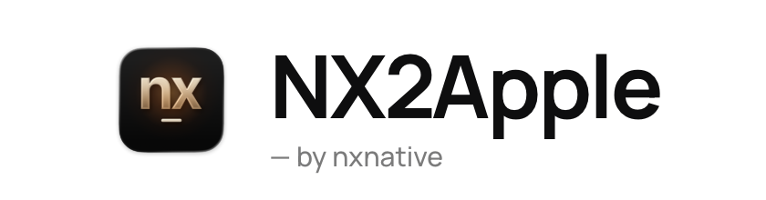
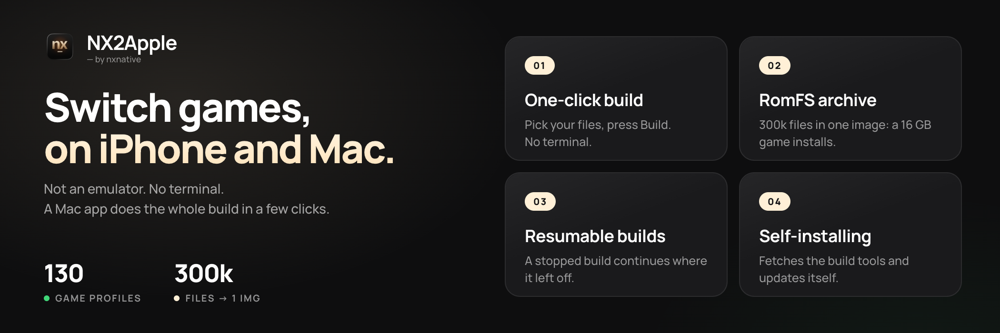
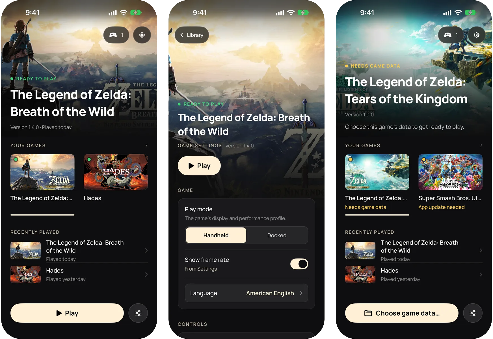
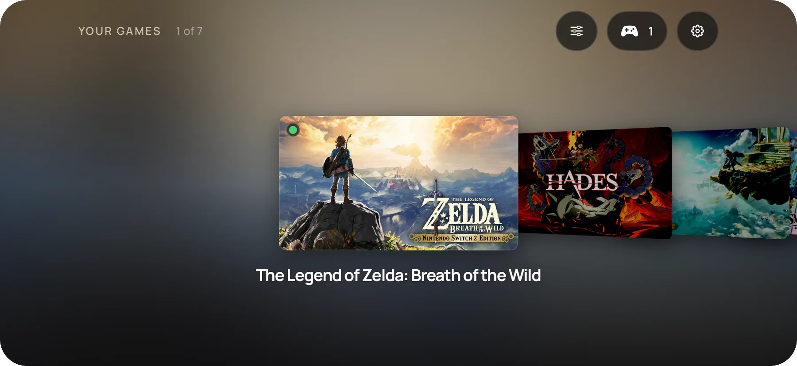

<picture>
  <source media="(prefers-color-scheme: dark)" srcset="frontend/screenshots/logo-dark.png">
  
</picture>

**Your Switch games, running on your iPhone.**

**Not an emulator. No terminal. A macOS or Windows app does the whole build in a few clicks.**

#### 🆕 Latest highlights

- **Windows launcher (`NX2Apple-windows-x64.zip`)**: Build iPhone and iPad IPAs on Windows with the same 1.2 interface, a bundled engine tree (no git needed), guided first-run setup, multi-core NSO rewriting, and in-app self-update (`NX2Apple.exe`).
- **Switch 2 games**: Pick a Switch 2 game folder or `.nup` file in the Mac or Windows launcher, with no `prod.keys` needed, and play on Mac, iPhone, or iPad.
- **Custom touch controls, split Joy-Con, and Steam Controller (2026)**: Resize buttons, move the left stick, or arrange every control in the visual layout editor on iPhone and iPad. Physical controllers support per-game or global button remapping, split a Bluetooth Joy-Con pair into two sideways controllers on Mac, and support the Steam Controller (2026).
- **One app for iPhone and iPad**: All your games live inside one shell app (or export an unsigned IPA for AltStore and SideStore), each carrying its own host framework so engine updates never force a rebuild, with Cover Flow in landscape, per-game settings and mods, safe game deletion that keeps your saves, and 7 languages.
- **Console mode**: Plug in a controller and press Select, or start directly in console mode. The library goes full-screen like a Switch home menu, and holding Home for 2 seconds quits a game.

Every release is in the [changelog](CHANGELOG.md).

---

## What NX2Apple is

NX2Apple runs Nintendo Switch games on your Mac and iPhone from your own game dumps. It is not an
emulator: the game's own code runs natively on Apple silicon, and Metal draws it. A Mac app, the
launcher, does the build in a few clicks (unpack, rewrite, translate the shaders, pack) and then
keeps your games in a library you start with **Play**, the way a Switch does.

It is a community fork of **[nxnative](https://github.com/seedds/nxnative)**, which does the actual
work (the code rewriter, the Horizon host, NVN on Metal and every game's profile); this fork adds the
launcher and a short list of patches, and follows nxnative every day.

## Requirements

- **An Apple silicon Mac.** The launcher opens on **macOS 13 or later**. Building needs Xcode with
  the iOS SDK, and NVN games need [Xcode](https://developer.apple.com/download/all/?q=Xcode%2027.2) 27.2 (macOS 26.6
  or later) unless built with `--allow-other-metal`. Take 27.2 from Apple's download page, not the App Store's newer
  Xcode. With a newer Xcode installed too, rename 27.2 to `Xcode-27.2.app` and select it:
  `sudo xcode-select -s /Applications/Xcode-27.2.app`.
- **Your own game dumps** (NSP or XCI) and **your own `prod.keys`** from your own console. Nothing is
  bundled, downloaded or looked up for you. The same `prod.keys` opens every one of your Switch
  games. A current dump covers all retail titles. Switch 2 games (a game folder or `.nup` file) do not need
  `prod.keys`.
- For an iPhone or iPad: iOS or iPadOS 26 or later and a recent device. Older devices are untested.

The app carries its own build tools and Python, so no Homebrew and no Python install; the .NET SDK 10
is the one tool it still installs for you. The launcher's dependency page checks each requirement and
installs what it can with one click.

## Install

1. **Download the app**: `NX2Apple-macOS-arm64.zip` from the
   [latest release](https://github.com/LNPANDY/NX2Apple/releases/latest). Unzip it.
2. **Open it once with right-click, then Open.** The app is not signed with a paid Apple developer
   certificate, so macOS asks before the first start; after that it opens normally.
3. **Follow the setup.** The launcher fetches the project it builds with (a **Download repository**
   button on the setup page, a shallow clone into `~/NX2Apple`; if GitHub is slow, the page shows the
   manual ZIP route), checks the tools above and updates itself later. You never need git.
4. **Build a game.** Pick the game's folder (or its base game, update, DLC and `prod.keys` one by
   one), choose **This Mac** or **iPhone / iPad**, and press build. The page shows the real stages and
   the time left, and a stopped build continues where it left off. The **iPhone / iPad** target is one
   app on the device for all your games. The launcher signs it with Xcode, installs it and copies the
   game in. It needs a device paired with the Mac.

Building by hand from a terminal is in [BUILDING.md](BUILDING.md).

**Updating a Mac game you already built.** Select the game in the library and choose **Rebuild**.
For an update NSP, keep the base game selected and choose the new NSP in **Updates & add-on content**.
Build for **This Mac** in the same output folder. The update can change both game code and data, so
the launcher builds the new version and reuses cached work where it can. Your saves stay in their
existing folder outside the `.app`, keyed by the game's title ID. Rebuilding in the same library
keeps that progress.

## The iPhone and iPad app

The **iPhone / iPad** target builds one shell app that holds all your games, the way the Mac launcher
does. Its library shows each game with its key art. In portrait it is one column with the chosen game
at the top. On its side it is a Cover Flow. An iPad shows a grid.

- **Add games from the Mac.** Build a game with the **iPhone / iPad** target and the launcher copies it
  into the app. Re-signing and reinstalling the app keeps your game data and saves.
- **Play.** Pick a game and tap **Play**. A game that is missing its data, or needs a newer app,
  says so on its card and offers the fix.
- **Settings for each game.** The settings button (or X on a controller) opens that game's launch
  options. **Reset** puts every choice back to its default.
- **Controller or keyboard.** The whole app works from a controller: the D-pad and stick move, A
  picks, B goes back, X opens the settings and Y lists the controllers. A hardware keyboard works the
  same way.
- **Game data folder.** Each game can read its data from a folder you pick in the Files app, for
  example on an external drive, or from the app's own folder.
- **Cloud saves.** Pick an iCloud Drive folder for a game's saves to keep them in step with the Mac.
- **Language.** The app follows the system language, English or Simplified Chinese.

The app needs iOS or iPadOS 26 or later. The covers are the eShop banners the Mac launcher caches
for your own games.

## How to play

**On the Mac**, a finished game appears in the library with its key art. **Play** starts it.
**Launch options** (per game, kept across rebuilds) set the frame rate, console mode (docked or
handheld), render scale and upscaling, game language, controls and more; what each does is in
[docs/settings.md](https://github.com/seedds/nxnative/blob/f25fa9562ee96d06f1e6412dbb91aab2b7035ec1/docs/settings.md). A controller drives the launcher as well as the games.

**On the iPhone**, the app shows the same settings before the game starts; tap **Play**. Touch
controls come in a 2D and a 3D layout (tap the button at the top centre), and a connected controller
(Xbox, PlayStation, Switch Pro, MFi) replaces them. [docs/playing.md](https://github.com/seedds/nxnative/blob/f25fa9562ee96d06f1e6412dbb91aab2b7035ec1/docs/playing.md) covers touch,
rumble and motion. Short stutters the first time a scene appears are normal: the app compiles
graphics for it once and remembers them. The game's data (`romfs.img`) can live on an external drive
that the Files app picks.

**Game language.** English is the default. On the Mac, use the **Game language** row of Launch
options. For anything the sheet lacks, write an `env.txt` of `KEY=VALUE` lines (for example
`DM_LANG=zh-Hans`) in one of two places: `~/Library/Application Support/nxnative/<title ID>/env.txt`
wins and survives rebuilds; `<App>.app/Contents/Resources/dm/env.txt` is the app's own. A Mac app
built before the language row existed needs one rebuild to get it. On the iPhone, the same lines go
in `Documents/env.txt` (`DM_FPS_TARGET=30` caps the frame rate to save battery, `DM_OPMODE=0` picks
handheld mode). That file applies to every game in the shared app. For a line that belongs to one game
(a mod's `DM_ROMFS_OVERLAY`, for example), write it in `Documents/games/<title ID>/env.txt`. Where both
files set a key, the game's file wins.
A mod is easier: put its folder in `Documents/games/<title ID>/mods/<mod name>/` (the RomFS files in a `romfs/`
folder inside it, or in the folder itself). The shell then sets `DM_ROMFS_OVERLAY` for that game only. If there
are several mods, the one first by name wins where they replace the same file. Where the same key is set twice,
the order is: the shell's own settings, the game's `env.txt`, the game's `mods/` folder, the shared
`Documents/env.txt`.

**Saves and logs.** A Mac game in a library folder keeps its saves and its log beside the app
(`log/<title ID>.log`); otherwise they are in `~/Library/Application Support/nxnative/<title ID>/` and
`~/Library/Logs/nxnative/<title ID>.log`. On the iPhone they are in the Files app under the app's
name: `save/` and `log.txt` (the previous run is `log.prev.txt`).

**Reporting a bug.** Use the [issue forms](https://github.com/LNPANDY/NX2Apple/issues/new/choose)
(game problem, build problem, launcher problem). Each asks for the game and its title ID, your
versions and device, **Settings > Copy diagnostics** and the game's log; [CONTRIBUTING.md](CONTRIBUTING.md)
says why. A report with the full `log.txt` is looked at first. Never attach keys, game files or
anything extracted from a game.

## Games

147 games have a profile. Many are reported playable on an iPhone upstream, and most have a
profile that has not been tried on a phone yet. A few of them:

| | Game | Where it runs | Status |
|---|---|---|---|
|  | The Legend of Zelda: Tears of the Kingdom | Mac and iPhone | **Verified here**: 304,243 files, byte-checked; ~17 GB |
|  | Hades II | Mac and iPhone | **Verified here** |
|  | Animal Crossing: New Horizons | iPhone | **Verified here**: runs smoothly |
|  | Super Mario Odyssey | iPhone | Reported playable upstream |
|  | The Legend of Zelda: Breath of the Wild | iPhone | Reported playable upstream; 60 fps with 1.9.0 |
|  | Mario Kart 8 Deluxe | iPhone | Reported playable upstream |

**[GAMES.md](GAMES.md)** has the screenshot gallery with each
game's install size, and the full table with the update version each game needs: the update NSP's
display version must match the profile's, or the build says so.

**Switch 2 games** are new in the engine. Eleven have a profile, all marked as playing on the Mac by
upstream: Donkey Kong Bananza, Splatoon Raiders, Fire Emblem Fortune's Weave, Pokémon Pokopia,
Hyrule Warriors: Age of Imprisonment, Mario Kart World, Mario Tennis Fever, Star Fox,
Yoshi and the Mysterious Book, The Legend of Zelda: Ocarina of Time and Kirby Air Riders. Choose the game's folder of files (`base/`, `updates/`, `dlc/`)
or its `.nup` file on the Builds page. No `prod.keys` are needed for them. The library marks them
**Switch 2**. Only Donkey Kong Bananza was tried on this fork. The owner built and played it through the
launcher on a Mac, an iPhone and an iPad, with no problems on the Mac and the iPhone and almost none on
the iPad. The other Switch 2 games were not tried here. [GAMES.md](GAMES.md#switch-2-games) has the details.

## Limitations

- **Only the games with a profile.** A title outside the list needs bring-up work of its own; the
  place to start is [docs/agents](https://github.com/seedds/nxnative/blob/f25fa9562ee96d06f1e6412dbb91aab2b7035ec1/docs/agents/README.md), upstream's guide for another Switch title.
- **Big games on an iPhone hit a memory limit.** Without the Increased Memory Limit entitlement iOS
  gives the app about 3.4 GB, which is not enough for Tears of the Kingdom. The app requests it, and
  AltStore Classic 2.2+, Impactor and Xcode with a Personal Team keep it; SideStore with a free Apple
  ID needs a one-time App ID fix, and Sideloadly drops it ([the steps](ENTITLEMENTS.md)). The
  full measurements are in [GAMES.md](GAMES.md#verified-on).
- **Unsigned launcher.** The launcher is not signed for you, so you sideload it. The iPhone app is signed
  by Xcode with your own team when the launcher installs it.
- **Your own files.** No game data, firmware or keys are included or downloaded.
- **Older shard archives are not read any more.** The first iPhone builds packed Tears of the Kingdom
  into a RomFS shard archive (`romfs.idx`); the build writes a single `romfs.img` now. An iPhone
  that still holds an old archive needs the game data sent again once, as a `romfs.img` through the launcher.

## For developers

- **Build from source:** [BUILDING.md](BUILDING.md). **Report or fix something:** [CONTRIBUTING.md](CONTRIBUTING.md).
- **Where help is wanted:** the [milestones](https://github.com/LNPANDY/NX2Apple/milestones) are the plan, and [CONTRIBUTING.md](CONTRIBUTING.md#where-we-would-love-help) says how to take an issue from one.
- **We are looking for one or two more developers.** There is a lot to do. If you want to join us, take an open issue from a milestone and send a well made pull request. People who deliver good work, again and again, are asked to help with reviews and triage.
- **What this fork changes in upstream:** the engine (`dm/`, `scripts/`, `docs/`, `ref/`) is not
  committed here. It is nxnative at a pinned commit (`.upstream-ref`) plus a queue of patches, each
  saying why the fork carries it, and `python3 tools/engine.py sync` builds it into `engine/`.
  [patches/README.md](patches/README.md) explains it, and `python3 tools/engine.py status` lists what
  is carried. A daily job moves the pin and opens a pull request, or an issue naming the patch that no
  longer fits. The links to the engine's documents in this README point at nxnative at the pinned commit.
- **Another Switch game:** [docs/agents](https://github.com/seedds/nxnative/blob/f25fa9562ee96d06f1e6412dbb91aab2b7035ec1/docs/agents/README.md) (extraction, binary survey, bring-up).
- **Release history:** [CHANGELOG.md](CHANGELOG.md).

## Credits

**Community contributors** — this project's code is not one maintainer's output:

- **[v0lumehi](https://github.com/v0lumehi)** — **the Mac front end's launcher** (PR [#27](https://github.com/LNPANDY/NX2Apple/pull/27), 40 files): a game library with key art, per-game launch options, a real progress stream, and a Stop that ends the whole build's process group. The Mac app went from "a build form" to the first version of a launcher that opens like a Switch.
- **[m1guelpf](https://github.com/m1guelpf)** (Miguel Piedrafita) — two HLE fixes (PRs [#24](https://github.com/LNPANDY/NX2Apple/pull/24) and [#26](https://github.com/LNPANDY/NX2Apple/pull/26)): the missing `EnableAlbumImageTakenNotification` and `CreateWithAdjustableSystemClock` entries plus their snapshot type byte — each would have read a null in games that call them, and each came with a test.

Want on this list? [Contributing](CONTRIBUTING.md#helping-with-games) says how to start; reports with a full log and fixes with a test move fastest.

**Community projects** — maintained by their authors, outside this repository:

- **[widmonstertony/nxnative](https://github.com/widmonstertony/nxnative)** (`ios16-pokemon-za-port` branch) — iOS/iPadOS 16.1–17 and tvOS compatibility, with a legacy Metal renderer path, tested on an A10X iPad and an M2 iPad. For devices this fork's releases do not support.

All of the engine work is other people's. This repository adds the launcher and the patch queue on top:

- **[nxnative](https://github.com/seedds/nxnative)** (MIT) — the native-execution toolchain this
  repository is built from: the NSO rewriter, the Horizon host layer, NVN-on-Metal, the per-game
  profiles and the iOS shell.
- **[d2r-mobile](https://github.com/jhaizhou-ops/d2r-mobile)** (MIT) — the original native-execution
  approach that nxnative grew out of.
- **Ryujinx** (MIT) — the shader translator that turns Maxwell shaders into SPIR-V.
- **[Atmosphère](https://github.com/Atmosphere-NX/Atmosphere)** — the reference for Horizon's
  synchronization semantics.
- **[LibHac](https://github.com/Thealexbarney/LibHac)** — reads NSPs and layers updates in
  `nx_extract`.
- **[SPIRV-Cross](https://github.com/KhronosGroup/SPIRV-Cross)** — SPIR-V to Metal Shading Language.
- **yuzu**, **deko3d**, **libvpx**, **stb_vorbis**, **libdeflate** — see upstream's acknowledgement
  list for what each contributes.

`dm/third_party` ships other projects with their licenses ([list](https://github.com/seedds/nxnative/blob/f25fa9562ee96d06f1e6412dbb91aab2b7035ec1/dm/third_party/README.md)).

## Legal

**What this project is.** A build tool for games you already own. It reads dumps you made of your
own cartridges and purchases, on your own machine, and produces a package for your own device.
Nothing in this repository, in the app, or in any release contains or distributes Nintendo's code,
art, text, data, shaders, firmware, keys or any other copyrighted material.

**What it cannot do.** The pipeline has no source of games or keys: it requires the user's own
`prod.keys` and their own NSP/XCI dumps, and it talks to no server. It does not bypass, strip or
redistribute any protection — LibHac opens the user's own dumps with the user's own keys, the same
operation a console performs on a cartridge.

**Trademarks.** Not affiliated with, sponsored by or endorsed by Nintendo. "Nintendo Switch" and
game titles are trademarks of Nintendo Co., Ltd.; all other trademarks belong to their respective
owners.

**Your responsibility.** Laws on making a personal backup copy differ by country; some places do
not allow it at all. You are responsible for knowing and following the law where you live, and for
never distributing game files, keys or the packages built from them — the project's outputs are for
personal use on your own hardware only. If you enjoy a game, buy it.

**Takedowns.** If you believe anything in this repository infringes your rights, open an issue or
contact the maintainer directly; valid claims will be actioned promptly, up to removing content or
the repository.

**No warranty.** The software is provided "as is" under the licenses in [LICENSE](LICENSE) (this
fork adds to upstream's; see the credits) — without warranty of any kind, express or implied. Use
it at your own risk.
