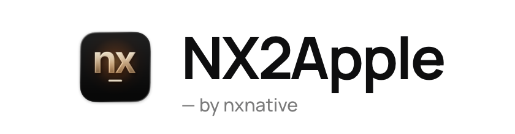
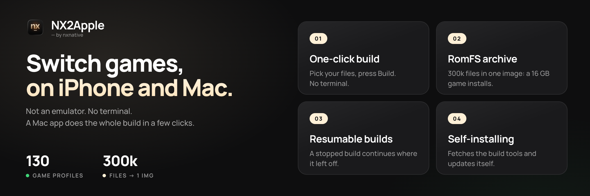
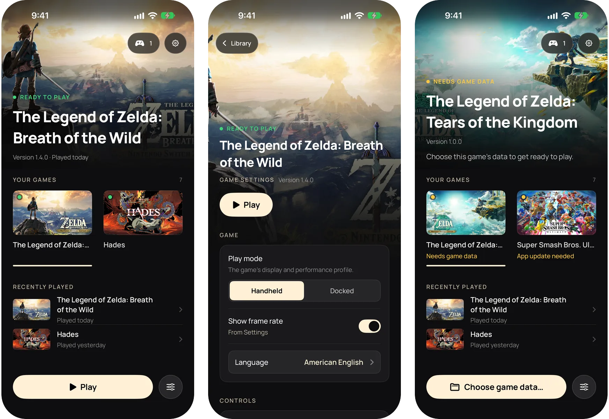
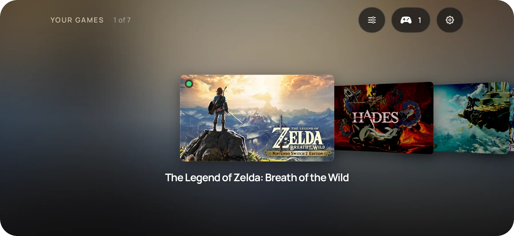

<picture>
  <source media="(prefers-color-scheme: dark)" srcset="frontend/screenshots/logo-dark.png">
  
</picture>

**Dina Switch-spel, direkt på din iPhone.**

**Ingen emulator. Ingen terminal. En macOS- eller Windows-app sköter hela bygget med några klick.**

#### 🆕 Senaste nyheterna

- **Windows-launcher (`NX2Apple-windows-x64.zip`)**: Bygg iPhone- och iPad-IPA:er i Windows med samma 1.2-gränssnitt, ett medföljande motorträd (inget git behövs), guidad förstagångskonfiguration, flerkärnig NSO-omskrivning och inbyggd självuppdatering (`NX2Apple.exe`).
- **Switch 2-spel**: Välj en Switch 2-spelmapp eller en `.nup`-fil i Mac- eller Windows-launchern, helt utan `prod.keys`, och spela på Mac, iPhone eller iPad.
- **Anpassade pekkontroller, delade Joy-Con och Steam Controller (2026)**: Ändra storlek på knappar, flytta vänster spak eller placera varje knapp i den visuella layoutredigeraren på iPhone och iPad. Fysiska handkontroller stöder knappmappning per spel eller globalt, uppdelning av ett Bluetooth-anslutet Joy-Con-par i två horisontella handkontroller på Mac samt Steam Controller (2026).
- **En app för iPhone och iPad**: Alla dina spel samlas i en enda skal-app (eller som en osignerad IPA för AltStore och SideStore), där varje spel bär sitt eget värdramverk så att motoruppdateringar aldrig tvingar fram ett ombygge, med Cover Flow i liggande läge, inställningar och moddar per spel, radering av spel med sparfilerna kvar och 6 språk.
- **Konsolläge**: Anslut en handkontroll och tryck på Select, eller starta direkt i konsolläge. Biblioteket går till helskärm som på en Switch, och att hålla in Home i 2 sekunder avslutar ett spel.

Alla versioner finns i [ändringsloggen](CHANGELOG.md).

---

## Vad NX2Apple är

NX2Apple kör Nintendo Switch-spel på din Mac och iPhone från dina egna spelavbilder (dumps). Det är inte
en emulator: Spelets egen kod körs nativt på Apple silicon, och Metal ritar den. En Mac-app, launchern,
sköter bygget med några klick (packa upp, skriva om, översätta shadrarna, paketera) och håller sedan dina
spel i ett bibliotek som du startar med **Spela**, precis som på en Switch.

Det är en community-fork av **[nxnative](https://github.com/seedds/nxnative)**, som gör det egentliga
jobbet (kodomskrivaren, Horizon-värden, NVN på Metal och varje spels profil). Den här forken lägger till
launchern och en kort lista med patchar och följer nxnative varje dag.

## Krav

- **En Mac med Apple silicon.** Launchern startar på **macOS 13 eller senare**. För att bygga behövs Xcode
  med iOS SDK, och NVN-spel kräver [Xcode](https://developer.apple.com/download/all/?q=Xcode%2027.2) 27.2 (macOS 26.6
  eller senare) om du inte bygger med `--allow-other-metal`. Ta 27.2 från Apples nedladdningssida, inte det
  nyare Xcode från App Store. Om du också har ett nyare Xcode installerat, döp om 27.2 till `Xcode-27.2.app` och välj det:
  `sudo xcode-select -s /Applications/Xcode-27.2.app`.
- **Dina egna spelavbilder** (NSP eller XCI) och **din egen `prod.keys`** från din egen konsol. Inget
  medföljer, laddas ned eller slås upp åt dig. Samma `prod.keys` öppnar alla dina Switch-spel. En aktuell
  avbild täcker alla titlar i handeln. Switch 2-spel (en spelmapp eller en `.nup`-fil) behöver ingen `prod.keys`.
- För en iPhone eller iPad: iOS eller iPadOS 26 eller senare och en ny enhet. Äldre enheter är otestade.

Appen har egna byggverktyg och en egen Python, så du behöver varken Homebrew eller någon Python-installation.
.NET SDK 10 är det enda verktyget som appen fortfarande installerar åt dig. Launcherns sida för beroenden
kontrollerar varje krav och installerar det den kan med ett klick.

## Installation

1. **Ladda ned appen**: `NX2Apple-macOS-arm64.zip` från den
   [senaste versionen](https://github.com/LNPANDY/NX2Apple/releases/latest). Packa upp den.
2. **Öppna den en gång med högerklick och sedan Öppna.** Appen är inte signerad med ett betalt
   Apple-utvecklarcertifikat, så macOS frågar före första starten. Därefter öppnas den som vanligt.
3. **Följ installationen.** Launchern hämtar projektet den bygger med (en knapp **Hämta förrådet** på
   installationssidan, en grund klon till `~/NX2Apple`. Om GitHub är långsamt visar sidan vägen via den manuella
   ZIP-filen), kontrollerar verktygen ovan och uppdaterar sig själv senare. Du behöver aldrig git.
4. **Bygg ett spel.** Välj spelets mapp (eller basspel, uppdatering, DLC och `prod.keys` ett i taget), välj
   **Den här Mac-datorn** eller **iPhone/iPad** och starta bygget. Sidan visar de verkliga stegen och
   återstående tid, och ett stoppat bygge fortsätter där det slutade. Målet **iPhone/iPad** är en app på
   enheten för alla dina spel. Launchern signerar den med Xcode, installerar den och kopierar in spelet.
   Det kräver en enhet som är parkopplad med Mac-datorn.

Att bygga för hand från en terminal beskrivs i [BUILDING.md](BUILDING.md).

## Appen för iPhone och iPad

Målet **iPhone/iPad** bygger en skal-app som rymmer alla dina spel, på samma sätt som Mac-launchern. Dess
bibliotek visar varje spel med sin key art. I stående läge är det en kolumn med det valda spelet överst. På
sidan är det en Cover Flow. En iPad visar ett rutnät.

- **Lägg till spel från Mac-datorn.** Bygg ett spel med målet **iPhone/iPad** så kopierar launchern in det
  i appen. Att signera om och installera om appen behåller din speldata och dina sparfiler.
- **Spela.** Välj ett spel och tryck på **Spela**. Saknar ett spel sin data, eller behöver det en nyare app,
  står det på spelets kort, som också erbjuder lösningen.
- **Inställningar för varje spel.** Inställningsknappen (eller X på en handkontroll) öppnar spelets
  startalternativ. **Återställ** sätter varje val tillbaka till standardvärdet.
- **Handkontroll eller tangentbord.** Hela appen går att styra med en handkontroll: styrkorset och spaken
  flyttar, A väljer, B går tillbaka, X öppnar inställningarna och Y listar handkontrollerna. Ett
  hårdvarutangentbord fungerar på samma sätt.
- **Mapp för speldata.** Varje spel kan läsa sin data från en mapp som du väljer i appen Filer, till
  exempel på en extern enhet, eller från appens egen mapp.
- **Molnsparfiler.** Välj en mapp i iCloud Drive så hålls ett spels sparfiler i takt med Mac-datorn.
- **Språk.** Appen följer systemspråket, engelska eller förenklad kinesiska.

Appen kräver iOS eller iPadOS 26 eller senare. Omslagen är de eShop-banners som Mac-launchern cachar för
dina egna spel.

## Så spelar du

**På Mac** visas ett färdigt spel i biblioteket med sin key art. **Spela** startar det.
**Startalternativ** (per spel, behålls vid ombyggen) styr bildfrekvens, konsolläge (dockad eller handhållen),
renderskala och uppskalning, spelspråk, kontroller med mera. Vad varje alternativ gör står i
[docs/settings.md](https://github.com/seedds/nxnative/blob/f25fa9562ee96d06f1e6412dbb91aab2b7035ec1/docs/settings.md). En handkontroll styr launchern lika väl som spelen.

**På iPhone** visar appen samma inställningar innan spelet startar. Tryck på **Spela**. Pekkontrollerna
finns i en 2D- och en 3D-layout (tryck på knappen överst i mitten), och en ansluten handkontroll (Xbox,
PlayStation, Switch Pro, MFi) ersätter dem.
[docs/playing.md](https://github.com/seedds/nxnative/blob/f25fa9562ee96d06f1e6412dbb91aab2b7035ec1/docs/playing.md) tar upp touch, vibration och rörelse. Korta hack första gången en scen visas är
normala: Appen kompilerar grafiken för den en gång och kommer ihåg den. Spelets data (`romfs.img`) kan ligga
på en extern enhet som appen Filer väljer.

**Spelspråk.** Engelska är standard. På Mac använder du raden **Spelspråk** i Startalternativ. För allt som
bladet saknar skriver du en `env.txt` med rader av typen `KEY=VALUE` (till exempel `DM_LANG=zh-Hans`) på en
av två platser: `~/Library/Application Support/nxnative/<title ID>/env.txt` gäller först och överlever
ombyggen, `<App>.app/Contents/Resources/dm/env.txt` är appens egen. En Mac-app som byggdes innan
språkraden fanns behöver ett ombygge för att få den. På iPhone läggs samma rader i `Documents/env.txt`
(`DM_FPS_TARGET=30` begränsar bildfrekvensen för att spara batteri, `DM_OPMODE=0` väljer handhållet läge).
Den filen gäller alla spel i den delade appen. För en rad som hör till ett enda spel (till exempel en
mods `DM_ROMFS_OVERLAY`), skriv den i `Documents/games/<title ID>/env.txt`. Där båda filerna sätter samma
nyckel gäller spelets fil.
En mod är enklare: lägg dess mapp i `Documents/games/<title ID>/mods/<modnamn>/` (RomFS-filerna i en mapp `romfs/`
i den, eller i mappen själv). Skalet sätter då `DM_ROMFS_OVERLAY` bara för det spelet. Med flera mods gäller den
som kommer först efter namn där de ersätter samma fil. Är samma nyckel satt flera gånger är ordningen: skalets egna
inställningar, spelets `env.txt`, spelets mapp `mods/`, den delade `Documents/env.txt`.

**Sparfiler och loggar.** Ett Mac-spel i en biblioteksmapp har sina sparfiler och sin logg bredvid appen
(`log/<title ID>.log`). Annars ligger de i `~/Library/Application Support/nxnative/<title ID>/` och
`~/Library/Logs/nxnative/<title ID>.log`. På iPhone ligger de i appen Filer under appens namn: `save/` och
`log.txt` (föregående körning är `log.prev.txt`).

**Rapportera ett fel.** Använd [formulären för ärenden](https://github.com/LNPANDY/NX2Apple/issues/new/choose)
(spelproblem, byggproblem, launcherproblem). Varje formulär frågar efter spelet och dess title ID, dina
versioner och din enhet, **Inställningar > Kopiera diagnostik** och spelets logg.
[CONTRIBUTING.md](CONTRIBUTING.md) förklarar varför. En rapport med hela `log.txt` tittar vi på först.
Bifoga aldrig nycklar, spelfiler eller något som extraherats ur ett spel.

## Spel

147 spel har en profil. Flera rapporteras som spelbara på en iPhone uppströms, och de flesta har en
profil som ännu inte har prövats på en telefon. Några av dem:

| | Spel | Var det körs | Status |
|---|---|---|---|
|  | The Legend of Zelda: Tears of the Kingdom | Mac och iPhone | **Verifierat här**: 304 243 filer, bytekontrollerade, ca 17 GB |
|  | Hades II | Mac och iPhone | **Verifierat här** |
|  | Animal Crossing: New Horizons | iPhone | **Verifierat här**: går smidigt |
|  | Super Mario Odyssey | iPhone | Rapporterat som spelbart uppströms |
|  | The Legend of Zelda: Breath of the Wild | iPhone | Rapporterat som spelbart uppströms, 60 fps med 1.9.0 |
|  | Mario Kart 8 Deluxe | iPhone | Rapporterat som spelbart uppströms |

**[GAMES.md](GAMES.md)** har skärmbildsgalleriet med varje spels installationsstorlek och den fullständiga
tabellen med den uppdateringsversion som varje spel behöver: Uppdaterings-NSP:ns visade version måste
stämma med profilens, annars säger bygget ifrån.

## Begränsningar

- **Bara spelen med en profil.** En titel utanför listan kräver eget bring-up-arbete. Börja med
  [docs/agents](https://github.com/seedds/nxnative/blob/f25fa9562ee96d06f1e6412dbb91aab2b7035ec1/docs/agents/README.md), uppströmsprojektets guide för en annan Switch-titel.
- **Stora spel slår i en minnesgräns på iPhone.** Utan behörigheten Increased Memory Limit ger iOS appen
  cirka 3,4 GB, vilket inte räcker för Tears of the Kingdom. Appen begär den, och AltStore Classic 2.2+,
  Impactor och Xcode med ett Personal Team behåller den. SideStore med ett gratis Apple-ID behöver en
  engångsfix av App-ID, och Sideloadly tar bort den ([stegen](ENTITLEMENTS.md)). Alla mätningar finns i
  [GAMES.md](GAMES.md#verified-on).
- **Osignerad launcher.** Launchern signeras inte åt dig, så du sideloadar den. iPhone-appen signeras av
  Xcode med ditt eget team när launchern installerar den.
- **Dina egna filer.** Ingen speldata, inget firmware och inga nycklar ingår eller laddas ned.
- **Äldre shardarkiv läses inte längre.** De första iPhone-byggena paketerade Tears of the Kingdom i ett
  RomFS-shardarkiv (`romfs.idx`). Bygget skriver numera en enda `romfs.img`. En iPhone som fortfarande har
  ett gammalt arkiv behöver få speldatan skickad en gång till, som en `romfs.img` via launchern.

## För utvecklare

- **Bygg från källkod:** [BUILDING.md](BUILDING.md). **Rapportera eller åtgärda något:** [CONTRIBUTING.md](CONTRIBUTING.md).
- **Var hjälp behövs:** [Milstolparna](https://github.com/LNPANDY/NX2Apple/milestones) är planen, och [CONTRIBUTING.md](CONTRIBUTING.md#where-we-would-love-help) förklarar hur du tar ett ärende från en av dem.
- **Vad den här forken ändrar i uppströmsprojektet:** Motorn (`dm/`, `scripts/`, `docs/`, `ref/`) är inte
  incheckad här. Den är nxnative vid en fastlåst commit (`.upstream-ref`) plus en kö av patchar som
  var och en säger varför forken bär den, och `python3 tools/engine.py sync` bygger den till `engine/`.
  [patches/README.md](patches/README.md) förklarar det, och `python3 tools/engine.py status` listar vad som
  bärs. Ett dagligt jobb flyttar fästpunkten och öppnar en pull request, eller ett ärende som namnger patchen
  som inte längre passar. Länkarna till motorns dokument i den här README:n pekar på nxnative vid den fastlåsta committen.
- **Ett annat Switch-spel:** [docs/agents](https://github.com/seedds/nxnative/blob/f25fa9562ee96d06f1e6412dbb91aab2b7035ec1/docs/agents/README.md) (extrahering, binärgenomgång, bring-up).
- **Versionshistorik:** [CHANGELOG.md](CHANGELOG.md).

## Tack

**Community-bidragsgivare**: Projektets kod är inte en enskild underhållares verk:

- **[v0lumehi](https://github.com/v0lumehi)**: **Mac-frontendens launcher** (PR [#27](https://github.com/LNPANDY/NX2Apple/pull/27), 40 filer): ett spelbibliotek med key art, startalternativ per spel, en riktig förloppsström och ett Stoppa som avslutar hela byggets processgrupp. Mac-appen gick från ”ett byggformulär” till den första versionen av en launcher som öppnas som en Switch.
- **[m1guelpf](https://github.com/m1guelpf)** (Miguel Piedrafita): två HLE-fixar (PR [#24](https://github.com/LNPANDY/NX2Apple/pull/24) och [#26](https://github.com/LNPANDY/NX2Apple/pull/26)): de saknade posterna `EnableAlbumImageTakenNotification` och `CreateWithAdjustableSystemClock` samt deras snapshot-typbyte. Var och en hade gett en null i spel som anropar dem, och var och en kom med ett test.

Vill du vara med på listan? [Bidra](CONTRIBUTING.md#helping-with-games) förklarar hur du börjar. Rapporter med hel logg och fixar med ett test går snabbast.

**Community-projekt**: underhålls av sina upphovspersoner, utanför det här förrådet:

- **[widmonstertony/nxnative](https://github.com/widmonstertony/nxnative)** (grenen `ios16-pokemon-za-port`): kompatibilitet med iOS/iPadOS 16.1 till 17 och tvOS, med en äldre Metal-renderarväg, testad på en iPad med A10X och en iPad med M2. För enheter som den här forkens versioner inte stöder.

Allt motorarbete är andras. Det här förrådet lägger launchern och patchkön ovanpå:

- **[nxnative](https://github.com/seedds/nxnative)** (MIT): verktygskedjan för nativ körning som det här
  förrådet bygger på: NSO-omskrivaren, Horizon-värdlagret, NVN på Metal, profilerna för varje spel och iOS-skalet.
- **[d2r-mobile](https://github.com/jhaizhou-ops/d2r-mobile)** (MIT): det ursprungliga angreppssättet för
  nativ körning som nxnative växte ur.
- **Ryujinx** (MIT): shaderöversättaren som gör om Maxwell-shadrar till SPIR-V.
- **[Atmosphère](https://github.com/Atmosphere-NX/Atmosphere)**: referensen för Horizons synkroniseringssemantik.
- **[LibHac](https://github.com/Thealexbarney/LibHac)**: läser NSP:er och lägger uppdateringar i lager i `nx_extract`.
- **[SPIRV-Cross](https://github.com/KhronosGroup/SPIRV-Cross)**: SPIR-V till Metal Shading Language.
- **yuzu**, **deko3d**, **libvpx**, **stb_vorbis**, **libdeflate**: uppströmsprojektets tackslista säger vad var och en bidrar med.

`dm/third_party` innehåller andra projekt med deras licenser ([lista](https://github.com/seedds/nxnative/blob/f25fa9562ee96d06f1e6412dbb91aab2b7035ec1/dm/third_party/README.md)).

## Juridik

**Vad det här projektet är.** Ett byggverktyg för spel du redan äger. Det läser avbilder som du har gjort av
dina egna spelkort och köp, på din egen dator, och skapar ett paket för din egen enhet. Ingenting i det här
förrådet, i appen eller i någon version innehåller eller distribuerar Nintendos kod, grafik, text, data,
shadrar, firmware, nycklar eller något annat upphovsrättsskyddat material.

**Vad det inte kan.** Kedjan har ingen källa till spel eller nycklar: Den kräver användarens egen `prod.keys`
och egna NSP/XCI-avbilder och pratar inte med någon server. Den kringgår, tar bort eller distribuerar inget
skydd. LibHac öppnar användarens egna avbilder med användarens egna nycklar, alltså samma åtgärd som en
konsol utför på ett spelkort.

**Varumärken.** Inte ansluten till, sponsrad av eller godkänd av Nintendo. ”Nintendo Switch” och speltitlar är
varumärken som tillhör Nintendo Co., Ltd. Alla andra varumärken tillhör sina respektive ägare.

**Ditt ansvar.** Lagarna om att göra en personlig säkerhetskopia skiljer sig mellan länder, och vissa platser
tillåter det inte alls. Du ansvarar för att känna till och följa lagen där du bor, och för att aldrig
distribuera spelfiler, nycklar eller paket som byggts av dem. Projektets resultat är endast för personligt
bruk på din egen hårdvara. Om du gillar ett spel, köp det.

**Borttagning.** Om du tror att något i det här förrådet gör intrång i dina rättigheter, öppna ett ärende eller
kontakta underhållaren direkt. Giltiga krav åtgärdas snabbt, ända till att innehåll eller förrådet tas bort.

**Ingen garanti.** Programvaran tillhandahålls ”i befintligt skick” under licenserna i [LICENSE](LICENSE)
(den här forken lägger till uppströmsprojektets, se tacken), utan garanti av något slag, vare sig uttrycklig
eller underförstådd. Använd den på egen risk.
