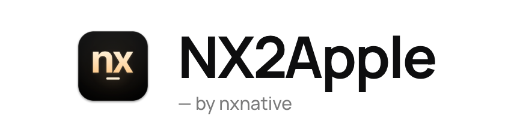
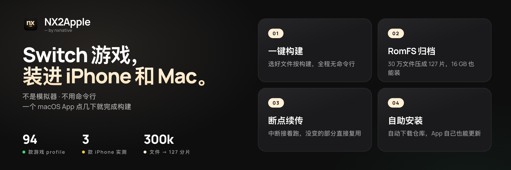
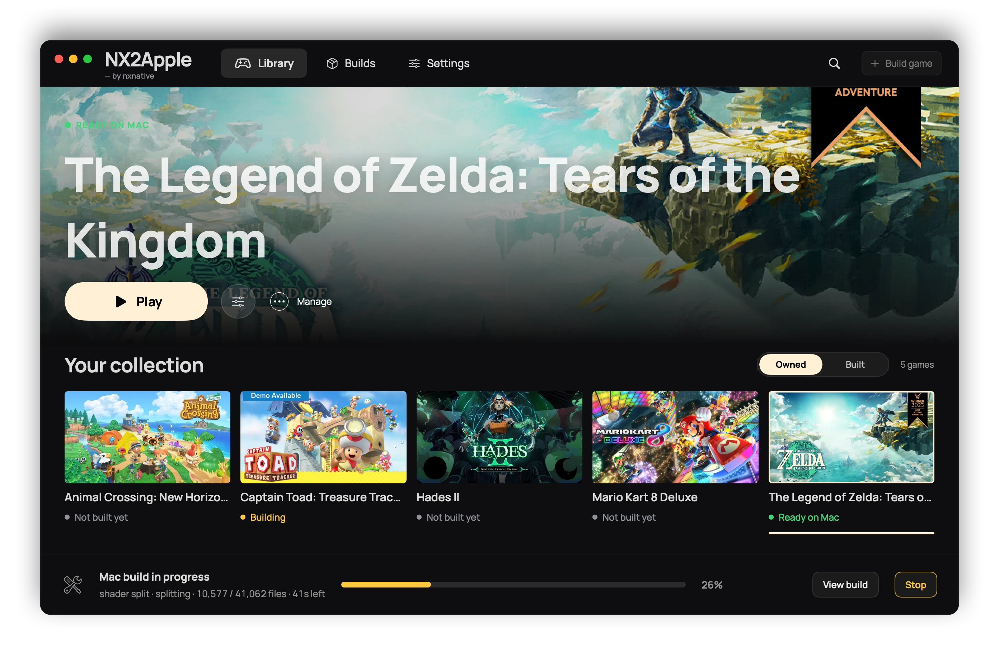

<picture>
  <source media="(prefers-color-scheme: dark)" srcset="frontend/screenshots/logo-dark.png">
  
</picture>

**你的 Switch 游戏，跑在你的 iPhone 上。**

**不是模拟器。不用命令行。一个 macOS App 点几下就把整个构建做完。**

#### 🆕 最近重点更新

- **引导式首次启动**：安装向导带新玩家走完 Xcode、密钥和游戏；构建工具和 Python 直接内置在 App 里，不用装 Homebrew
- **存档跟着走**：Mac ⇄ iPhone 存档通过同一个 iCloud Drive 文件夹自动同步；删掉的 App 几秒重装；免费 Apple ID 的 7 天签名原地续签
- **主机模式**：插上手柄按 Select，游戏库变全屏封面墙，手柄操作——就像 Switch 主菜单

所有版本见[更新日志](CHANGELOG.zh-CN.md)。English readers — the [English README](README.md) covers everything.

---

## 这是什么

NX2Apple 用你自己导出的游戏文件，在你的 Mac 和 iPhone 上运行 Nintendo Switch 游戏。它不是模拟器：
游戏自己的代码直接在 Apple 芯片上运行，由 Metal 负责绘制。一个 Mac App（启动器）点几下就完成构建
（解包、改写、翻译 shader、打包），然后把你的游戏放进游戏库，像 Switch 一样点 **Play** 启动。

它是 **[nxnative](https://github.com/seedds/nxnative)** 的社区 fork。真正的工作（代码改写器、Horizon
宿主层、NVN-on-Metal 和每个游戏的 profile）都是 nxnative 的；本 fork 在其上增加启动器和少量补丁，
并每天跟随 nxnative 更新。

## 环境要求

- **Apple Silicon Mac。** 启动器支持 **macOS 13 或更新**。构建需要装了 iOS SDK 的 Xcode；NVN 游戏需要
  [Xcode](https://apps.apple.com/app/xcode/id497799835) 27.1（macOS 26.6 或更新），除非加 `--allow-other-metal`。
- **你自己的游戏文件**（NSP 或 XCI）和**你自己主机里导出的 `prod.keys`**。本项目不自带、不下载、
  也不替你查找任何东西。一份 `prod.keys` 能解你所有的游戏；新导出的一份覆盖所有零售游戏。
- 要装到 iPhone：iOS 26 或更新，以及较新的手机。更旧的设备未测试。

App 自带构建工具和 Python，不需要装 Homebrew 和 Python；.NET SDK 10 仍由 App 帮你安装。启动器的依赖页会逐项检查，能装的一键安装。

## 安装

1. **下载 App**：从[最新版本](https://github.com/LNPANDY/NX2Apple/releases/latest)下载
   `NS-Port-Builder-macOS-arm64.zip`，解压。
2. **首次启动：右键 → 打开。** 这个 App 没有付费的 Apple 开发者证书签名，所以 macOS 在第一次启动时会
   询问；之后就能正常打开。
3. **按设置页走。** 启动器会取回构建用的项目（设置页上的「下载仓库」按钮，浅克隆到 `~/NX2Apple`；
   GitHub 不顺手时页面会给出手动 ZIP 的路线），检查上面的工具，之后还会自己更新。全程不需要懂 git。
4. **构建游戏。** 选好游戏文件夹（或者分别选本体、更新包、DLC 和 `prod.keys`），选择「这台 Mac」或
   「iPhone / iPad」，按构建。页面显示真实的阶段和剩余时间，中途停止的构建会从上次继续。iPhone 构建
   结束时会给出装到手机的三步。

在终端里手动构建见 [BUILDING.zh-CN.md](BUILDING.zh-CN.md)。

## 游玩

**在 Mac 上**，构建好的游戏带着封面出现在游戏库里，点 **Play** 启动。**启动选项**（按游戏保存，重新
构建后仍然保留）可设置帧率、主机模式（底座或掌机）、渲染缩放和超分辨率、游戏语言、操控等；每项的
作用见 [docs/settings.md](docs/settings.md)（英文）。手柄既能操作游戏，也能操作启动器。

**在 iPhone 上**，App 在游戏开始前显示同样的设置，点 **Play** 即可。触屏操控有 2D 和 3D 两种布局
（点顶部中央的按钮切换），连接手柄（Xbox、PlayStation、Switch Pro、MFi）后触屏控件会隐藏。
触屏、震动和体感见 [docs/playing.md](docs/playing.md)（英文）。新场景第一次出现时短促卡顿是正常的：
App 会为它编译一次图形并记住。游戏数据（`romfs.img`）可以放在外置硬盘上，用「文件」App 选取。

**游戏语言。** 默认英文。Mac 上用启动选项里的「游戏语言」一行。面板里没有的设置，可以写一个
`env.txt`，每行 `KEY=VALUE`（例如 `DM_LANG=zh-Hans`），放在两处之一：
`~/Library/Application Support/nxnative/<title ID>/env.txt` 优先，重新构建后仍在；
`<App>.app/Contents/Resources/dm/env.txt` 是 App 自带的。在加入语言选项之前构建的 Mac App 需要重新构建
一次才有该项。iPhone 上同样的行写在 `Documents/env.txt` 里（`DM_FPS_TARGET=30` 限帧省电，
`DM_OPMODE=0` 选掌机模式）。

**存档和日志。** 放在游戏库文件夹里的 Mac 游戏，存档和日志在 App 旁边（`log/<title ID>.log`）；否则在
`~/Library/Application Support/nxnative/<title ID>/` 和 `~/Library/Logs/nxnative/<title ID>.log`。
iPhone 上在「文件」App 里该 App 名字下：`save/` 和 `log.txt`（上一次运行的是 `log.prev.txt`）。

**报告问题。** 请用[问题表单](https://github.com/LNPANDY/NX2Apple/issues/new/choose)（游戏问题、构建问题、
启动器问题）。表单会要你填游戏和 title ID、版本和设备、**设置 > 复制诊断信息**，以及游戏的日志；
为什么需要见 [CONTRIBUTING.md](CONTRIBUTING.md)（英文）。附上完整 `log.txt` 的报告会优先处理。
千万不要附上密钥、游戏文件或任何从游戏中提取的内容。

## 游戏

共有 94 个游戏 profile。3 款在本 fork 完整验证（构建、安装、在手机上玩过），另有 45 款上游报告 iPhone
可玩，其余的 profile 还没在手机上试过。其中几款：

| | 游戏 | 运行于 | 状态 |
|---|---|---|---|
|  | 塞尔达传说：王国之泪 | Mac 和 iPhone | **本 fork 验证**：304,243 个文件，逐字节校验；约 17 GB |
|  | Hades II | Mac 和 iPhone | **本 fork 验证** |
|  | 集合啦！动物森友会 | iPhone | **本 fork 验证**：流畅运行 |
|  | 超级马力欧 奥德赛 | iPhone | 上游报告可玩 |
|  | 塞尔达传说：旷野之息 | iPhone | 上游报告可玩；1.9.0 可 60 fps |
|  | 马力欧卡丁车 8 豪华版 | iPhone | 上游报告可玩 |

**[GAMES.zh-CN.md](GAMES.zh-CN.md)**（English: [GAMES.md](GAMES.md)，带截图图库和每款的安装大小）
有完整表格和每款游戏需要的更新包版本：更新包 NSP 的显示版本必须与 profile 一致，否则构建会提示。

## 限制

- **只支持有 profile 的游戏。** 列表之外的游戏需要单独的 bring-up 工作；起点是
  [docs/agents](docs/agents/README.md)（上游为其他 Switch 游戏写的指南，英文）。
- **大体积游戏在 iPhone 上会碰到内存上限。** 没有 Increased Memory Limit entitlement 时 iOS 只给 App
  约 3.4 GB，不够《王国之泪》用。App 请求了它，AltStore Classic 2.2+、Impactor 和 Xcode + Personal Team
  会保留；SideStore 配合免费 Apple ID 需要对 App ID 做一次性修复，Sideloadly 会丢掉它
  （[步骤](dm/ios/ENTITLEMENTS.md)）。完整的测量见 [GAMES.zh-CN.md](GAMES.zh-CN.md#验证情况)。
- **App 未签名。** 启动器和 iPhone 构建不会替你签名，需要你自己侧载。
- **你自己的文件。** 不包含也不下载任何游戏数据、固件或密钥。
- **旧的分片归档不再被读取。** 最早的 iPhone 构建把《王国之泪》打成 RomFS 分片归档（`romfs.idx`）；现在
  构建写出单个 `romfs.img`。仍保留旧归档的 iPhone 需要通过启动器把游戏数据重新发送一次（`romfs.img`）。

## 给开发者

- **从源码构建：** [BUILDING.zh-CN.md](BUILDING.zh-CN.md)。**报告或修复问题：** [CONTRIBUTING.zh-CN.md](CONTRIBUTING.zh-CN.md)。
- **本 fork 对上游改了什么：** 引擎（`dm/`、`scripts/`、`docs/`、`ref/`、`AGENTS.md`）就是 nxnative 在固定提交上的
  内容，加一组补丁，每个补丁写明本 fork 为什么带着它。见 [patches/README.md](patches/README.md)；
  `python3 scripts/patches.py status` 列出带着的全部补丁。每天一次的任务移动固定提交并开 pull request，
  某个补丁对不上时开一个点名该补丁的 issue。
- **其他 Switch 游戏：** [docs/agents](docs/agents/README.md)（解包、二进制调查、bring-up）。
- **版本历史：** [CHANGELOG.zh-CN.md](CHANGELOG.zh-CN.md)。

## 致谢

**社区贡献者** —— 这个项目的代码不只是一个维护者的输出：

- **[v0lumehi](https://github.com/v0lumehi)** —— **Mac 前端的启动器界面**（PR [#27](https://github.com/LNPANDY/NX2Apple/pull/27)，40 个文件）：游戏库、封面图、每游戏启动选项、真进度流、能真正结束整个构建进程组的 Stop。Mac 端从"一个构建表单"变成了"打开像一台 Switch 的启动器"的第一版。
- **[m1guelpf](https://github.com/m1guelpf)**（Miguel Piedrafita）—— 两个 HLE 修复（PR [#24](https://github.com/LNPANDY/NX2Apple/pull/24)、[#26](https://github.com/LNPANDY/NX2Apple/pull/26)）：补上了 `EnableAlbumImageTakenNotification` 和 `CreateWithAdjustableSystemClock` 及其快照类型字节——两个原本会让游戏读到空指针的缺失条目，各带测试。

想加入这个列表？[参与贡献](CONTRIBUTING.zh-CN.md#帮忙补充游戏)写了怎么开始；issue 里附上完整日志的报告和带测试的修复最快。

所有底层引擎的工作都是别人的。本仓库在其之上增加了启动器和补丁队列：

- **[nxnative](https://github.com/seedds/nxnative)**（MIT）—— 本仓库所基于的原生执行工具链：
  NSO 重写器、Horizon 宿主层、NVN-on-Metal、各游戏 profile 和 iOS 外壳。
- **[d2r-mobile](https://github.com/jhaizhou-ops/d2r-mobile)**（MIT）—— nxnative 由之发展而来的
  原始原生执行方案。
- **Ryujinx**（MIT）—— 把 Maxwell 着色器翻译成 SPIR-V 的翻译器。
- **[Atmosphère](https://github.com/Atmosphere-NX/Atmosphere)** —— Horizon 同步语义的参考实现。
- **[LibHac](https://github.com/Thealexbarney/LibHac)** —— `nx_extract` 用它读取 NSP 并叠加更新。
- **[SPIRV-Cross](https://github.com/KhronosGroup/SPIRV-Cross)** —— SPIR-V 转 Metal Shading Language。
- **yuzu**、**deko3d**、**libvpx**、**stb_vorbis**、**libdeflate** —— 各自贡献见上游致谢列表。

`dm/third_party` 里随附了其他项目及其许可证（[列表](dm/third_party/README.md)）。

## 法律

**本项目是什么。** 一个为你**已拥有**的游戏做构建的工具。它读取你在自己机器上从自己的卡带和购买中
导出的文件，产出一个装到你自己的设备上的安装包。本仓库、App 和任何 Release 中都不包含、也不分发
任天堂的代码、美术、文本、数据、着色器、固件、密钥或任何其他受版权保护的内容。

**它做不到什么。** 整条流水线没有游戏和密钥的来源：必须由用户提供自己的 `prod.keys` 和自己的
NSP/XCI 导出文件，且不连接任何服务器。它不绕过、不移除、也不再分发任何保护——LibHac 用用户自己的
密钥打开用户自己的导出文件，和主机读取卡带执行的是同一种操作。

**商标。** 与任天堂无关联，也未获得其赞助或认可。"Nintendo Switch" 及各游戏名称是任天堂株式会社的
商标；其他商标归各自权利人所有。

**你的责任。** 制作个人备份副本的法律因国家而异，有些地方完全不允许。你有责任了解并遵守所在地的
法律，并且绝不分发游戏文件、密钥或由它们构建出的安装包——本项目的产物仅供在你自己的硬件上个人使用。
喜欢哪个游戏，请购买它。

**下架。** 如果你认为本仓库中的任何内容侵犯了你的权利，请开 issue 或直接联系维护者；有效的权利
主张会得到及时处理，包括删除相关内容乃至整个仓库。

**无担保。** 本软件按 [LICENSE](LICENSE) 中的许可证（本 fork 在上游之上有所附加，见致谢）以"现状"
提供，不附带任何明示或默示的担保。使用风险自负。
