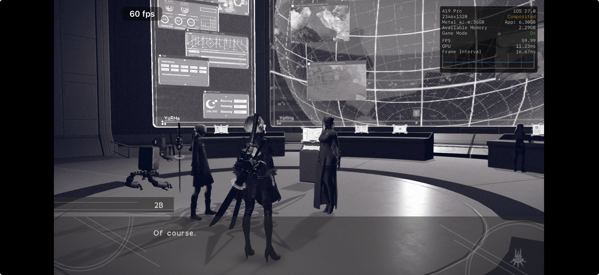

# NieR:Automata The End of YoRHa Edition (`010056B015FE8000`)

Update 1.0.3 (v131072) over the base cartridge dump. PlatinumGames' engine, SDK 12.3.9, NVN, CRI CPK archives and Sofdec USM movies, Wwise audio through `AudioOut`. Modules `main`, `subsdk0` (NintendoSDK_movie) and `sdk`. Mac and iPhone gameplay have been tested; platform-specific performance and integration results are recorded below.

## What it needs

| Setting | Where | Why |
|---|---|---|
| `mem_reserve 0x140000000`, `mem_alias 0x118000000`, `mem_stack 0x10000000`, `app_pool 0xCD500000` | [`game.tsv`](game.tsv) | 5 GB guest block with a 4.375 GB alias region; the game maps its own memory there and never sets a heap during startup |
| `sys_resource 0x1000000` | `game.tsv` | the NPDM declares 16 MB of system resource, enabling virtual address memory |
| `pad_layout full` | `game.tsv` | movement and camera/aiming use both sticks |
| `tex_flush_upload on` | `game.tsv` | CPU-filled texture storage is published through mapped-range flushes; without uploads the title background is magenta |
| `tex_dirty_upload on` | `game.tsv` | tracks later CPU texture writes that the game does not publish with an NVN flush |
| `feedback_snap fd2c47b73f0e7e24` | `game.tsv` | `filter09.pso` samples the HDR attachment it writes through separate texture slot 128; a snapshot prevents NaNs spreading through bloom |
| `present_interval display` | `game.tsv` | replaces the game's interval-two presentation target with 60 Hz; the native clock already measures elapsed time |
| `fps_target 60` | `game.tsv`, `hle_fpslock.c` | initializes the verified build's engine interval at 60 fps; the launcher can select 30 fps independently of resolution policy |
| `gpu_timestamps segment` | `game.tsv` | the renderer subtracts two raw timestamp reports; one timestamp for the whole submission makes its measured GPU cost zero |
| Four dynamic-resolution threshold cuts | [`patches.py`](patches.py) | the verified 1.0.3 main build uses 22.5 / 16.005 / 15 ms thresholds for a 60 fps budget |

## Files and shaders

- 660 RomFS files, 10.84 GB: 30 CRI CPK archives (6.20 GB), 162 USM movies (3.52 GB), loose Wwise banks and streams, and Enlighten data.
- **Resolved: the shader split found zero shaders.** Five DAT archives in `data000.cpk` contain 1,371 size-delimited shader objects: 819 pixel, 517 vertex, 31 compute and four geometry objects, before deduplication. Every object has a 0x88-byte binding prefix, a length-prefixed NVN code area, then a length-prefixed 0x880-byte control section. All section bounds and control code lengths agree. They produce 1,225 distinct keys, including the initial runtime keys `f2fd6cfd0ff14a18`, `7855550732b71e48` and `62026f624061e259`. The general reader is linked below.
- The full RomFS scan finds 451 distinct vertex, 739 pixel, 31 compute and four geometry shaders, with 902 single-stage cover pairs.
- **Resolved: magenta title background.** The `render02` / `flush01` route captures frame 1,200 with identical inputs; enabling `tex_flush_upload` alone changes the magenta pixel share from 91.8% to zero and restores the cream title background. `TEXINFO` also finds populated guest texture storage without packaged layouts (for example a 1024×1024 format `0x7d` texture, 279,870 nonzero bytes of 704,512). That comparison had dirty-write tracking disabled; the current profile also tracks later unflushed writes.
- **Resolved: geometry shader compilation and binding failures.** All four geometry objects use viewport-mask output in their generated raster reader. The reader's scalar/array mismatch, missing geometry storage-buffer table and incorrect write-flag interpretation are general chain/host fixes linked below. All 1,225 shaders build for Mac and iOS after these changes.
- **Resolved: passthrough output bounds and raster emission.** All four geometry objects set SPH `GpPassthrough` with a raw output bound of one. The earlier metadata underallocated the raw scratch/index region and read the wrong stride, while native passthrough support left compute raster output absent. The shared fixes derive bounds/output topology from input, explicitly emit positions and generic attributes, and preserve viewport-zero culling. Native canaries, compaction and real-translator GPU tests cover every topology and the full capture map. Rebuilt flight scenes render the ship models and effects.
- **Resolved: green flight scene and dark rectangles.** HDR targets contained sparse red/blue NaNs, most on 16-pixel seams; bloom spread them across both channels. `filter09.pso` (`fd2c47b73f0e7e24`) samples the HDR attachment it also writes, through a separate texture slot. The host's snapshot path skipped separate slots before its general fix. `snap01` with the snapshot restores ship, cloud and exhaust colors; scans at frames 3,000, 3,060, 3,540 and 3,600 find no non-finite passes. Both default and active LUTs matched deswizzled guest storage byte-for-byte, ruling out their upload/layout. Enabling dirty-write tracking alone did not fix the green output; the separate-slot snapshot fix resolved it.

## Status on the Mac

- The title, menus, keyboard naming, a new Easy game with auto-chips, save creation and save loading pass. The opening formation cinematic and ocean combat render ships, clouds, lighting, exhaust, shots and HUD correctly. Left/right movement and firing respond to input (`snap01_control_*`, `fps60_opt_*`).
- Both logo movies decode through NintendoSDK_movie. The final 300-second run exits cleanly after the test's SIGTERM; Wwise output has zero underruns through 28,000 device callbacks. Resident memory peaks around 2,811 MB and Metal allocations around 2,995 MB, then settle below those peaks while the route streams more objects; its last report is 2,794 / 2,933 MB at frame 17,700.
- **Resolved: repeated geometry drains and sorting.** The original heavy flight route spent most sampled main-thread time waiting in `mdi_wait`, followed by sorting capture indices. The shared synchronization/bitset fix linked below removes those hotspots.
- **Resolved: serial geometry prefix scan.** A GPU profile of frame 4,600 in the 720p `fps60_seg` records 79 geometry sequences: 7.246 ms in their serial scans out of a 16.19 ms GPU span, with 521 encoders. The general parallel scan and combined compute encoder preserve ordered primitive compaction; native checks cover 129,032 groups and the translated geometry stages. The final 1080p route's frame 4,600 uses 284 encoders, 4.19 ms compute/copy and an 11.17 ms GPU span. The mode and camera timing differ, so these totals are supporting encoder evidence rather than an isolated same-frame speedup.
- Initial upstream build validation (before the integration below): both standard NSP build workflows pass. The unsigned `NieRAutomata.ipa` is 11,712,290,740 bytes (about 10.9 GiB), with all 1,225 Mac/iOS shader libraries on chain `20fe3d62b9f6` and 331 recorded prewarm entries. Its four cuts and all three embedded main sections match the tested rewrite; all 3,551 archive entries pass CRC verification. The normal Mac executable is `010056B015FE8000_build/tools/dmhost`.
- Work folder: `/Volumes/T7/nsp/NieR Automata The End of YoRHa Edition/010056B015FE8000-work`. `run/boot.py <name> <seconds> [KEY=VALUE ...]` runs the adjacent `010056B015FE8000_build/tools/dmhost` with bounded duration, control file `run/<name>.ctl`, logs and save data beside it.

## 60 fps

Four of main build `3c10ec35c5ef4c3686b4053afb0e58e7`'s eight verified cuts replace the threshold constants at `0x9bf434`, `0x9bf484`, `0x9bf4d4` and `0x9bf4f8`, with original-byte assertions, following the [FPSLocker 1.0.3 threshold sites](https://github.com/masagrator/FPSLocker-Warehouse/blob/v4/SaltySD/plugins/FPSLocker/patches/010056B015FE8000/3C10EC35C5EF4C36.yaml). The other four initialize the 60 Hz interval and make the native resolution lower bounds follow the preset minimum. All addresses are build-gated; no function-matched cuts are enabled.

The native clock at `main+0x8fc7a8` converts elapsed milliseconds to 60 Hz ticks and clamps each step to [1, 2]. It needs no clock rewrite. Probe `main:8fc888@x19+b0` reads step, accumulator, scale and elapsed milliseconds. The paired title runs measure 33.34 ms / step 2 at the original target and 16.66 ms / step 1 at 60 Hz. Slow flight before the geometry fix clamps to step 2 and loses game time; raising the presentation target alone was insufficient.

The pre-integration M4 Pro run, `fps60_final`, uses the profile's default console mode (1920×1080), 60 Hz presentation, the four 1.0.3 cuts, the current shader chain, sound and native-clock/DR probes. No resolution reduction is required for this route:

| Window after launch | Average fps | Frame p50 / p95 | Average GPU time | Game seconds / wall second |
|---|---:|---:|---:|---:|
| 80–110 s, heavy opening formation | 59.79 | 16.67 / 17.99 ms | 10.15 ms | 1.011 |
| 120–150 s, flight transition | 60.03 | 16.67 / 17.23 ms | 10.99 ms | 1.010 |
| 170–200 s, free flight | 60.00 | 16.66 / 17.39 ms | 10.93 ms | 1.011 |
| 220–250 s, ocean combat | 59.92 | 16.66 / 17.26 ms | 10.06 ms | 1.009 |

These are measured windows, not a full-game or iPhone frame-rate guarantee. The frame rate stays near 60 with occasional longer frames; the native clock's minimum-one-tick clamp gives about 1% timing bias with host jitter in these flight windows.

Reproduce the save-load route with `DM_KEYS=40:A,45:A,50:A,52:Left,53:A,60:A`, `DM_PRESENT_LINK=0` and sound enabled. Headless timing runs unset `DM_WINDOW`. To compare the original presentation target, set `DM_PRESENT_INTERVAL=game`; `display` selects 60 Hz. `DM_OPMODE=0` selects the game's native 720p handheld mode; `1` selects 1080p console mode.

[`smoke.tsv`](smoke.tsv) uses `saves/opening-flight` inside the NSP folder: an Easy save frozen immediately before Start Game, after confirming the name, difficulty and auto-control chips. Each revision loads its own copy for the opening formation and ocean flight.

**Resolved: dynamic-resolution cost reads zero or 32 times too small.** The renderer's producer at `main+0x9ba6d4` waits for a ring fence, maps its counter buffer and subtracts timestamp fields at +8 and +0x18; its inline conversion publishes milliseconds through renderer +0x10c4. Submission timestamps gave zero. Segment timestamps need the shared raw-unit fix linked below: this consumer expects 614.4 MHz, while the host previously wrote 19.2 MHz. Both report paths and the nanosecond API now use the proper rate. The current preset policy is described under [iPhone resolution and frame-rate controls](#iphone-resolution-and-frame-rate-controls).

## Geometry optimization review

The objects in `data000.cpk/shader.dat` decode as follows:

| Geometry key | `IndexBuildIndependent_` suffix | ALD attribute addresses |
|---|---|---|
| `4a2b0df808307d63` | `bccw.gso` | `0xb0`, `0xb4`, `0xc0`, `0xd0` |
| `5dc6fcf19e502bf2` | `bcw.gso` | `0xb0`, `0xb4`, `0xc0`, `0xd0` |
| `137b54dc5462e5bb` | `xccw.gso` | `0xa0`, `0xa4`, `0xb0`, `0xc0` |
| `636a45f7fa065f43` | `xcw.gso` | `0xa0`, `0xa4`, `0xb0`, `0xc0` |

- **Verified from this dump:** all four objects match the committed keys and set `GpPassthrough`. Their ALD instructions load generic attributes only. None loads `PrimitiveID` (`0x60`) or a physical attribute address. The lean kernels retain four capture words each and the visible-index storage writes.
- **Compute-split follow-up:** the [shared primitive-ID correction](../../../docs/reference/shaders.md#split-geometry-primitive-ids) now retains the draw's primitive offset through compute chunks too. The synthetic Maxwell regression covers the ID behavior; these four shaders still do not load it.
- **General correctness fix found during review:** the mesh composer repeated guest primitive IDs across groups. These four shaders do not consume that ID; their invocation indices address the capture and generated output. The [general finding and GPU regression](../../../docs/reference/shaders.md#mesh-geometry-primitive-ids-restart-per-group) distinguish the synthetic failure from this game's verified behavior.
- **Integration:** the lean and mesh paths retain #336's dependency-aware batching, index cache, parallel compaction and upload fixes, reconciled with main through `d0b7c846` (the four-game gameplay comparison below used `3e77816c`; final shader equivalence and native checks cover the subsequent integration). The M1 measurements in PR #416 describe the original implementation; validation of the reconciled host is recorded below.

- **Rebuilt for this reconciliation:** all 1,225 shaders and 96 mesh pairs for Mac and iOS, for both global and Asian profiles in separate stamped directories, on chain `a78f966a7b38`. The native graphics suite (including 1,920 geometry checks), host suite, tool tests, translated geometry GPU tests and 178-source iPhone SDK compile check pass. A further 110 native checks cover restored geometry-feedback capture, pause/resume and raster discard. The original mesh ID mapping fails the strengthened GPU oracle at primitive 32 of a 33-triangle draw; the fix passes all 48 cases.
- **M6 Mac, full 220-second opening-flight comparison against `3e77816c`:** baseline/candidate frame rate 59.1/59.5 fps, frame p99 17.58/18.26 ms, peak footprint 2,746/2,022 MB. These are this route's measurements; the M1 performance figures from PR #416 remain author-reported. Both runs reach the route target without crashes, hangs or new red diagnostics; 902 pipeline bases prebuild without failures. At frame 12,000, the candidate's preceding 300 frames contain 11,334 mesh draws and no draws waiting for a mesh pipeline.
- **Screenshot review:** the raw harness flags the moving formation at 180 seconds (17 dHash bits, RGB difference 8.52). An earlier repeat of unchanged `df694e3` produced a larger RGB difference (16 bits, RGB 9.90). The reviewed images retain all three ships at different positions, with animated effects. This is classified as flight-motion variance; the raw warning is retained. The 100-second flight image does not trigger the comparison threshold.

## Found on this game

- [Size-delimited PlatinumGames shader objects](../../../docs/reference/shaders.md#size-delimited-platinumgames-shader-objects).
- [Mapped-range flushes taken as uploads](../../../docs/reference/nvn-objects.md#mapped-range-flushes-taken-as-uploads-tex_flush_upload).
- [Geometry reader viewport masks](../../../docs/reference/shaders.md#geometry-reader-viewport-masks).
- [Geometry-stage storage-buffer table](../../../docs/reference/shaders.md#geometry-stage-storage-buffer-table).
- [Storage-buffer write flag in translation metadata](../../../docs/reference/shaders.md#storage-buffer-write-flag-in-translation-metadata).
- [Passthrough geometry output bounds follow input topology](../../../docs/reference/shaders.md#passthrough-geometry-output-bounds-follow-input-topology).
- [Passthrough geometry kernels lose raster vertices](../../../docs/reference/shaders.md#passthrough-geometry-kernels-lose-raster-vertices).
- [Same-pass feedback read through a snapshot](../../../docs/reference/rendering.md#same-pass-feedback-read-through-a-snapshot).
- [Geometry capture waits for every indexed draw](../../../docs/reference/shaders.md#geometry-capture-waits-for-every-indexed-draw).
- [Geometry compaction serial prefix scan](../../../docs/reference/shaders.md#geometry-compaction-serial-prefix-scan).
- [Geometry jobs preserve transform-feedback replay](../../../docs/reference/shaders.md#geometry-jobs-preserve-transform-feedback-replay), found while checking the integration against main's existing feedback path; the native replay fixture covers the restored behavior.
- [Raw NVN timestamp units](../../../docs/reference/frame-rate.md#raw-nvn-timestamp-units).
- [GPU timestamps per submission segment](../../../docs/reference/frame-rate.md#gpu-timestamps-per-submission-segment).
- [Controller haptic engines without advanced players](../../../docs/reference/services.md#controller-haptic-engines-without-advanced-players): the game's rumble on a GameSir Super Nova (iPhone).
- [Regression rewrites register copied profiles twice](../../../docs/reference/rewriter.md#regression-rewrites-register-copied-profiles-twice).
- [Mesh geometry primitive IDs restart per group](../../../docs/reference/shaders.md#mesh-geometry-primitive-ids-restart-per-group): the general defect was exposed by a synthetic shader during this review.
- [Passthrough geometry shaders drawn by the vertex shader](../../../docs/reference/shaders.md#passthrough-geometry-shaders-drawn-by-the-vertex-shader): the lean kernels and dependency-aware batching; the pairs in `geo_mesh.tsv` (shadow-map vertex shaders `zmap_vs_*` with the four `IndexBuildIndependent_*` kernels) as mesh draws.

## Open

- Conditional rendering is still drawn unconditionally (`SetRenderEnableConditional` is the route's only `[RED]` warning); no visible fault was found from it in this route.
- iPhone performance remains scene-dependent; a constant 60 FPS across the full game has not been established. The current reconciliation's regression coverage is recorded in the geometry optimization review above.

## Rendering and performance follow-up

The following checkpoints and screenshots were reported with PR #336 before the current reconciliation. They document the original Mac and iPhone tests; validation of the reconciled host is recorded in the geometry optimization review above.

### Factory combat capture and 9S texture follow-up

9S's magenta face/hair was traced to ASTC images already present in CPU-uncached storage before texture registration. Upstream now has that first-use fill; this integration keeps it and adds the original mip/color/reuse regression test. Dirty uploads are also enabled for textures rewritten later without a mapped flush. See [initial uncached storage](../../../docs/reference/nvn-objects.md#storage-of-a-cpu-uncached-pool-at-first-use).

### CPU preparation after query batching

Independent geometry draws share capture and compute encoders across compatible state and query boundaries. Exact-byte index caching reuses primitive maps and capture IDs; CPU edits and GPU writes invalidate reuse. Unknown dependencies and sparse aliases stop reordering. Newer upstream hazard proofs, unaligned-stream preparation and large-draw splitting remain. See [geometry runs](../../../docs/reference/rendering.md#geometry-shader-draws-encoded-a-run-at-a-time), [dependencies](../../../docs/reference/shaders.md#geometry-runs-retain-external-buffer-dependencies) and [query boundaries](../../../docs/reference/shaders.md#geometry-runs-across-occlusion-query-boundaries).

### Upload stability follow-up

Upload slots retain bounded primary and overflow staging buffers. The integration keeps upstream's batch-memory budget and retirement on upload completion. The warmup seed adds 841 unique shader/pipeline records from later Mac checkpoints and iPhone factory combat. See [staging reuse](../../../docs/reference/frame-rate.md#reusing-upload-staging-after-a-slot-completes).

### Library checkpoint: geometry GPU cost

Small geometry outputs use fused compaction; large outputs use ordered block scans. Capture initializes only missing words. Masked depth draws omit color attachments only when attachment bounds and state prove that safe. Upstream's full 32-attribute map, scratch limits and overflow guards remain. See [capture initialization](../../../docs/reference/shaders.md#geometry-capture-initializes-only-missing-words).

### Small light-probe array uploads

The bounded RGBA16F array path uploads every face in one compute dispatch per mip through an integer view, preserving the stored bits. Unsupported formats and sparse pools keep staging. Temporary views survive upload completion; targets participate in dropped-upload recovery. See [small array uploads](../../../docs/reference/frame-rate.md#small-array-texture-uploads-without-per-face-staging).

### Library shadow sequence and geometry ordering

Geometry encoder boundaries may submit prepared work through the existing segment policy. Queries, events, dependent storage writes and depth coverage retain their order. The independent unwritten-attachment store proof is enabled; broader lookahead/pass merging remains at its upstream default. See [early geometry submission](../../../docs/reference/frame-rate.md#geometry-boundaries-submit-prepared-work-early) and [unwritten stores](../../../docs/reference/rendering.md#unwritten-attachment-stores-without-lookahead).

### iPhone resolution and frame-rate controls

Frame rate defaults to 60 FPS and Dynamic resolution defaults off. Both remain editable, along with console mode, the FPS counter and performance HUD. Verified 1.0.3 rewrites expose the resolution control through capability metadata: on selects a 0.7 preset minimum; off holds full resolution. The native scale/UV path remains, independently of the 30/60 FPS choice. Guest-main QoS follows configured policy. Opt-in player builds discard saved diagnostic overrides while retaining launcher choices.

The earlier direct-encoding experiment is not forced. The iPhone retest below is noticeably better after integration, but remains below a constant 60 FPS across the full game.

### Mac: M4 Pro

The author of [PR #336](https://github.com/seedds/nxnative/pull/336) reports a complete playthrough at stable 60 FPS on that revision. The 2B/Adam capture below shows 60.00 FPS, 8.48 ms GPU time and a 16.67 ms frame interval on macOS 27.0. That screenshot is one scene; the full-game result comes from that reported playthrough, not from the still image. The HUD's 2560×1440 value is the presentation size, not proof of the game's internal render resolution.

### iPhone: 17 Pro Max

The author of PR #336 reports improved performance after retesting that revision on iPhone 17 Pro Max. It reaches 60 FPS in some areas, but it is not a constant 60 FPS through the whole game. The 2B/9S Bunker capture below shows 59.99 FPS, 11.23 ms GPU time and a 16.67 ms frame interval on iOS 27.0. This is a scene-specific example, not a full-game 60 FPS claim.

