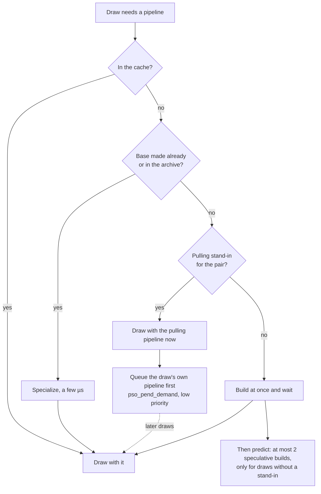

# Development

The README covers packing and playing. This page is for working on nxnative itself: how it is built, the script's options, running games on the Mac, and adding a game (per-game notes are in [dm/games](../dm/games/README.md#games)). Agent-oriented details (bring-up failure catalogue, graphics specifics, debugging recipes) are in [docs/agents](agents/README.md).

## How it works

| Part | State |
|---|---|
| Rewriter (`dm/tools/patch_nso.py`) | Runs unchanged on every module of every supported game. Per-build cuts are keyed by the module's build ID, in the profile's `patches.py` (a game's own modules) or `dm/tools/sdk_patches.py` (Nintendo's `sdk` modules). Profiles can opt verified cuts into [function matching](reference/rewriter.md#function-matched-cuts-for-unregistered-builds) across updates |
| Host (`dm/host`) | Stands in for the Horizon kernel and the system services the games call: threads and synchronization, memory, file system with transactional saves, HID, audio, movies (VP9 through libvpx, Vorbis sound through stb_vorbis), software keyboard, focus and lifecycle |
| Graphics (`dm/gfx`) | NVN on Metal. Shaders are extracted by `shader_split.py` from Nintendo's containers and from Unity's `Shader` objects, then translated offline. Mario: 16,266 of 16,268 shaders compile. Engage: 9,268 of 9,269. Games that render with Vulkan (Hades) or OpenGL (Digimon Story Cyber Sleuth) go through layers of their own on Metal (`dm/gfx/vk`, `dm/gfx/gl`) |
| Audio | Games that carry the SDK's audio renderer (Mario) run it in-process; games that use AudioOut directly (Engage: Wwise) feed it straight. Output goes through Core Audio (default on iOS, `DM_AUDIO=1` on the Mac) |
| Input | iOS: the touch gamepad (hidden while a physical controller is connected) and physical controllers; shaking the phone shakes the controller (its six-axis sensor, `hle_hid.c`; the accelerometer in `DmGamepad.m`, threshold `DM_SHAKE_G`, 1.5 G by default). Mac: scripted input (`DM_KEYS=<seconds>:<button>,…`, `Shake` for a shake, with `DM_KBD=<text>` answering the system keyboard; `DM_REC=<file>` records what the player does in that syntax, [05](agents/05-debugging.md#scripted-input-and-thread-scheduling)) or `DM_WINDOW=1` for a window with keyboard input (Space shakes) and physical controllers (face buttons by position as on the iPhone, a Nintendo pad by its labels: `pad_apple.h`). On the Mac and iOS each controller is a player of its own, for local co-op: the first one connected is player 1, together with the keyboard (iOS: the touch gamepad and the phone's gyro), the next player 2, and so on up to 8 (`pad_slots.h`); a controller that is removed frees its player and gets it back when it reconnects, and the log names each one's player and npad (`controller 'Xbox Wireless Controller' connected: player 2 (npad 1)`). Player 1 is the Handheld npad in handheld mode and No1 docked, player n is No n; the game's supported npad ids decide how many play (`hle_hid.c`): a one-player game gets every controller as player 1, and a controller past a game's last player is not used. `DM_PAD_MERGE=1` makes every controller player 1, as before (on iOS from `Documents/env.txt`); `DM_KBD_PLAYER=own` makes the keyboard player 1 on its own, with the controllers from player 2 on. The window goes fullscreen from its green button or ⌃⌘F; `DM_FULLSCREEN=1` starts it that way and `DM_SCREEN=<NSScreenNumber>` opens it on that screen instead of the one macOS picks. In fullscreen, a screen whose refresh rate is not a multiple of the game's (144 or 165 Hz) runs at one that is (120 Hz) until the window leaves fullscreen; `DM_SCREEN_MATCH=0` keeps its rate. The drawable follows the window in pixels (fullscreen at the screen's resolution); `DM_METAL_HUD=1` shows Apple's performance HUD (on the iPhone too, from `Documents/env.txt`). The left mouse button is the touchscreen, on the 16:9 picture. Motion: a controller with a gyroscope drives its player's six-axis sensor (`motion_apple.h` → `dm_motion_set`, `hle_hid.c`; orientation from the gyro with tilt correction toward gravity, `motion_fusion.h`), and on iOS the phone's own device motion drives player 1's while no controller supplies fresh motion (`DmGamepad.m`, in the Switch frame: the pad view's own frame on iOS 27 and later (`deviceMotionBody`), turned for the screen's orientation before that ([The phone's motion in the picture's frame](reference/services.md#the-phones-motion-in-the-pictures-frame)); `DM_PHONE_MOTION=0|1|auto`; `1` selects only the phone). On the Mac, a Switch Pro Controller whose GameController motion is empty can use passive HID reports instead (`motion_pro_mac.h`; `DM_MOTION_HID=0` turns this reader off). This requires exactly one Pro in each API so it can use the same player slot without guessing; multiple Pros retain GameController input. Raw HID has its own orientation and nominal sensor scales; hardware validation of the reworked reader remains open ([Pro Controller fallback](reference/services.md#switch-pro-controller-advertises-motion-but-sends-zeroes)). `DM_MOTION_AXES` / `DM_MOTION_ACC_SIGN` apply only to GameController. Each source keeps its own orientation. Without live motion the sensor lies flat as before. `DM_MOTION_LOG=1` logs player 1's mapped sample once a second per source; `DM_MOTION_AXES` (e.g. `x,-z,y`) and `DM_MOTION_ACC_SIGN=-1` remap a controller whose axes differ, `DM_MOTION_GAIN` sets the tilt correction (0.5), `DM_MOTION=0` turns motion off (the NSP script's `--no-motion` builds it in). The console's own sensor (`SevenSixAxisSensor`, read in handheld mode) still reports no states. In handheld mode the touches also drive `hid::GetGestureStates` (taps, presses, pans, swipes, pinches and rotations recognized by the host, `hle_touch.c`) |
| iOS app | One unsigned IPA for iPhone and iPad. The rewritten code is embedded in the executable; the shader libraries, the RomFS and the game icon are inside the app. A settings screen comes before the game (`Launcher.swift`, drawn from `dm/launcher.json`, which `dm/games/settings.py` writes from `dm/games/settings.tsv`); the host's loading starts at app launch meanwhile, and the frame rate and render scale go into the frame step state when the game starts (`loader.c` `dm_fps_state_apply`) |
| Known gaps | Conditional render is always drawn; `MultiDraw*IndirectCount` waits on the CPU for the GPU-written count; geometry shaders do not translate. TBDR optimizations are off by default (they don't understand bindless textures yet). No amiibo. On the Mac, Mario's menu and dialogue text render blank (fine on the iPhone) |

On the Mac, `DM_KEYMAP=<name>=<key code>,…` puts a button, a stick direction (the right stick too, on no key by default) or `Shake` on another key, and `DM_PAD_MAP=<name>=<name>,…` changes what a controller's buttons send (`A=B,B=A` swaps them; `input_map.h`).

## Cheats

How a Switch with Atmosphère runs cheats, and where this host differs, is in [Cheats on a Switch](reference/cheats.md).

Atmosphère-format cheat code files (`atmosphere/contents/<title ID>/cheats/<build ID>.txt` files that cheat sites share) apply to the running game (`dm/host/hle_cheats.c`): the file of the running build is chosen by the first 16 hex digits of the main NSO's build ID (FFCC 1.0.1: `DF154E1D08E39646`), from a folder holding either the flat `<build ID>.txt` layout, the Atmosphère tree under it, or both. The Mac window (`DM_WINDOW=1`) has a **Cheats** menu: each `[Name]` cheat is a checkmark row that toggles when clicked, a `{Name}` master code is always on and not toggleable, a cheat the VM cannot run shows its reason (`unsupported opcode FFF`) and stays off, and with no file of this build the menu lists `No cheats for build …` plus each other build's `.txt` in the folder as `another version of the game` (all disabled; `DM_CHEATS_ANY_BUILD=1` loads one, with a `[RED]` warning). The menu also reloads the file in place (**Reload cheats**, ⌘R) and opens the folder (creating it when missing). Which cheats are on is remembered per build in `<build ID>.enabled` (one name per line) in the folder, restored at the next launch. The menu's first item **Show Cheats Window** (⌘⇧C, or `DM_CHEATS_WINDOW=1` at launch) opens a **Cheats panel** (`dm/host/front_mac.m`, `DmCheatsPanel`), a floating utility panel beside the game. A click never takes the key window from the game, so the game keeps keyboard and controllers; the panel takes the keyboard only while the player types in its search field or a value field: Return gives it back with the value applied, Escape gives it back with the typed value abandoned, and a click anywhere else in the panel never keeps it. It shows:
- a header with the build and its version ("1.0.3 (build E1D8…): 18 cheats, 5 on", or "No cheats for …"), and a line with **Restore** in safe mode;
- **Cheats On** (the master switch), **Select All** / **Deselect All** (plain cheats only: never masters, disabled cheats, "set" cheats or the off half of a pair; both off while Cheats On is off) and a search field that filters by name and section;
- the rows: section headers, labels, one row per cheat (an on / off pair is one row without its " - on"; a "set" cheat has an **Apply** button; an "ask" cheat a value field; ⓘ shows the cheat's dry run and note below the rows), then the cheats the compiler left out, the other builds' files with their versions, and, with no file of this build, the anchored sources with a **Copy Command** for compiling them;
- **Reload**, **Open Folder**, **Find Cheats…** (this game's files in Ryujinx's mods tree, the yuzu family's load trees and SD cards' Atmosphère trees, this build's first) and **Report** (the load report).

A `.txt` or `.cheats.toml` dropped on the panel (from a Finder window in the background: the panel hides while another app is in front), or picked in Find Cheats…, is copied into the cheats folder and the file reloaded: a build-ID name keeps its name, any other `.txt` (also one named after the title ID) becomes this build's after the player confirms, and a file already there is kept as `.bak` (replacing an older `.bak`). Find Cheats… lists only files named after a build ID, so Ryujinx's `enabled.txt` stays out. The menu shows the same rows in short, with Cheats On and, in safe mode, Restore Saved Cheats. Every click, a menu toggle and a ~1 s timer while the panel is visible refresh it. Closing the panel only hides it; its place and size are remembered. The enabled cheats run once per presented frame and at ~60 Hz from a host thread whenever the game is not presenting: one pass reads the keys once, then runs the masters, then the enabled cheats in file order, with the registers and the saved values reset once per pass and shared between the cheats, as dmnt's one concatenated program has them (a pointer chain compiled by `cheat_anchor.py` zeroes its register 15 behind itself for that reason); each cheat is still its own program, with its condition depth and loop tops (word indexes into its own words) starting fresh, so an unclosed block in one cannot swallow the next cheat's words, and a loop end without its start jumps to the first word of its own cheat, never into another cheat's. A failed conditional block is skipped like the reference's. An access to memory that is not mapped (a pointer the game has not set yet, at start-up or on a loading screen) is ignored as on a Switch: a load leaves the register as it was, a conditional compares against 0, a store writes nothing, and the cheat stays on and retries next pass; the first failure of a cheat logs one `[RED]` line, every one is counted, and the row shows ` (no effect: N accesses out of mapped memory)` while the cheat's latest pass had one (the note goes on the first pass without). A run of hex digits is cut into 8-digit words wherever whitespace falls, as dmnt reads it (`0400000000123456` is two words). A line that mixes code words with a token that is not one, or holds hex digits that are not whole words (`0400000`, `dead beef`), turns its cheat off (`malformed line N`): a silently dropped word could be a begin or an end whose absence leaves a body running every frame. A cheat that names the heap before the game's first `SetHeapSize` waits (logged once): it runs as soon as the game opens its heap. Writes into main's code pages go through a writable alias of the whole image (`mach_vm_remap`, same physical pages) mapped when a cheat file is picked: the game's own mapping never changes protection, so a running core cannot fetch a page mid-toggle (RWX is denied on Apple Silicon, and toggling the original page race-faults fetches, found on FFCC), and a run without a cheat file never maps one. If the alias fails to map the writes fall back to the per-page mprotect toggle with a `[RED]`, and every code-page write is passed through `sys_icache_invalidate`.

Switches:

- `DM_CHEATS=<folder>`: cheats folder. Default `<DM_ROOT>/cheats` (the game's work folder). A flat folder and the Atmosphère tree both work.
- `DM_CHEATS_ANY_BUILD=1`: with no file of this build, load the folder's single `.txt` of another build with a `[RED]` warning that addresses may be wrong.
- `DM_CHEATS_ON=<name>,…`: cheats turned on by name at launch (case-insensitive; the `<build ID>.enabled` states still apply).
- `DM_CHEATS_DEBUG=1`: log every write the cheats make (cheat name, bytes, value, guest address), and with no file of this build the other-build `.txt` list.
- `DM_CHEATS_WINDOW=1`: open the Cheats panel at launch.

Implemented opcodes, all with the reference's word order and block-skipping (`dmnt_cheat_vm.cpp`):
- 0 store static, 1 (the six memory comparisons), 2 end/else, 3 loop, 4/5 load register (a load narrower than 8 bytes keeps the register's upper bytes, as dmnt's does), 6 store static to a register address, 7 legacy arithmetic, 8 key-press conditional (a 28-bit mask of keys held on any controller: button bits 0–15, stick directions 16–23; the Joy-Cons' SL / SR on 24–27 are never held here, no input source reports them), 9 register arithmetic (add, sub, mul, shl, shr, and, or, not, xor, move, and float add / sub / mul / div at width 4 or 8, with a register or an immediate operand; the result truncated to the width, an unknown math type storing 0, a shift count taken modulo 64 as the Switch's own core does where dmnt's C++ leaves it undefined);
- A, store register, with its six offset types and the increment;
- C0, register conditional, against memory, a static value or another register;
- C1 / C2, save and restore of registers (one by index, or by a 16-bit mask; save, restore, clear the saved value, clear the register): the 16 saved values reset once per pass like the registers and are shared by the cheats of the pass the same way;
- C3, static registers: a cheat reads 0x00–0x7F and writes 0x80–0xFF; they persist across passes and are cleared when a file is loaded. On a Switch an overlay tool fills the readable ones; nothing does here yet, so a cheat reads 0;
- C4, extended key-press conditional (a 64-bit mask; bits above 23 are never held here): with auto-repeat as 8, without it met only on the pass where the mask became fully held, against one previous-keys value shared by every C4 of the pass and set at the end of each pass that ran a VM cheat (a pass of only never-decrease cheats leaves it), as dmnt's static is (a dry run never changes it).

The others (pause/resume, the debug log) mark the whole cheat `(unsupported opcode N)`, shown disabled in the menu and never run; so does an instruction whose last words are missing (`truncated`), where dmnt would run the whole words and end the pass. An else at depth 0 turns its cheat off (dmnt aborts there); an end at depth 0 is a no-op; a loop that never ends (a counter of 0) is stopped by a step cap and turns its cheat off, where dmnt's VM thread stays blocked. The memory-type nybble selects dmnt's regions from the host's own layout: 0 main NSO, 1 heap (a cheat that names it before the game's first `SetHeapSize` waits, logged once), 2 alias (virtual address memory), 3 aslr (the whole guest block), 4 absolute, 5–F main. What an access reaches is the kernel's rule as on a Switch, restricted to the game's own memory: a read any page of the guest block or of a module (a stack, the alias region, another NSO or NRO), a write main (through its alias), the opened heap, another module's data and bss, or any other mapped guest page, never another module's code or read-only data nor the host's key page. Pages the game maps and unmaps while a pass runs (stacks, the alias region) are copied through the kernel (`vm_read_overwrite`, `vm_write`), which fail instead of faulting on a page gone in between; the heap goes through `hle_svc.c`'s map lock as before. The state files (`<build ID>.enabled`, the safe-mode flag) are written by a serial dispatch queue, never on the presenting thread, in the order they were asked.

On top of the format (`hle_cheats.c`; the `dm_cheat*` calls of `dm.h` give them to a front end, the Mac panel above):
- **Labels and sections.** An entry without code words is a label, not a broken cheat: a credits line, or EdiZon's `[--SectionStart:Name--]` / `[--SectionEnd:Name--]`, whose entries in between carry that section. A header glued to the previous code word (`00000008[Next]`, found in a cheat-site file) still starts its own entry. Code words on the header's own line belong to the entry, as in dmnt. An entry whose lines were all dropped as prose is broken (`no code words`), not a label.
- **On / off pairs.** "X - on" / "X - off" entries (also "X on", "X (off)", …, or a pair the meta file names) are one switch. Turning the on half on turns the off half off. Turning it off runs the off half, the restore, for one pass. A saved state is kept as it is.
- **Duplicate names.** `<build ID>.enabled` saves the second entry of a name as `Name #2`, and so on. A plain name, as older files have it, turns on the next entry of that name that is still off. One-pass cheats ("set", a pending restore) are never saved as on.
- **The meta file.** `<build ID>.meta.tsv` beside the file ([Cheats that survive game updates](#cheats-that-survive-game-updates)) adds per entry:
  - its section, note and type, and its on / off pair;
  - a typed value the panel may set ("ask", within its bounds, written into the program words the meta file names and kept in `<build ID>.values`);
  - "set" cheats that run one pass and turn themselves off;
  - never-decrease: a host action on a typed address that puts back the highest value seen since it was turned on (signed and float types compare as such). Atmosphère's VM keeps no state of a cheat between passes, so the `.txt` holds an empty entry that other engines show as a label.

  The meta file also gives the display versions and lists the cheats the compiler left out, with their reasons.
- **Toggles of a new build.** A compiled file (one with a meta file) of a build without `<build ID>.enabled` takes its toggles, by name, from the newest other build's `<build ID>.enabled` whose meta file names the same source.
- **Dry run.** `dm_cheat_preview` lists what a cheat would write right now (`main+0x5607AAE (2 bytes): 37 -> 999`), or why nothing (a condition not met, a patch whose code is not the original any more, an access that fails). It replays the cheats a pass runs before it, so its registers are a real pass's; it writes nothing and changes no state.
- **Master switch.** A `.cheats-off-<title ID>` file in the folder stops every cheat of that game, masters included, without touching the toggles.
- **Safe mode** (Mac only: an iOS app usually ends killed). While some cheat runs, the folder holds `.cheats-running-<title ID>`; a clean exit (`exit`, or `dm_host_exit` before its `_exit`) removes it. A launch that finds it starts with every cheat off, masters too, with a `[RED]` line. The saved toggles are kept, and come back when the player restores them or turns a cheat on.
- **Load report.** `dm_cheats_report` gives the counts, duplicate names, ignored or split lines, carried-over toggles, safe mode, the master switch, left-out cheats, and Atmosphère's limits (0x80 cheats, 0x100 words per cheat, 0x400 enabled words: a Switch refuses past them, this host does not).

`dm/host/tests/t_cheats.c` covers the opcodes and this layer on a synthetic image.

### Cheats that survive game updates

`scripts/cheat_anchor.py` carries cheats from one build of a game to another. An Atmosphère file names fixed offsets of one build. The script first converts such a file into a version-independent source, `<game>.cheats.toml`, where each address is described by the game's own code. Then it compiles that source into the plain `<build ID>.txt` of any build. It needs only the build's `ExeFS/main`, which the NSP script extracts to `<title ID>_build/extract/v<version>/ExeFS/`. The compiled file is ordinary Atmosphère text: this host, a Switch, Ryujinx and yuzu forks all run it.

```
python3 scripts/cheat_anchor.py import E1D8B399B787AE41.txt --nso <build folder>/extract/v196608/ExeFS/main -o FFCC.cheats.toml
python3 scripts/cheat_anchor.py compile FFCC.cheats.toml --nso <another build's ExeFS/main> -o <cheats folder>
python3 scripts/cheat_anchor.py check FFCC.cheats.toml --nso <ExeFS/main>    # the report only
```

- **Anchors** (written by `import`, kept at the end of the source):
  - *data*: the nearest address at or below the target that the code references, plus a field offset. The nearest keeps the offset from crossing into an unrelated variable. The anchor stores up to four adrp + add / ldr / str pairs that compute it, in functions identified as below. With `deref = true` the pairs compute `.data` slots, and the anchor is the target of their relative relocations (RELA or RELR; FFCC's stats live in the object behind such a slot). At least two references must agree on the address (one when there is only one) and none may disagree. An anchor with a single reference is reported as weak, and so is one whose agreeing references were found only among identical copies by order.
    - The anchor lies in the target's own segment (`.rodata`, `.data` or `.bss`, from the NSO header). An object never spans two segments, and an update moves them apart: a `.rodata` base for a `.data` target would land wrong once `.rodata` grows. `compile` also refuses an anchor whose field offset crosses into another segment.
  - *code*: the words one cheat writes in one contiguous run (they move together), with their original words.
  - *cave*: the zero padding between the end of the text and the read-only data, kept at the same distance before the read-only data. ASM cheats put their own code there.
- **Finding a function:**
  1. a unique function with the same length and fingerprint (its body and its direct callees): the test of the rewriter's [function-matched cuts](reference/rewriter.md#function-matched-cuts-for-unregistered-builds) (`dm/tools/nso_match.py`);
  2. this tool's first fallback: a unique function with the same body digest alone (a callee changed);
  3. its second fallback: a window of 9 to 33 relocation-masked instructions around the site that occurs once in the whole text.

  The first way that finds a candidate decides. No approximate similarity is used. A code site's original words must match at the new place, raw or, when only relocation bits moved, masked. A relocated word may be overwritten only by:
  - its restore, which writes this build's own word;
  - a branch token;
  - a word with no address bits: NOP and other hints, MOVZ / MOVN / MOVK, register-only data processing, RET, FMOV register / immediate (`carries_address_bits`). Any other word would keep the old build's address bits, so it is refused.

  The same rule holds for patches and for stores inside `code` programs, gated or not. Some more rules apply to every write into the code:
  - Each write is checked by the whole word it leaves, 1- and 2-byte writes included.
  - A new word that takes the page of an adrp up to 8 instructions before it (an add / ldr / str on the adrp's register) is bound to its build. Its low page bits hold only there, because the data can move inside its page while the code does not.
  - Only opcode 0 literals carry values into the code. A register store (opcode A) into the code, or a store offset by a register the cheat sets (r0 included: the VM always adds it), stays bound to its build.
  - An opcode 1 compare with a moved word's authored original compares with this build's word, so an "if still original" gate still opens.

  Identical copies of a function are taken in address order. The copy is confirmed when the window finds the same one, refused when the window points to another, and otherwise reported as weak (`by order: weak`). Data references are checked by decoding the adrp pair at the found place.
- **Cheats** in the source, in file order:
  - `target` + `type` (u8…u64, s8…s64, f32, f64) + `action` + `value`, where the action is one of:
    - `freeze`: written on every pass;
    - `set`: the meta file marks it to be applied once;
    - `min` / `max`: an opcode 1 comparison, which is unsigned, so only unsigned types;
    - `never-decrease`: nxnative's host only. It puts back the highest value seen (static targets; the `.txt` gets an empty entry, the meta file the type and the `address`).

    `value = "ask"` with `min`, `max` and `default` marks the value for the panel to ask for. A target can be a pointer chain, `[anchor+0x8]+0x38` (freeze and set only). The chain uses register 15 and zeroes it afterwards, because dmnt runs all enabled cheats as one program. `import` turns a single store into data into this form.
  - `patch`: stores into the code and the cave.
    - Each word is guarded with "if it still holds this build's original" (`--plain` drops the guards, for build-time baking). The optional off entry puts the originals back.
    - A B / BL to outside the run it is written in is a token (`bl:cave+0x10`), re-encoded per build.
    - A B.cond / CBZ / CBNZ / TBZ / TBNZ (the "flip b.ne to b.eq" cheat) whose target lies in the site's own function stays as written. `compile` writes it only when that function was found by fingerprint or body digest, which implies the same layout; a window match is refused. Any other PC-relative word aimed outside the cheat's own words is refused.
    - The NSP script puts the rewriter's output of the build at `<title ID>_build/patched_v<version>/main.patched.bin`. When it is there, a word the rewriter changed is reported: the guard leaves such a word alone. A patch that changes other words as well is skipped whole, because the guards would apply a partial hook (`--plain` writes all of them).
    - `import` merges an "X - on" / "X - off" pair whose off entry restores exactly the on entry's code sites. Both names, their order and their master flags stay (`master`, `off_master`), so saved toggles stay valid.
  - `code`: any other program, kept word for word with `{anchor+offset}` tokens in place of its main-relative addresses.
  - `label`: an empty entry (a credits line). `section` puts EdiZon's `[--SectionStart:Name--]` / `[--SectionEnd:Name--]` entries around a run of cheats.
  - Addresses that cannot be anchored, such as heap or alias addresses or a store into the code indexed by a register, keep their words. They come with `builds = [...]` and compile only for those builds. A program the decoder cannot read is kept the same way and written word for word on those builds.
  - Words glued together (`0400000000123456`) are split into 8-digit words, as Atmosphère reads them. A line with no code word is prose (a credits or author line) and is ignored with a warning, as the host ignores it; a token of hex digits only counts as a cut code word. Any other token on a code line makes the cheat malformed: it keeps the token, is bound to its build, is listed with its line, and never compiles. Dropping the token instead could lose an end-of-block word and let an open conditional swallow the next cheats.
- **Outputs:**
  - `compile` writes `<build ID>.txt` and `<build ID>.meta.tsv`. The meta file has one row per entry: kind, section, type, action, value, ask bounds, the program words that hold the value, on/off pair, how each anchor was resolved, and the reason a cheat was skipped. Its header names the source and the builds' display versions.
  - Only an unchanged `.txt` that this source compiled is rewritten. The meta file records the `.txt`'s SHA-256 and the source's name. A hand-made, edited or other source's `.txt` is kept: the output goes to `<build ID>.txt.new`, or with `--replace` the old file is kept as `.orig`.
  - Skipped cheats are left out of the `.txt` with a `[RED]` line in the report. Weak resolutions are listed, and so is a cheat over Atmosphère's 0x100 words, which a Switch refuses (the guards make patches longer).
  - Exit status: 0 everything resolved, 2 some cheats skipped (or, for `import`, kept bound to one build), 1 an error.
  - `import` refuses a file named after another build unless `--assume-build`; its unanchored cheats then stay bound to the file's own build. A file named after the game's title ID names no build, so it is taken as written for the NSO's build. `import` also counts the writes into the code that put back the word already there (restore entries): evidence that the file belongs to the NSO's build.
- **Not yet:** `min` / `max` and never-decrease through pointer chains, anchors by IL2CPP names. Validation on FFCC and 13 Sentinels: [Cheats carried across game updates](reference/rewriter.md#cheats-carried-across-game-updates).

## Guest memory SVCs

`dm/host/hle_svc.c` serializes heap resizing, physical map/unmap, stack
map/unmap and memory queries with one memory-state lock. The alias bitmap is
the source of committed/free runs for `QueryMemory` and of committed-byte
accounting. With `mem_map_limit`, heap growth and physical maps check the same
application-pool budget; overlapping maps charge only newly committed pages.
Unexpected host protection failures abort before publishing state, including
the `SetHeapSize` fail-fast check from PR #127.

`MapMemory` borrows opened heap memory, committed alias memory or writable
static-module data until an exact unmap copies it back. Another borrow,
decommit, heap shrink or permission/attribute request cannot invalidate that
source. Queries report its original state with borrowed attribute bit 0 and
no user permissions. The implementation still copies bytes: source permissions
are logical, and native host pages cannot isolate adjacent 4 KiB slices.
Dynamic NRO backing is rejected because reload can restore it outside this
ownership lifetime. Host-created guest threads allocate their stack backing
through SDK malloc and free it after SDK thread destruction/copyback. Physical
recommit may overlap a borrowed source: SDK allocators extend committed windows
this way, and existing committed bytes are preserved.

A host-page exposure bitmap preserves lazy zero-fill on first commitment.
Later commits clear only newly committed logical slices, preserving live
neighbors on a 16 KiB host page. GPU dirty tracking is notified when a mapping
opens a host page and before stack copyback. The SDK retains address-region
reservation ownership and its existing build patches.

`make -C dm/host/tests GAME=<id> run` includes the production-dispatcher memory
tests, real GPU dirty-tracker integration and heap-probe log compatibility.
The focused targets are `heap_size`, `memory`, `memory-dirty`, `memory-profile`
and `memory-tsan`; `memory` includes undefined-behavior and address sanitizers.
The heap-probe check imports the production profile reader and needs only the
Python standard library; LZ4 is loaded when decoding NSO files.

## Continuous integration

`.github/workflows/tests.yml` runs host and CPU graphics tests, Python tool
tests, Mac builds for NVN/Vulkan/OpenGL profiles, and iOS source compilation.
It also runs the CPU texture layout/deswizzle test (`dm/gfx/tex/tests/t_tex`)
and the host's `tsan` and `memory-tsan` targets for audio and memory races.
The texture format test (`t_fmt_mtl`) creates Metal textures and stays local.
All five macOS jobs, including the sanitizer job, run with the toolchain the
project supports: Xcode 27.1 on GitHub's `xcode-27` image, named by path in
`DEVELOPER_DIR` so a new default Xcode on the image does not change CI. The
build check first compares the image's Metal compiler with `dmsh_chain.lock`
(`own_compilers.py --check-metal`), and `dm/tools/tests/test_ci_toolchain.py`
keeps the workflow, the image, README and the NSP script naming the same
Xcode: raising the toolchain changes them together.

A separate `sanitizers` job builds the same tests again with sanitizers, each
build in a folder of its own (`build/asan`, `build/tsan`, `asan/`): every host
unit test and the CPU texture test under AddressSanitizer and
UndefinedBehaviorSanitizer (`asan`), and the host tests that start threads under
ThreadSanitizer (`tsan-threads`). Documented exceptions live in
`dm/sanitizers/`: ASan and UBSan in `ignorelist.txt` (compile time), TSan in
`tsan.supp` (run time). These cover custom HLE sections, synthetic NRO offsets,
an intentionally unjoined test and uninstrumented CoreAudio synchronization.
The job fails on other findings. The initial header-alignment, AudioUnit
publication and thread-registration bugs were fixed and their suppressions
removed ([audio](reference/audio.md#unaligned-command-headers-during-layout-probing),
[AudioUnit publication](reference/audio.md#audiounit-construction-before-output-publication),
[thread registration](reference/threads.md#publishing-a-new-threads-scheduler-fields)). To run it
locally (about a minute on an Apple-silicon Mac):

```sh
make -C dm/host/tests GAME=010015100B514000 -j8 asan tsan-threads
make -C dm/gfx/tex/tests asan
```

A new finding is fixed, not listed, unless its cause lies outside the code under
test (an uninstrumented system framework, a test fixture); then it gets an entry
with its reason. A fix removes any existing entry in the same change: the job
then checks the repaired code. A change to `ignorelist.txt` rebuilds the ASan tests.

A separate iOS job uses XcodeGen and the production project template to compile
`Launcher.swift`, link the complete app and stage synthetic resources. It uses
tiny zero-filled embedded modules, needs no game files or keys, and neither
signs nor installs the app. This checks build integration, not game execution.
To reproduce it with Xcode and XcodeGen installed, choose a new scratch folder:

```sh
GAME=010015100B514000 python3 dm/ios/tools/build_smoke.py --output /path/to/scratch/ios-smoke
```

Generated projects and Xcode build products stay in that folder; the host profile
header is generated under `dm/host/gen/` as usual. CI uploads failure logs.
GPU regression tests still run locally with `make -C dm/gfx/tests GAME=<id> run`.

`.github/workflows/lint-python.yml` lints `scripts/` and the Python tools under
`dm/` with ruff (rules for bugs, never reformatting) and type-checks them with
pyright in basic mode (`pyproject.toml`). It is a ratchet: today's findings are
in `dm/tools/lint_python_baseline.tsv`, so it fails only on a new finding, or on
a fixed one still listed there. Astral's ty, a faster type checker, can replace
pyright once it is stable. With the pinned tools in a new venv:

```sh
python3 -m venv /path/to/lint-venv && /path/to/lint-venv/bin/pip install -r .github/requirements/lint.txt
/path/to/lint-venv/bin/python3 dm/tools/lint_python.py            # the check CI runs
/path/to/lint-venv/bin/python3 dm/tools/lint_python.py --update   # after fixing findings: shrink the baseline
```

The baseline never gains entries: fix a new finding, or silence it on its line
(`# noqa: <rule>`, `# pyright: ignore[<rule>]`) with a reason. Only a raised tool
version in `.github/requirements/lint.txt` rewrites it (`--rebaseline`). On pull
requests, only the checker whose pinned release version increased may gain
baseline entries or counts. Comments, dependency updates and checker downgrades
do not allow growth.

`scripts/bug_report.py` (`-h`) collects the logs, versions and settings a bug report needs into one zip ([CONTRIBUTING.md](../CONTRIBUTING.md#reporting-a-problem)); it reads an allow-list of text files only.
For a Mac app, it reads the name, title ID and game version from `Info.plist`, lists the chain folders in `Contents/Resources/msl`, and includes both the player's and the bundle's `env.txt`. Recorded `DMCommit` and `DMChain` values take precedence; `dm/mac/pack_app.py` and `dm/ios/tools/build_ipa.sh` write them (the packing checkout's short hash, `+dirty` with uncommitted changes to tracked files, and the chain of the libraries the app carries), and the host logs them at start (`build: commit …, shader chain …, profile …`). An app without a commit stamp (packed before these keys) reports its commit as unknown. The collector's checkout and chain are labeled separately. An NSP build lists available chain folders under `shader/cache` (Mac), `shader/ios` (iOS) and `shader`; old cached folders do not identify the chain that ran. The 4 MB file limit and 20 MB bundle limit include `report.md` and truncation markers; space for the report is reserved before logs are collected. Explicit `.keys` inputs are refused.

`scripts/clean_metal_cache.py` (`-h`, `--dry-run`) frees the internal disk of the build folders Metal's pipeline archive compiler leaves in `getconf DARWIN_USER_CACHE_DIR`/`com.apple.gpuarchiver`, up to about 127 MB for each archive flush of a Mac run, which the host cannot remove itself ([Metal's build folders left by pipeline archive flushes](reference/shaders.md#metals-build-folders-left-by-pipeline-archive-flushes)). It removes only folders idle for an hour and older than every running `dmhost`; `scripts/regress.py` runs it too.

`.github/workflows/fuzz.yml` fuzzes the Python parsers of files a player
supplies, nightly and by hand (never on pull requests): the RomFS image reader
(`romfs.py`), the control data (`nacp.py`), the NSO loader, the shader
containers of `shader_split.py` (BNSH, BAHS, MSHD, SARC / Yaz0, GLSLC, SDF,
ARH1 and the others `scan_blob` recognizes) and the Unreal paks and shader
archives of `uepak.py`. Each harness, `dm/tools/fuzz/fuzz_<parser>.py`, builds
its seeds in code and mutates them for 60 s; nothing comes from a game. A
finding is an exception other than the parser's declared rejection (each
harness's docstring says which), a hang or an oversized allocation. Its input
goes into `dm/tools/fuzz/corpus/<parser>/`, and `dm/tools/tests/test_fuzz_corpus.py`
replays the corpus with the tool tests on every pull request; an open finding
has a row in `dm/tools/fuzz/known.tsv` (its signature, its issue) and replays as
an expected failure until the parser is fixed, when the row comes out. Locally,
`python3 dm/tools/fuzz/fuzz_romfs.py --time 300` runs a harness: with atheris
(`.github/requirements/fuzz.txt`) coverage-guided, without it on a blind random
engine. atheris has no macOS wheel; it builds from source with an LLVM that
ships libFuzzer (Apple's Clang does not):

```sh
python3 -m venv /path/to/fuzz-venv && /path/to/fuzz-venv/bin/pip install lz4
SDKROOT=$(xcrun --show-sdk-path) CLANG_BIN=/path/to/llvm/bin/clang CC=/path/to/llvm/bin/clang CXX=/path/to/llvm/bin/clang++ \
  /path/to/fuzz-venv/bin/pip install 'git+https://github.com/google/atheris@e36da74cf42b5834c4e31d7cabb58d796695d29f'   # 3.1.0 (Python 3.14 support) has no source release on PyPI
/path/to/fuzz-venv/bin/python dm/tools/fuzz/fuzz_shader_split.py --time 300 --findings /path/to/scratch/findings
```

## The packing script in detail

`scripts/build_ipa_from_nsp.py` (`-h` lists every option):

```
# written to the Desktop with your own home-screen name
python3 scripts/build_ipa_from_nsp.py ~/Games/MarioWonder -k ~/keys/prod.keys -o ~/Desktop/Mario.ipa --app-name "Mario Wonder"

# pack Mario 1.0.0 instead of 1.2.1 (the folder still needs both NSPs: the shader tables cover both versions)
python3 scripts/build_ipa_from_nsp.py ~/Games/MarioWonder -k ~/keys/prod.keys -p v0

# delete the extracted game files after the IPA is built (they are kept by default, to skip extraction next time and to run the game on the Mac)
python3 scripts/build_ipa_from_nsp.py ~/Games/MarioWonder -k ~/keys/prod.keys --no-keep-extracted

# play the game in Japanese (a code or a name: ja, fr, de, es, zh-Hans, zh-Hant, ko, en-GB, ..., Japanese; English by default)
python3 scripts/build_ipa_from_nsp.py ~/Games/MarioWonder -k ~/keys/prod.keys -l ja

# show the game's frame rate on the iPhone (frames on screen per second, top left)
python3 scripts/build_ipa_from_nsp.py ~/Games/MarioWonder -k ~/keys/prod.keys --show-fps

# no motion controls, for when they misbehave: DM_MOTION=0 is built in (with --env-file's switches; also for --platform mac and mac-app); on the iPhone, DM_MOTION=1 in Documents/env.txt turns it back on
python3 scripts/build_ipa_from_nsp.py ~/Games/BreathOfTheWild -k ~/keys/prod.keys --no-motion

# a diagnostic build with environment switches baked in (one KEY=VALUE per line)
python3 scripts/build_ipa_from_nsp.py ~/Games/MarioWonder -k ~/keys/prod.keys --env-file diag_env.txt

# a damaged NSP (files failing the NCA's hash check) stops the build after listing them; this packs those files as read
python3 scripts/build_ipa_from_nsp.py ~/Games/MarioGalaxy -k ~/keys/prod.keys --allow-damaged

# a game without a profile: survey, provisional profile (a heap check on the Mac when the game needs one), best-effort IPA
python3 scripts/build_ipa_from_nsp.py ~/Games/NewGame -k ~/keys/prod.keys

# test the guesses on a game that has a profile: build from a provisional one (the IPA is named <ipa>-provisional.ipa)
python3 scripts/build_ipa_from_nsp.py ~/Games/MarioGalaxy -k ~/keys/prod.keys --provisional --allow-damaged

# the pipeline archive for another GPU too, beside the A19 / A19 Pro (applegpu_g18p) that a game whose profile sets pso_mtl4 on gets by default; --gpu none leaves it out
python3 scripts/build_ipa_from_nsp.py ~/Games/BreathOfTheWild -k ~/keys/prod.keys --gpu g18p,g17p

# development: build only what running the game on this Mac needs (no iOS shaders, Xcode project or IPA) and print the command that runs it
python3 scripts/build_ipa_from_nsp.py ~/Games/MarioWonder -k ~/keys/prod.keys --platform mac

# the same, then a double-clickable Mac app of the game in the NSP folder (<game name>.app), signed with your Developer ID instead of ad-hoc
python3 scripts/build_ipa_from_nsp.py ~/Games/MarioWonder -k ~/keys/prod.keys --platform mac-app --mac-sign "Developer ID Application: <name> (<team ID>)"
```

`--platform` takes `ios` (the default: the IPA, or the Xcode project with `--prepare-xcode`), `mac` ([A Mac-only build for development](#a-mac-only-build-for-development)) and `mac-app` ([A Mac app](#a-mac-app)).

In Spyder, open the script, fill in the settings at the top (`NSP_DIR`, `PROD_KEYS`, and optionally `PACKAGE`, `OUT_IPA`, `APP_NAME`, `BUNDLE_ID`, `LANGUAGE`, `KEEP_EXTRACTED`, `SHOW_FPS`, `MOTION`, `PSO_GPUS`, `PLATFORM`; for a game without a profile `HEAP_CHECK`, `HEAP_CHECK_SECS`, `PROVISIONAL`), and press F5. Empty paths are asked for at run time.

What the script does:
0. Before it extracts anything it checks the environment (`check_prereqs`, `check_native_python`): the Python modules and tools (glslang too, which an OpenGL game needs), the iOS SDK for an iPhone build (a separate download in Xcode's Components), the Metal compiler, and the shader translator, which it starts once with `--source-sha`, so a translator that finds no .NET 10 runtime of its architecture (an Intel .NET on Apple silicon, a `DOTNET_ROOT` that names one) stops it here, not as an empty `xlate_source` at the shader step. A Python under Rosetta (an Intel Homebrew's) stops it too: the universal translator it starts runs as Intel code and finds no Intel .NET.
1. It finds the game profile from the title ID (the NSP's ticket, else the `[title ID]` in the file name, else the package's own meta NCA, read with the keys through `nx_extract --title`; the update by its `[vN]` tag). The update is optional: it packs the newest version in the folder (`-p` / `PACKAGE` picks another).
2. It extracts ExeFS and streams the merged, integrity-checked RomFS directly into `<id>_build/extract/<version>/RomFS.img`. No RomFS folder or individual resource files are written. Shader scanners, profile discovery and NRO collection read bounded file ranges from that image through `dm/tools/romfs.py`; archive readers map only the archive's range. This requires Python 3.12 or newer. An old folder extraction is replaced atomically after the new extraction succeeds. Each DLC similarly becomes `aoc/<index>.img`.
3. It rewrites the code modules, checking each build ID against the profile. A version the profile does not register (the base game alone when the profile was brought up on an update, another update, or files whose build IDs differ), or one whose shader tables need a version that is not in the folder, is built from a profile derived from it in `<id>_build/profile/<id>/`: the profile's keys, that version's build row, and shader tables, chain header, `c1_full.tsv` and `cb_extent.tsv` made from that version's own files (as for a provisional profile, without the heap check; with the address region check below). The rewriter's cuts and the host's fixes for a registered build do not reach a module of another build; the script says which modules those are. A title ID no profile has is first looked up by build: when its `main` (of the base game with its newest update, else of the base game alone, read from a code-only extraction) is a build a profile registers, a regional release of the same build (Advance Wars 1+2: Re-Boot Camp under `0100300012FFF000`, issue #114), it packs from a profile derived from that one, with the folder's title ID and `main.npdm`'s program ID (`same_build`, `game.py` `by_build`); only otherwise is it surveyed. A provisional profile (a game without one in `dm/games`) then gets `mem_used` from the rewritten modules, and, when the game has virtual address memory and sets a heap, a heap check: the Mac host is built into `<id>_build/tools/dmhost` and the game boots in it until its first heap request (a few seconds, log `<id>_build/logs/heap_check.log`), which sizes the heap region (see [dm/games/README.md](../dm/games/README.md), Adding a game). For a game with virtual address memory, with a provisional or a derived profile, a second boot, the address region check, runs with a Switch-sized alias region for 15 s into `nnMain` (log `<id>_build/logs/region_check.log`, table `regions.tsv`) and reports the address regions the game takes, who asks for each and where they reach against the profile's alias region, in red when past it; when the regions made after a `StandardAllocator` region need more room than the host's cap leaves them, it sets `stdalloc_cap` in the profile ([memory.md, Measuring address regions and commits](reference/memory.md#measuring-address-regions-and-commits)).
4. For a game whose `main` holds GLSL sources and calls `glslcCompile` (Three Houses), it captures the shaders the game compiles at run time, which no game file holds. It builds the Mac host into `<id>_build/tools/dmhost` and boots the game in it, headless and silent, with `DM_GLSLC_CAPTURE` pointing at `<id>_build/extract/<version>/glslc_capture`. The save, temporary storage and log all stay in `<id>_build/`. It stops the game as soon as every capture file named in the profile's shader map is there (Three Houses: 9, about a second after launch), and gives up after 30 s. A folder that already holds them all is reused.
   A Vulkan game without SPIR-V files in its RomFS (Super Mario Galaxy) gets the same kind of run: the game boots in the Mac host with `DM_VK_CAPTURE` pointing at `<id>_build/extract/<version>/vk_capture` until every SPIR-V key in the profile's `vk_capture.tsv` is there (Galaxy: 3,089, about 7 s after launch), and gives up after 120 s.
   So does an OpenGL game with no GLSL source in its RomFS or `main` (Balatro: LÖVE puts its shaders together at run time, in Lua): `DM_GL_CAPTURE` at `<id>_build/extract/<version>/gl_capture` until every file in the profile's `gl_capture.tsv` is there (Balatro: 35, made before its first frame). Without the profile's tables (a provisional profile) a capture stops once nothing has been added for 20 s.
   The Vulkan and GL captures also run on a Mac whose GPU has no Metal 4, such as a virtual Mac (GitHub's `macos-26` runner). Those two layers draw on classic Metal queues of their own, so there the NVN layer starts only its classic part and drops every present, which a headless capture does not need (`nvn_mtl.m` `mtl_device_classic`; `DM_TEST_NO_METAL4=1` does the same on any Mac). The GLSLC capture boots an NVN game, which needs Metal 4.
5. It splits out the shaders from the game and every extracted DLC RomFS and checks them against the profile's tables (a Vulkan profile: it translates the RomFS's SPIR-V and the capture with `vk_shaders.py` instead; an OpenGL one: the GLSL sources and the capture with `gl_shaders.py`). Optional DLC that changes only the NVN shader union gets new tables in an external profile after the non-DLC shaders and facts have matched; registered module builds and fixes stay in use.
6. It builds the iOS shader libraries with the in-repo SPIRV-Cross (`dm/gfx/tools/spirv_cross_bin`) and the Metal compiler in `dmsh_chain.lock` (Xcode 27.1). Another Metal compiler stops an NVN game's build before its shader steps. Issue #242 reported corruption with an untested compiler; its role remains unconfirmed. `--allow-other-metal` (`ALLOW_OTHER_METAL = True` in Spyder; `DM_ALLOW_OTHER_METAL=1` for `own_compilers.py`) permits it and reports the actual version. If a registered profile's `dmsh_chain.h` does not hold the version the source tree gives (a chain change left it behind), the script writes it again before any host is built, so it shows as changed in the checkout (`dmsh_build.py` would stop otherwise). Then the script makes the profile's `c1_full.tsv` and `cb_extent.tsv` from this build's Mac outputs when they are missing or name another chain. These two tables are not committed and git ignores them; `build_ipa.sh` stops without a current `c1_full.tsv`. Each line in the output names the file.
   It then compares the build with the game's previous one, the newest other `b-*/` in `<id>_build/shader/cache/` (the one the last chain change left: a build that succeeds removes the older chain folders and their keys, so each game keeps one) (`dm/gfx/tools/shader_regressions.py`, which reads the two `_b_build.json` reports). The translation chain is one for every game, so a translator change is tested only on the games its author owns; shaders that translated before and fail now are listed in `logs/shader_regressions.log` and stop the build ([GitHub issue #272](https://github.com/seedds/nxnative/issues/272)). Report them; `--allow-shader-regressions` (`ALLOW_SHADER_REGRESSIONS = True` in Spyder) packs the app without them.
7. It calls `build_ipa.sh`. Xcode builds the app in the game's own build folder (`<id>_build/ipa/build/ios/pkg/dd`: `build_ipa.sh` sets `SYMROOT` and `OBJROOT`, which a custom build location in Xcode's settings does not override), so a repeat build compiles only what changed and two games built at once never write the same app. Then `dm/ios/tools/pack_ipa.py` packs it with the shader libraries, the add-on content and the RomFS straight from where they are. It reads and deflates files on all cores and writes at about the T7's write speed (300 MB/s): Breath of the Wild's 16 GB IPA takes 57 s, Info-ZIP's copy and zip took 2 min 50 s. A repeat pack reuses the previous IPA through `<ipa>.idx`, which records each packed file's size, times and inode: the unchanged leading entries stay in place in an APFS clone of the old IPA, and after the first changed entry, an unchanged file is copied compressed from it (both only when the source folder is on APFS; elsewhere every file is deflated again). `build_ipa.sh` passes the RomFS, the add-on content, the pipeline archive and the shader libraries before the app, so after a host fix only the app is written: Breath of the Wild repacks in 12-23 s instead of 105-163 s.

A repeat build skips work whose inputs have not changed. The extraction is kept (`extract/`). The DLC, the rewrite, the shader split and the iOS (or Vulkan) shaders each write a key beside their output: a sha256 of their inputs (the game files, the tools, the profile, Xcode's version and the in-repo spirv-cross; for the DLC, the DLC NSPs' names, sizes and times and nx_extract's sources). When the key matches, the stage line says `reused (inputs unchanged)` and the step does not run. Any change to a tool or the profile runs the step again; deleting the `.key` file forces it. The rewrite's key covers the patch files that name one of the modules' builds, the selected game's own, and always `dm/tools/sdk_patches.py`, whose SDK-wide `MATCH_CUTS` apply to builds it does not name (a new reviewed implementation was left out of a reused rewrite of Pokémon Legends: Arceus before). The iOS shaders' inputs are the shader package's content and only the tools `dmsh_build.py` loads (the modules it imports, at any depth): a split that runs again because a reader for another engine changed (a pull that touches `shader_split.py` or `unityfs.py`) writes the same package, and the iOS shaders stay reused.

Derived profiles keep generated files while `<id>.derived.key` matches and every source-generated data row remains intact, including repeated rows. Provisional and derived shader keys include their profile files and each RomFS or capture file's path, size and modification time. Re-extraction or a new capture timestamp therefore runs the split or Vulkan/GL translation again, even with identical bytes. Registered RomFS keys use paths and sizes; NVN split tables are still checked against the profile.

For `mac-app`, `pack_app.py` owns the sidecar `<game>.app.key`. It checks packed inputs, options, compiler, SDK and app files; unchanged bundles skip cloning, launcher compilation and signing. The script uses the packer's reuse message. `pack_ipa.py --no-reuse` forces a full pack; a missing or stale `.idx` also causes a full pack.

The rewrite also collects NRO modules registered by the game's NRR files, including modules inside supported archives (`nro_collect.py`). The host maps the rewritten modules at startup and activates them on `nn::ro::LoadModule`, with symbol precedence following activation order; unloading and reloading restores their initial data and bss. `DM_NRO=0` disables this loading. Epic Online Services modules are identified by their exports and refused, preserving offline play. Collection reuse includes the archive reader and symbol parser; the rewrite key includes `nro.tsv`, even when it lists only refused modules. On iOS the rewritten NROs are packed into three sections of the executable (`dm/ios/tools/gen_embed.py`: a Mach-O file has at most 255 sections, and Super Smash Bros. Ultimate's 98 NROs would take three each) with a table of their pieces, from which the host maps them at start (`loader.c` `nro_pieces`). The synthetic loader test (`make -C dm/host/tests GAME=<id> nro`) covers load order, rebinding, weak symbols, init/fini, data reset and refusal without game files.

While it runs, the console shows one line per stage: building nx_extract, extracting each version, the DLC, the rewrite, the run-time shader capture (only for such profiles), the shader split, the iOS shaders, the app build and packing the IPA. Each line shows `[k/n]`, the stage and its current step. Where the work can be counted, it adds a bar with done/total, percent, elapsed time and ETA. Counted work is bytes extracted, modules rewritten, shaders (cache check, translation, compile), files compiled by Xcode, and bytes packed into the IPA. Elsewhere a spinner shows the elapsed time. A total marked `~` is an estimate. A version's first extraction is estimated from the NSPs' size, and later extractions use the previous run's exact size. The IPA is estimated from the previous IPA, or from the files' size before compression. In a terminal or in Spyder the line is redrawn in place. When the stage ends, it becomes a `✓` line with the elapsed time and a summary:

```
[15:24:28] ✓ [2/7] extract v327680 (0:20): 9,779 files, 5.0 GB
⠸ [7/7] IPA pack · packing  ████████▍░░░░░░░░░░░  42%  1.9/~4.5 GB · 13,597 entries  0:05 · ETA 0:07
```

When the output goes to a file or a pipe, the script prints a plain line instead, every `BEAT` seconds (30). `--progress bar|lines|off` (`PROGRESS` in Spyder) overrides that choice; `off` prints only each stage's start and end. The tools' own output goes only to the logs in `<id>_build/logs/`, one per step. When a step fails, the script prints the last 40 lines of that step's log and the log's path.

`--progress json` is for a program that shows the build (a GUI): stdout carries one JSON object per line, each with `ev` and the time `t`. The events are `stage` (`k`, `n`, `name`, `step`), `step`, `progress` (`done`, `total`, `unit`, `est`, `note`, `frac`, `eta`, `elapsed`; `null` while unknown), `stage_end` (`ok`, `summary`, `elapsed`) and `say` (`msg`: every message, errors and a failed step's log tail included). A count change goes out at most every 0.5 s, any other change at once. This mode never asks for the NSP folder or the keys; argument errors and an unexpected error's traceback still go to stderr. `dm/tools/tests/test_nsp_progress.py` tests it without game files, keys or Xcode (`python3 -m unittest discover -s dm/tools/tests`).

A file in the NSP folder counts only when its header is an NSP's or an XCI's (whatever its name says); others are skipped with a line. The NSP folder may be on an exFAT or FAT drive: the AppleDouble `._<name>` files macOS writes there are skipped quietly, and removing a folder tolerates entries that vanish meanwhile ([exFAT drives](reference/packing.md#a-game-folder-on-an-exfat-drive-reads-one-update-as-two-or-fails-to-remove-a-folder)). Everything it writes stays in the NSP folder: intermediate files and logs in `<id>_build/`, the IPA next to the NSPs. NSZ and XCZ files are converted with `nsz -D` (from the `nsz` package in the Python running the script, else an nsz 5.0 or later executable on PATH, `nsz` or the release binary `nsz-cli-macos-arm64`, given the keys with `--keys`) into `<title ID>_build/nsp/`, through a temporary folder so that only a conversion nsz finished is used, and reused while the source keeps its name, size and modification time; `nsz -D` reports an NCA hash mismatch but goes on, so a damaged file is caught by nx_extract's own hash check (`--allow-damaged`). The keys selected by `-k` are linked temporarily as `keys.txt` for nsz's import-time lookup ([NSZ keys](reference/packing.md#nsz-decompression-rejects---keys)). The extracted game files stay in `<id>_build/extract/` for the next build; `--no-keep-extracted` (`KEEP_EXTRACTED = False` in Spyder) deletes them at the end. It exits with 0 when done and 1 on an error. The app's bundle ID is `org.nxnative.<base game title ID>` (for example `org.nxnative.0100a6301214e000`), and its version is the game's display version: the update's when an update is packed, else the base game's (Engage 2.0.0); `--app-name` / `--bundle-id` (or `APP_NAME` / `BUNDLE_ID` in Spyder) override the name and ID.
The game language (`--language`, `LANGUAGE`; English by default) is what `nn::oe::GetDesiredLanguage` returns. As on the console, it must be one the game's control data lists (`SupportedLanguageFlag`, `nacp.py --languages`); the packed version's control data counts, since an update may add languages. The same language for another region stands in (`en-GB` for `en-US`, `es` for `es-419`, `fr` for `fr-CA`, `pt` for `pt-BR`, and back). A language the game lacks stops the build with the game's list; English, the default, falls back to the game's first language.

On the device, environment switches go in `Documents/env.txt` (one `KEY=VALUE` per line), and game files are also accepted at `Documents/romfs`.

Game rumble is enabled by default (`DM_RUMBLE=0` disables it); `DM_RUMBLE_GAIN=0..3` scales its strength (default 1, zero is silent). Both are launcher settings, independent of `DM_TOUCH_HAPTICS`. `DM_RUMBLE_LOG=1` logs the game's vibration handle requests and, once a second, the values it sent, how many had no routed output and the peak amplitude. `hle_hid.c` decodes SDK vibration handles (style index / npad / motor bytes, as in libnx's `_hidGetVibrationDeviceHandles`) and routes them through the same player assignments as input. `hle_haptics.c` retains each motor's two amplitude/frequency bands, commits batches atomically and invalidates queued output on lifecycle or route changes. `haptics_apple.m` provides shared Core Haptics output for Mac controllers and iOS: left/right handle localities when available, otherwise one combined output; on iPhone, the phone is used while no controller is selected. A controller whose haptics server offers no advanced players gets plain players in 0.5 s pulses from a new engine, both motors on one engine ([Controller haptic engines without advanced players](reference/services.md#controller-haptic-engines-without-advanced-players)); on the Mac, a DualShock 4 (or a controller presenting itself as one) takes its HID effects report instead, as SDL drives it ([DualShock 4 rumble through its effects report](reference/services.md#dualshock-4-rumble-through-its-effects-report)). `DM_RUMBLE_MIN=0..0.9` (default 0) silences controller levels below it, for games whose quiet texture keeps rotating motors running. A connected controller without haptics produces no game rumble. Continuous effects keep running until the game stops them; short effects are not extended. Engine resets, focus loss and interruptions clear the old values and require a fresh game signal. The frequency-to-sharpness mapping is approximate and physical feel / controller compatibility require device testing. The headless Mac host has no output. `make -C dm/host/tests GAME=<id> run` covers state and HID routing without hardware.

Haptic engines are created on demand, after the game has activated its audio session. Stop/reset handlers are installed before starting an engine. Idle release, focus loss and engine resets stop an engine but keep it, so the next effect restarts the same one. An engine or player failure releases that connection; fresh game signals retry with a new engine after a 1–8 second backoff, without replaying effects from before the failure. If a controller advertises separate handle localities but those engines cannot be created or started, the route falls back to the controller's default locality until it is reconnected. The log names the controller, localities and output channels, and errors name the failed stage with the error domain/code and underlying service error. The Apple adapter test covers failed creation/start, player and parameter failures, default-locality fallback and stale callbacks using fake controllers and engines. It advances a virtual monotonic clock and delivers delayed callbacks on the real serial queue, so idle-release and pulse-renewal checks do not depend on wall-clock sleeps. An iOS Settings Identify response alone does not verify the app's own haptics connection.

### A Mac-only build for development

The Mac is the development host. To test or debug a game on the Mac, `--platform mac` (`PLATFORM = 'mac'` in Spyder) builds only what running it in the Mac host needs, from the same NSP folder:
- the same steps up to the shaders: extraction, rewrite, run-time shader captures and decodes, a provisional profile's heap check and the shader split;
- the Mac shader libraries only: `dmsh_build.py` without `IOSOUT` into `<id>_build/shader/cache/b-<chain>/`, which a full build stamps with the profile's inputs (`inputs.tsv`) and from which it makes the profile's `c1_full.tsv` and `cb_extent.tsv`, or a Vulkan or GL game's library without `--ios` into `<id>_build/shader/vk/` or `gl/`;
- the Mac host for the profile into `<id>_build/tools/dmhost`: the compile line of `make -C dm/host GAME=<id> dmhost`, with a provisional or derived profile through `DM_GAMES_DIR` / `DM_GAMES_FIRST` as for the script's other host builds. It is reused while its sources (the chain header `dm/gfx/nvn/dmsh_chain.h` among them), the generated profile header, libvpx and the compiler are unchanged;
- the button-icon font (`make_ext_font.py`) into `<id>_build/font/`.

It skips the iOS shaders, the Xcode project and the IPA. For Mario Kart 8 Deluxe that saves about 30,000 iOS shader compiles and the 12 GB IPA. It keeps the extracted files even with `--no-keep-extracted`, because the game runs from them. It needs a Mac with Apple silicon, and it cannot be combined with `--prepare-xcode`. The last line it prints is the command that runs the game, built from the run's own paths (step 5 of [Build by hand (Mac)](#build-by-hand-mac)), for example:

```
cd "<NSP folder>/<id>_build/run" && DM_ROOT="<NSP folder>/<id>_build" DM_ROMFS="<NSP folder>/<id>_build/extract/<version>/RomFS.img" DM_SAVE="<NSP folder>/<id>_build/run/save" DM_TEMP="<NSP folder>/<id>_build/run/temp" DM_MSL_DIR="<NSP folder>/<id>_build/shader/cache" DM_FONT_DIR="<NSP folder>/<id>_build/font" DM_NVN_SHMAP="<repository>/dm/games/<id>/shader_map.tsv" DM_LANG=en-US DM_WINDOW=1 DM_AUDIO=1 "<NSP folder>/<id>_build/tools/dmhost" "<NSP folder>/<id>_build/patched_<version>"
```

The save is in `<id>_build/run/save` and stays there from run to run. `DM_AOC_DIR` is added when the folder has DLC. `DM_NVN_SHMAP` is added for an NVN game; it names the profile's shader map, or the derived or provisional profile's. A Vulkan or GL game's `DM_MSL_DIR` is `<id>_build/shader`. The switches of `--env-file` are added to the command.

Reuse works as for the IPA. Each shader output has its own key, named after the one chain version: `shader/ios/b-<chain>.key` for the iOS libraries and `shader/mac-b-<chain>.key` for the Mac's (`shader/ios/vk.key` and `shader/vk.key` for a Vulkan game, the same with `gl` for a GL game). An NVN build writes only the requested target's key and compiles only its libraries, with one exception: an iOS build of a folder that holds the current chain's Mac libraries (a Mac-only build's, which its run command loads) builds them again too and writes both keys, since a full `dmsh_build.py` run removes every library of the folder before it rebuilds ([An iOS build after a Mac-only build kept no Mac libraries](reference/shaders.md#an-ios-build-after-a-mac-only-build-kept-no-mac-libraries)). The Mac sources and reflection are written and cached for either target, since paired vertex shaders, `c1_full.tsv` and `cb_extent.tsv` need them. A Mac-only build of a folder already packed as an IPA therefore translates again and compiles the Mac libraries. Either key is taken only while the Mac outputs carry a full build's stamp; `c1_full.tsv` or `cb_extent.tsv` that does not name it is made again from them, as for the IPA. Switching targets translates again because `dmsh_build.py`'s per-shader keys include the iOS compile convention; returning to a target reuses its previously compiled MSL from the Metal compile cache (`shader/cache/cas/metallib`). Vulkan and GL builds still compile both targets for an IPA. After a successful shader build, the script removes the libraries of other chain versions (`b-<other>` in `shader/cache` and `shader/ios`, and their keys) and logs `removed old shader libraries b-… (N GB)`. A chain change used to leave about 2 GB per update for Breath of the Wild. The Metal compile cache is not touched.

### A benchmark on the Mac

`scripts/bench.py <NSP folder>/<id>_build` runs a game prepared with `--platform mac` along a fixed route and reports frame-time percentiles, so two hosts or two sets of switches compare under the same conditions. The route is a line of the profile's `bench.tsv`: the button presses and stick moves at fixed seconds from the start (`DM_KEYS`), and the window that is measured, from when the scene is loaded. Each run starts from a copy of the same save (`--save`, by default `<id>_build/run/save`, which is not changed), and its numbers come from the host's per-frame rows (`DM_NVN_TSV`):
- the frame time (start to start) and the time each frame stayed on screen, at p50 / p95 / p99 / max, with the frames that stayed longer than 1.5 frame times;
- the GPU time per frame (p50 / p95), the frames the system dropped, and the game's speed against real time where the frame step logs it;
- the `[RED]` lines of the run.

`--variant 'label:KEY=VALUE,…'` adds a variant: environment switches, or another host (`host=`), other Mac shader libraries (`msl=` with `shmap=`), other rewritten modules (`patched=`) or another pipeline archive (`pso=`). Variants run in turn, `--runs` times each (2 by default), and the results are medians with their range. `--fps` and `--scale` set the frame rate target and the render scale for every variant. Each run's log, `frames.tsv` and two screenshots, taken at the same moments of the route, are in the output folder (`<id>_build/bench/<date-time>/`), with `results.md` and `results.json`. Load on the Mac moves the numbers, so compare the variants of one run of the script rather than separate runs.

Relative output and variant paths are resolved from the terminal's working directory before the host starts in its run folder. Each metric's median and range use the runs that supplied it; a missing optional GPU or game-speed reading leaves a dash when no run supplied one. A failed launch releases `--lock` so another measurement can run. A lock whose process is gone, with no game running, is stale and removed.

### The regression harness

One translation chain and one host serve every profile, but a contributor can test only the games they own, and CI has no game files and no Metal 4 (GitHub issue #272). `scripts/regress.py` compares two revisions on every game this Mac has a `--platform mac` build of, and writes a report that holds only numbers, hashes, shader keys, normalized `[RED]` texts and timings, so it can go into a pull request. It builds on the shader regression check the NSP script runs after each shader build ([packing step 6](#the-packing-script-in-detail)): that one compares one game's new build with its previous one when you rebuild it; the harness compares two revisions on every local game without touching their builds, and adds the MSL hashes, the pipeline interface and a run of the game.

```sh
python3 scripts/regress.py check --quick      # the merge base with main against this checkout (uncommitted files included): chain checks and a 60 s boot per game
python3 scripts/regress.py check              # the same with the whole route and the pipeline prebuild
python3 scripts/regress.py chain              # the static checks only, no game runs
python3 scripts/regress.py baseline --rev main --runs 2   # record a baseline (check records a missing one itself)
python3 scripts/regress.py list               # the games found, their routes and stored baselines
python3 scripts/regress.py capture --rev main  # capture each route's capture frame and measure its replay noise
python3 scripts/regress.py replay              # replay those captures against the merge base and this checkout
```

`--games <id>,…` selects games, `--baseline` / `--candidate` take any revision (`worktree` is this checkout), `--lock` (or `DM_MEASURE_LOCK`) is the measuring lock `bench.py --lock` shares, held only while a game runs, and `REGRESS_SKIP=<id>,…` leaves out a game someone else is working on. Source trees and public reports go under `--root` (`REGRESS_ROOT`), the games' NSP folders are found under `--games-dir` (`REGRESS_GAMES`); both have no default, since they depend on the machine, and go before the command (`regress.py --root <drive>/harness --games-dir <drive>/nsp check …`). All commands except `impact` require both paths; `impact` reads only git and committed manifests, prints its report without either path, and saves it with `--out` or under an existing configured root. Each revision is checked out once into `trees/`, and its chain, host and rewriter come from there. Game-derived files (shader libraries, rewritten modules, profile copies, saves, screenshots and baselines) stay in the game's NSP folder at `<id>-work/regress/`. Shader tools write generated tables only into those profile copies. The games are the NSP folders under `--games-dir` (`REGRESS_GAMES`). The exit status is 0 without a regression, 1 with one, and 2 when the harness could not check a game.

The default selection keeps every local build for the chain checks; games with a `smoke.tsv` also run its route. A game without a route does not build a host or run. `check --no-smoke` and `baseline --no-smoke` perform only the chain and interface checks. The chain cache includes the shader package's contents and the split's fallback `pso_pairs.tsv`; Vulkan builds include captured SPIR-V from the packed version's `vk_capture` folder. Interface checks run again with each revision's archive planner and profile even when the libraries are reused. Stored smoke baselines are reused only while the route, save bytes, build artifacts, compilers, machine and run settings match; older records are recorded again. Each candidate run must supply its scheduled screenshots, and a prebuild that crashes or times out fails the run. With repeated runs, every candidate screenshot is compared with its closest baseline screenshot.

Per game it checks:
- **Chain** (no GPU): the shaders built by each revision's `dmsh_build.py` (a Vulkan game: `vk_shaders.py`), shader by shader: built or failed (newly failing by the rule of `shader_regressions.py`, which it imports; a new shader that fails is listed apart), and the SHA-256 of the MSL, of the reflection without its chain fields and of the variant libraries. A build is kept per chain version, profile inputs and compilers (`<NSP folder>/<id>-work/regress/chain/`), so a revision that did not change the chain reuses it, and the build takes the game's own shader cache (`DMSH_CAS`), so unchanged MSL is not compiled again. A changed chain still translates every shader: Breath of the Wild's 19,592 took 14 minutes on an M2 Max.
- **Interface** (no GPU): every pipeline base `pso_offline.py` would put into the archive, from `shader_pairs.tsv` and `pso_pairs.tsv`, whose pixel shader reads a `[[user(locnN)]]` input the vertex shader does not write or writes with another type. `metal-tt` refuses such a pipeline and with it the whole archive (GitHub issue #283).
- **Replay** (`replay`, an NVN game with a capture; GPU, no game run): the game's current capture ([Frame capture and replay](#frame-capture-and-replay)) replayed by each revision's `nvn_replay`, built from that revision's tree, with that revision's shader libraries given on its command line, a few times each (`--repeat`, default 3), each replay compared with the live frame. A candidate replay that differs from the live frame in more pixels than the tolerance, twice the capture's measured noise (a few replays see less than the whole spread: Breath of the Wild measured 154, then gave 157), while the baseline's stay within it, is a `REGRESSION`; with both beyond it, `CHANGED` with the baseline's failure as known. A capture that replays exactly has no tolerance: any other frame is a `REGRESSION`. A capture the candidate cannot replay (the record layout changed, or a translated shader now takes other bindings or inputs than the records were made for) is an `ERROR` that asks for a new capture: the replay accepts another chain version as long as every program's bindings still match. `capture` runs the route of each game whose `smoke.tsv` has a `capture` frame with the given revision (wall clock, `DM_PSO_HYBRID=0`, no prebuild), stops once the frame is written, then replays it `--repeat` times (default 8): the largest number of pixels any of them differs from the live frame is the capture's noise, kept with it in `<NSP folder>/<id>-work/regress/captures/` (Super Mario Bros. Wonder 0, Pokemon Scarlet 7, Breath of the Wild 122: its depth-EQUAL variation, Tears of the Kingdom 163: its early fragment tests, each game's note, Open; 2026-10-30, chain `f3ceca86cac5`). A replay takes seconds where a route takes minutes, and checks the replay layer only: the guest, the host's services and frame pacing do not run.
- **Smoke** (Mac host, window, no audio): the route `dm/games/<id>/smoke.tsv` from a copy of its save, under a watchdog: the frame it must reach, a crash, a hang (no frame for `hang` seconds), the prepare step's time, `[RED]` lines the baseline did not print (numbers, addresses and paths normalized), frame times from `DM_NVN_TSV` (a Vulkan or GL game: presents counted from the log), the peak memory footprint, and perceptual hashes of screenshots at fixed times. The full mode first runs the pipeline prebuild (`DM_PSO_PREBUILD=tool`) under a watchdog and starts the game on its archive; `--quick` skips it (`DM_PSO_PREBUILD=0`).

A route is `key <TAB> value` lines: `save` (a folder in the NSP folder, `run` for `<id>_build/run/save`, `new` for an empty one), `keys` (`DM_KEYS`, or a `DM_REC` recording joined to one line), `secs` and `quick` (the run lengths), `reach` (`<frame>@<seconds>`), `window` (start and length of the frame-time window), `shots` (seconds), `hang`, `capture` (the frame `regress.py capture` records). A game is `PASS`, `CHANGED` (MSL or numbers differ, nothing worse), `REGRESSION` (new `[RED]` lines, a screenshot, frame time, memory or prepare time beyond the tolerances at the top of the script), `NEW-FAIL` (a shader, the interface check, a crash, a hang or the frame that worked in the baseline fails) or `ERROR`. Failures the baseline has too are listed as known and do not fail the check. `report.json` (its schema is in the script's header) and `report.md` go to `<root>/reports/<date-time>-<command>/`; the screenshots, logs and frame rows stay in `<NSP folder>/<id>-work/regress/runs/`.

### Recording input (`DM_REC`)

`DM_REC=<file>` writes what the player does to the file as `DM_KEYS` steps ([05, Scripted input](agents/05-debugging.md#scripted-input-and-thread-scheduling)), so a run can be played again without the game's data: a bug report's path to the bug, or a smoke route recorded instead of written. It records player 1 as the game reads it from the physical sources: the keyboard, the mouse on the touchscreen, player 1's controller and the controllers a one-player game merges into it, taken at the game's own reads of player 1 (`hle_hid.c`, `rec_read`), so the iPhone's touch gamepad and touches are recorded too (in `Documents/env.txt` a relative path is in Documents). Scripted input (`DM_KEYS`, `DM_CTL`) has a path of its own and is never recorded.

The file holds one step per line, each one state of player 1 from the presented frame whose reads first saw it to the frame whose reads no longer did, the idle stretches left out:

```
f1520:A~f4,
f1524:A+L0.50/-0.25~f12,
f1610:T0.250x0.750~f1,
```

- **Frames, not seconds, stamped at the game's reads.** Under `DM_DETCLOCK` the guest clock follows the presents; seconds from host start drift with the machine's load. A state is stamped with the frame of the game's reads that saw it, not with the moment it arrived (a press that arrives just after a frame's read reaches the game in the next frame, and is recorded there). A list made only of frame steps held in frames, as a recording is, is applied at the game's reads too: each read of player 1 (the controller state, the touchscreen, gestures) first applies every step due in its frame, on the reading thread (`keys_sync`). So every read in frame N of the replay sees what frame N's reads saw in the recording. A list with any step in seconds is played by the `DM_KEYS` thread instead, which presses within 5 ms after a present.
- **Holds.** `~f<frames>` holds a step until that many frames after its frame, and a step that begins where the hold ends follows it without a release in between, so held buttons stay held and a dragged finger moves instead of lifting. A gap between two steps is a release that the game reads.
- **Sticks** are written in hundredths of full tilt (`L<x>/<y>`, `R<x>/<y>`), again only when an axis moves by 0.02 or leaves or returns to the centre, so a controller's drift does not fill the file. **Touch** is the first finger in thousandths of the picture (`T<x>x<y>`), again when it moves 0.005. `Shake` is recorded as held.
- Within one frame the buttons of all its reads are combined (a press that came and went between two reads reached the game through the press latch, and is recorded for that frame); the sticks and the touch are what the frame's last read saw. A stick flicked and back between two reads never reached the game and is not recorded. `~f0` steps, from recordings made before the stamps followed the reads, still play: pressed and let go before one read, which the latch hands the press to.
- The reading thread only compares and formats into memory; a writer thread appends to the file every 250 ms and at exit (`exit`, `SIGTERM`), so the game threads never wait for the disk. A killed host loses at most the last 250 ms. With `DM_REC` and `DM_KEYS` unset a read costs two branches.

To replay a run deterministically, record and replay with the same build, the same `DM_DETCLOCK` step (and `DM_DETCLOCK_PACE=1` when loading has to keep up) and the same save: copy the save folder before recording and start the replay from that copy, then `DM_KEYS=@rec.keys` (the steps read from the file; a value in the environment is capped by `ARG_MAX`, 1 MiB on macOS, about 40,000 recorded steps, and `Documents/env.txt` takes one line per switch). A reporter sends the recording, the save copy and the build they used. For a smoke route (`smoke.tsv`) or a bench route, join the recording to one line (`tr -d '\n' < rec.keys`) and put it in the route's `keys`, with the save it started from as `save`.

Limits: the replay matches the recording read for read only while the game's reads fall in the same frames in both runs; a game that reads input on a thread racing the present, or that runs differently despite `DM_DETCLOCK`, can still drift. Input that changes between two reads of one frame is recorded as that frame's state (above), so a read early in the frame can see in the replay what only a later read saw live. The touchscreen is sampled at player 1's controller reads. Players 2 to 8, a second finger and a controller's live motion are not recorded (`DM_KEYS` has no syntax for them).

### GPU measurement

The benchmark gives each frame's GPU time; these switches split it by pass, on the Mac or on an iPhone (`Documents/env.txt`), and are off by default: `DM_NVN_GPUPROF=every:<n>` (each encoder's GPU time and attachment traffic in one frame of every n), `DM_NVN_PASSDUMP=every:<n>`, `DM_AB=<frames>` (switches set to `ab` alternate in phases of one run) and `DM_GPU_CAPTURE` (Metal GPU traces for Xcode, written to `DM_GPU_CAPTURE_DIR`, by default `gpu_captures/` in the working directory, which keeps the newest `DM_GPU_CAPTURE_KEEP`; an IPA built with `DM_METAL_CAPTURE=1`, or `MTL_CAPTURE_ENABLED=1` on the Mac). `dm/tools/gpuprof.py` reads their log lines. How to use them: [05, GPU time on the device](agents/05-debugging.md#gpu-time-on-the-device).

### Frame capture and replay

`DM_NVN_CAPTURE=<frame>:1:<path>` (an NVN game, Mac host) writes one frame to one file, at the boundary between recording and replay: from the frame's first `nvnQueueSubmitCommands` to its present (frames counted as `DM_NVN_SHOT` counts them). `dm/gfx/tests/nvn_replay` replays it against the replay layer of the tree it is built from (`nvn_mtl.m` and everything under it) and compares the presented frame with the live one:

```sh
DM_NVN_CAPTURE=900:1:<NSP folder>/<id>-work/capture/frame900.nvncap DM_PSO_HYBRID=0 … dm/host/dmhost <modules>
make -C dm/gfx/tests GAME=<id> nvn_replay
dm/gfx/tests/nvn_replay <NSP folder>/<id>-work/capture/frame900.nvncap --repeat 8
```

A capture is game data: it stays in the game's work folder, never in the repository or a report (digests and timings may go there). The file (format in `dm/gfx/nvn/nvn_capture.h`) holds a header (chain, host commit, profile, `main` build ID, frame, every `DM_*` setting of the run), the record layout it was made with, every live pool's bytes, the texture and sampler registries, each program's stage keys and a fingerprint of the bindings its translated shaders had, the contents of every texture the frame can reach whose content lives only in Metal (render targets, copy destinations), each submission's records, and the presented frame's digest and pixels. Pointers in the records are written as a region and offset (an address in a pool, or in memory a record reads outside the pools, such as deferred texture handles) or as an object index (textures, programs, descriptor pools, syncs, other segments); `cap_rec_fields` in `nvn_capture.c` names every such field, and static asserts there break the build when a payload struct in `nvn_obj.h` changes. Before each later submit of the frame it adds the pool blocks that changed and the registry entries that changed. The replay runs no guest code, so the capture needs no fixed clock: `DM_DETCLOCK` only makes a frame-numbered route reach the same scene from run to run, and some games stop presenting under it, waiting for guest time that only advances with presents (Tears of the Kingdom at frame 1, Super Mario Bros. Wonder at about frame 150). Each capture step first waits for the GPU, which changes the frame's timing but not its content; unset, the hooks in `hle_nvn.c` cost a call and a branch per submit and present.

The replayer is built like the gfx tests: it includes `nvn_mtl.m` and `hle_nvn.c` in its own translation unit, so it needs no entry point in them. It applies the live run's `DM_*` settings (one given on its command line wins), so it takes the same shader map and libraries (`DM_NVN_SHMAP`, `DM_MSL_DIR`, the current chain's `b-<chain>`), maps the regions at fresh addresses, rebuilds the objects and registries (they keep the live run's serials; the replay layer's own objects take theirs from 2^61 up, [a replay's own objects take serials above a capture's](reference/nvn-objects.md#a-replays-own-objects-take-serials-above-a-captures)), fills the captured textures, decodes the records and hands them to `mtl_exec` submit by submit, then reads the presented texture back the way the capture did and prints its SHA-256 next to the live one, with the submissions' CPU time and the frame's GPU time; when they differ, it also prints how many pixels differ from the live frame, the largest difference of one byte and the box around them (a capture made before the live pixels were stored is compared by digest only). `--repeat n` replays the frame n times, each in a fresh process (replay against replay); `--warm n` replays it n times in one process, each after the one before, which also replays against the replay layer's own state from the run before (pipelines built meanwhile, caches), so those replays may differ from the first. A replay of an unchanged tree is not always the live frame bit for bit: on Breath of the Wild up to about 120 pixels differ from run to run (its note, Open; the cause is open), while a frame of Super Mario Bros. Wonder's opening course replays bit for bit in eight fresh replays of eight, with segmented submission on. So measure a capture's noise first, with `--repeat 8` on the tree the capture was made with, then check a change with `--max-pixels n` set just above the worst of those replays: a replay that differs in at most n pixels counts as a match. Exit status 0: the same frame (within `--max-pixels`); 1: different; 2: it stops with a `[RED]` line because the capture is another game's, was made with another record layout, a program's translated shaders now take other bindings or inputs than the records were made for, or the file is damaged.

`regress.py capture` and `regress.py replay` do this for every local game and compare two revisions ([The regression harness](#the-regression-harness)). By hand, a replayer built from a newer tree replays an older capture when it is given its own tree's libraries (`DM_MSL_DIR`, `DM_NVN_SHMAP` on its command line); it refuses only when a program's translated shaders take other bindings or inputs than at capture.

Tests without game files: `t_capture` (CPU only, in CI) runs synthetic records through the format and the relocation; `make -C dm/gfx/tests GAME=<id> check_t_capture_live` (GPU) captures the second of two synthetic frames and replays it with `nvn_replay`.

Diagnostics: each replay writes the presented image beside the capture (`.replay<n>.png`, the live one is `.live.png`); the first replay takes the live frame's number, so `DM_NVN_TEXDUMP=<that frame>:<path>` given to the live run and `--texdump <dir>` (every replay's colour targets) compare the frame target by target; after each replay the replayer compares every pool block with the live run's state after the frame and names the ops of the records that touch blocks that differ; `--writes` lists, per submission, the pool ranges the GPU writes and the later records that read them; `--made` lists the textures the frame made without captured content. Under `MTL_SHADER_VALIDATION=1` (and `MTL_SHADER_VALIDATION_REPORT_TO_STDERR=1`) a replay reports the undefined reads of the replay layer, such as a texture that is not resident, with where Metal made the texture.

What step 1 does not cover yet (GitHub issue #402): a replay that equals the live frame bit for bit every time (above); more than one frame (pool deltas between frames); multisampled textures and formats that are not plain texels are not captured (a `[RED]` line at capture); sparse virtual pools; addresses stored inside pool contents (the game's own pointers to GPU memory) are not relocated; textures the CPU uploads through `DM_GAME_TEX_DIRTY_UPLOAD`'s flush tracking are uploaded again from the pools in the replay; timing and synchronization (waits, the encode thread, present pacing) are not reproduced.

### A Mac app

`--platform mac-app` (`PLATFORM = 'mac-app'` in Spyder) builds everything `--platform mac` builds, then packs a Mac app of the game with `dm/mac/pack_app.py`. The app is `<NSP folder>/<game name>.app` (a `:` or `/` in the name becomes ` - `); `-o` names another path ending in `.app`. Open it from Finder, from any folder: it does not need the build folder or the drive it is on. Like the Mac host, it needs a Mac with Apple silicon. Its name, version and bundle ID are the IPA's: the game name and display version from the control data, and `org.nxnative.<title ID>`. Its icon is the game's icon as `AppIcon.icns` (`sips`, `iconutil`).

The bundle holds what the IPA holds, with the Mac's shader libraries:

```
<game name>.app/Contents/
  Info.plist                 name, version, bundle ID, the profile's app_category; DMTitleID, DMRomfsMarker, DMLanguage, DMModuleFiles and DMSettings for the launcher
  MacOS/nxnative             the launcher (dm/mac/launcher.c, linked by pack_app.py with swiftc and its settings window: dm/mac/Launcher.swift, LauncherSettings.swift and LauncherRow.swift)
  MacOS/dmhost               the Mac host built for the profile
  Resources/romfs.img        the packed version's RomFS image
  Resources/msl/b-<chain>/   the Mac shader libraries, reflection JSON and runtime TSV tables (vk/ or gl/ for a Vulkan or GL game)
  Resources/aoc/<index>/     the DLC, when the folder has some
  Resources/pso/             an NVN game's pipeline archive made offline for this Mac's GPU (<arch>.mtl4a, prebuilt.tsv; --gpu none leaves it out)
  Resources/dm/              the rewritten modules and their rewriter tables, nro.tsv, the profile's shader_map.tsv, pso_manifest.tsv, c1_full.tsv, cb_extent.tsv, shader_pairs.tsv and pso_pairs.tsv, font/, env.txt (--env-file)
  Resources/AppIcon.icns
```

The shader pairs are what the pipeline prebuild and the hybrid pipelines read ([Hybrid pipelines](#hybrid-pipelines)), as in the IPA; a profile without `pso_pairs.tsv` gets the shader split's copy (`--pso-pairs`). An app without them builds no base: [Shader-pair tables in a Mac app](reference/shaders.md#shader-pair-tables-in-a-mac-app).

An NVN game's app also carries its pipeline archive made offline ([The pipeline archive made offline](#the-pipeline-archive-made-offline)), built by `pso_offline.py --platform macos` for this Mac's GPU (`MTLDevice.architecture`, e.g. `applegpu_g14s` for an M2 Max; `--gpu` names others, `none` builds none) into `<id>_build/pso/mac` and made again only when its inputs change. The launcher hands `Resources/pso` to the host as `DM_PSO_BUNDLE`, as the iOS app's `main.m` does: the first start builds no base (`pipeline archive bundled with the app: holds the bases of every shader pair (16 of 16 probed bases found …)`), and the bases (about 615 MB for Breath of the Wild) stay in the app instead of the player's `~/Library/Application Support`. On a Mac with another GPU, or after a macOS update that changed the GPU compiler, the app builds them there as before. `PSO_GPUS` is shared with the IPA, so a value that does not name this Mac's GPU (`g18p`, an iPhone's) still builds what it names, and the console says that this Mac's app will build its own bases. When every eligible pair declares function constants, `pso_offline.py` makes no archive and the app is packed without one.

The RomFS (image or folder), the rewritten modules, the shader libraries, the pipeline archive and the DLC are APFS clones (`cp -c`) of the build's files when the app is on the same APFS volume, so they take no space of their own; each is probed with a real clone on its own, and those on another volume are copied, after a check for the free space they need. The app is written as `<app>.partial` and replaces the old one only when it is complete.

The shader folder includes only `.metallib`, `.json` (except `_b_build.json`) and `.tsv` files. Translated `.metal` sources, build records and the compile cache stay in the build folder and do not count toward the free-space check. Copies of many shader files are batched by encoded argument bytes, including the inherited environment, to stay below the system's `ARG_MAX` even in long NSP folder paths.

The packer records the rewritten module files and their tables in `DMModuleFiles`, and rejects a module without its fixups table. Before starting the host, the launcher checks that every recorded file is readable and is a regular file, so losing a binary and its table together still produces the missing-data alert. The alert passes the game name and message as AppleScript arguments, preserving quotes and backslashes in game names.

The launcher sets the host's environment from the bundle, as the iOS app's `main.m` does, and runs the host as a child process. The save, `pso_user.tsv` and temporary files go to `~/Library/Application Support/nxnative/<title ID>/` (`save/`, `temp/`; that folder is also `DM_ROOT` and the working folder). The host's output goes to `~/Library/Logs/nxnative/<title ID>.log`, and the previous run's is kept as `<title ID>.prev.log`. Environment switches go in `env.txt` in the Application Support folder, then in the bundle's `dm/env.txt` (one `KEY=VALUE` per line). Neither replaces a variable that is already set. Then come the player's saved choices, `launcher.<VAR>` in the app's preferences domain, each checked against `DMSettings` (the values `launcher.json` offers) ([Saved choices](frontends.md#saved-choices)); `DM_SAVED_CHOICES=0` ignores them. Before that, unless `DM_LAUNCHER=0` or `--no-launcher` says otherwise, the launcher shows the settings window in its own process (`dm/mac/Launcher.swift`, drawn from `Resources/dm/launcher.json` with the iOS launcher's model and rows), which puts the player's settings into the environment the host inherits ([The Mac settings window](settings.md#the-mac-settings-window)); the launcher's C and Swift sources and the Swift compiler are in the app's reuse key. The launcher passes SIGTERM, SIGINT and SIGHUP on to the host and returns the host's exit code. When the bundle's game data is missing, it shows an alert.

Why the host is a child process: macOS privacy checks (TCC) cover files on removable volumes. A launcher that hands its process over to the host, such as a shell script that `exec`s `dmhost`, got EPERM on every open on the external drive, with no prompt. That happened with ad-hoc and Developer ID signatures alike, and after `tccutil reset`. A compiled launcher as `CFBundleExecutable` that `posix_spawn`s `dmhost`, which sits beside it in `Contents/MacOS`, can read those files. An app that sits on the game drive needs this, and so does an env file that points at files there.

Signing: `pack_app.py` signs the inner host first, then the bundle (`codesign --force --sign <identity>`). It signs ad-hoc by default; `--mac-sign "<identity>"` (`MAC_SIGN` in Spyder) names a Developer ID or another identity. It never uses the hardened runtime: `--options runtime` refuses the executable memory the host maps for the game's code. Notarization needs the hardened runtime, so the app is not notarized. Gatekeeper blocks it on a Mac it was downloaded to until it is allowed in System Settings › Privacy & Security. `dm/tools/tests/test_nsp_mac_app.py` tests the packer and the launcher with a stand-in host, without game files.

## Build and run on a device with Xcode

With an Apple developer account, Xcode can sign and install the app itself:

```
python3 scripts/build_ipa_from_nsp.py "<NSP folder>" -k "<prod.keys>" --prepare-xcode
open "<NSP parent folder>/NxNative.xcworkspace"
```

`--prepare-xcode` (`PREPARE_XCODE = True` in Spyder) runs the same extraction, rewrite and shader preparation, reusing unchanged outputs, then stops after generating the project. It does not build an IPA, sign, or install. It needs the extracted files, so it cannot be combined with `--no-keep-extracted`.

1. In **Xcode > Settings > Apple Accounts**, add your Apple developer account.
2. Open the **DmIOS** target's **Signing & Capabilities**, enable **Automatically manage signing**, and select your team, replacing the generated placeholder. If Xcode reports that the bundle identifier is unavailable, choose an identifier you own (or pass `--bundle-id` when preparing).
3. Connect and trust your iPhone or iPad, enable **Developer Mode** on the device, and select it as the run destination. The iOS Simulator cannot run the game's code.
4. Select the game's scheme, named **Game name (title ID)**, and press **Run**. Its Run configuration is **Release**. Xcode manages provisioning, signs the app and installs it on your device.

Each game has its own generated project at `<NSP folder>/<title ID>_build/xcode/DmIOS.xcodeproj`. Its **Copy game resources** target phase (`dm/ios/tools/stage_resources.sh`) runs before code signing: it syncs the RomFS, the iOS shader libraries and the add-on content named in the project's `Gen/resources.env` to `DmIOS.app/romfs.img`, `DmIOS.app/msl/<b-chain, vk or gl>` and `DmIOS.app/aoc`. The rewritten game code is embedded by `Gen/embed.S` at link time. No keys are copied to the device. The project links `Sources`, `tools` and the host sources to the checkout it was prepared from (relinked on each preparation), so code edits apply to every prepared game. The prepared shaders do not follow a chain change: when the profile's `dmsh_chain.h` names another chain than the prepared shader folder (after a pull, or `dmsh_chain.py --header`), the phase stops and asks to prepare the game again.

The project asks for the Increased Memory Limit capability (`Gen/DmIOS.entitlements`; without it iOS closes the bigger games, see the README). `DM_ENTITLEMENTS=<plist>` when preparing uses another entitlements file, and an empty `DM_ENTITLEMENTS=` none, for an account that cannot provision it.

The first Xcode build copies the complete game, so allow free space on the game's drive for another uncompressed copy; later builds sync changes. Derived data and build products go under `<NSP folder>/<title ID>_build/xcode-derived-data/`; keep that drive connected while building. The installed app holds its files and runs without the Mac.

Each prepared game is a scheme in the shared workspace (by default `NxNative.xcworkspace` beside the NSP folder; `--xcode-workspace`, `XCODE_WORKSPACE` in Spyder, collects games from different folders in one). Give each game its own bundle ID (`--bundle-id`) to keep them installed together; keep it when updating an installed game, as another ID is a separate app with separate saves. The script rejects a bundle ID that another project in the workspace uses. Preparing a game again regenerates only its project and keeps its Release bundle ID and team, including changes made in Xcode; `--bundle-id` / `--team-id` (`BUNDLE_ID` / `TEAM_ID` in Spyder, or `DM_TEAM_ID`) override them. Other manual project edits are replaced; edit `dm/ios/project.yml` for shared changes. Prepare a game again after changing its game files, profile, shaders or the project template; switching games needs only the scheme menu.

### Quick reinstalls

A full install sends the whole app, about 11 GB for Animal Crossing: New Horizons (3 to 4 minutes). The game files can stay on the phone instead:

1. Once per game, with an app built with image support installed: `scripts/push_romfs.sh <device UDID> <bundle ID> "<NSP folder>/<title ID>_build/xcode/Gen/resources.env"`. It validates and copies the extracted image directly to `Documents/romfs.img`. A legacy folder source is packed first; its `.inputs.json` stamp tracks source names and metadata, the packer and image identity, and `--repack` forces that legacy conversion again. The host reads file ranges through one descriptor, with `DM_ROMFS_OVERLAY` folders taking precedence. iOS startup and the host share the complete index validator: an invalid or interrupted image leaves the folder fallback intact. Only after validation is an old `Documents/romfs` moved aside and deleted in the background. Rerun the push after a failed transfer. The Mac also accepts `DM_ROMFS=<image>` (in `~/Library/Application Support/nxnative/<title ID>/env.txt`). See [RomFS images](reference/packing.md#romfs-folder-transfers-fail-or-leave-stale-game-files) for the format, failure modes and validation limits.
2. Build with `DM_COPY_ROMFS=NO` (a build setting read by `stage_resources.sh`, for example `xcodebuild ... DM_COPY_ROMFS=NO`). The shaders, add-on content and pipeline archive still go into the app.

PR #368 reports Animal Crossing's app shrinking from 11 GB to 1.2 GB, with reinstalls in 30 to 60 seconds. Deleting the app deletes its `Documents`, so push the game files again after a delete. The copy needs one `devicectl` transfer at a time.

`build_ipa.sh` takes the same switch for the unsigned IPA: `DM_COPY_ROMFS=NO` leaves the RomFS out of the package (add-on content stays in), which keeps a large game under the size iOS extracts; the IPA is then only useful with `Documents/romfs.img` already on the phone. The IPA's executable also gets an ad-hoc signature carrying the Increased Memory Limit entitlement (the default `DM_ENTITLEMENTS`, an empty value for none): an unsigned binary has no signature for a sideloader to read entitlements from, and the packed bundle drops `_CodeSignature`, so only the executable's own signature survives.

**The route for repeated builds: `--romfs separate`.** `python3 scripts/build_ipa_from_nsp.py <NSP folder> -k <prod.keys> --romfs separate` (`ROMFS = 'separate'` in the script's settings block) builds with `DM_COPY_ROMFS=NO` for both the unsigned IPA and the prepared Xcode project (`--prepare-xcode`; the project's `Gen/dm.xcconfig` carries the switch). The RomFS image stays where the extraction put it, `<title ID>_build/extract/<version>/RomFS.img`, and is reused with the extraction while the game files are unchanged, so a rebuild neither packs nor sends it again (Breath of the Wild: 14 of the IPA's 14.7 GB, 10.9 of a 53 minute build). The script ends by printing the command to run once per game and version, `scripts/push_romfs.sh <device UDID> <bundle ID> "<…/RomFS.img>"`, needed again only when the image changed (a new game version, a new extraction). A copy made by hand (Finder, the Files app) may keep the name `RomFS.img`: the app takes `Documents/romfs.img` in any letter case, `romfs.img` itself first, with the same checks ([why](reference/packing.md#a-hand-copied-romfsimg-is-not-found-on-ios)). `bundle`, the default, packs the game files as before.

The app never uses an image silently that its build was not made for. A `separate` build carries `romfs.id`, one ASCII line, `DMROMFSID1 title=<title ID> version=<display version> build=<package version> size=<image bytes> index=<16 hex digits>`, where `size` and `index` decide: `index` is a hash (FNV-1a 64 over 64-bit words) of the image's 32-byte header and its directory tables, so the file data is not read and the check costs milliseconds even for 14 GB (a changed file of the same size would not show; a new game version does, as sizes and offsets move). At start `main.m` computes the same two values from `Documents/romfs.img` (`dm/host/romfs_identity.h`, written by `dm/tools/romfs_image.py --identity`): on a match it uses the image; on a mismatch, or when the image is missing or cut off, it tries the existing folder fallback. If no usable files remain, it logs a `[RED]` line naming the expected and found size and index and the `push_romfs.sh` command, and shows the same text on screen in an alert. A build without `romfs.id` (the default, or a `separate` build whose extraction holds a RomFS folder) takes any complete image or folder as before. Separate deployment requires keeping the extraction: `--no-keep-extracted` is rejected before building. See [separate deployment failures](reference/packing.md#separate-romfs-deployment-loses-its-image-or-folder-fallback).

The unsigned IPA build still uses the repository's `dm/ios/DmIOS.xcodeproj`, skips the resource phase (`DM_COPY_GAME_RESOURCES=NO`) and packs the resources straight from the drive as before.

The iPhone settings list can require a verified rewrite capability (`fixups:<NAME>` in `dm/games/settings.tsv`). A game's `patches.py` declares `CAPABILITIES = {build ID: (name, ...)}`; the rewriter writes those flags only for that main build. This keeps controls that require particular rewritten instructions out of older or unsupported builds. For example, NieR's resolution control requires its native scale/UV path and configurable preset bounds.

## Port another game

Each game has a profile in `dm/games/<id>/`:
- `game.tsv` holds the title ID, known builds, code modules, RomFS marker, memory split, app name and bundle ID;
- the shader tables: `shader_map.tsv`, `shader_facts.tsv`, `shader_pairs.tsv`, `pso_pairs.tsv` (pairs used by vertex output padding and the pipeline prebuild), `pso_manifest.tsv`, and `c1_full.tsv` / `cb_extent.tsv`, which each checkout's full shader build makes (not committed);
- `patches.py` (when there are any): the rewriter's patches of the game's own builds.

The shader translation chain has one version for every game, in `dm/gfx/nvn/dmsh_chain.h`. What the shader libraries and the host must agree on, the NVN driver segment layout and the binding kinds of the reflection, is written once in `dm/gfx/nvn/dmsh_abi.h`: the host includes it, the build reads it through `dm/gfx/tools/dmsh_abi.py`, and `dm/tools/tests/test_dmsh_abi.py` guards it ([Shaders, Bindings and handles](reference/shaders.md#bindings-and-handles)).

The shader tools pick a profile with `DM_GAME=<id>`; `make -C dm/host` and `build_ipa.sh` pick it with `GAME=<id>`. Profiles are named after the base game's title ID. There is no default game: without `GAME` / `DM_GAME` the tools stop and list the profiles. `python3 dm/games/game.py list` lists the profiles. Host code that relies on one build's fixed addresses checks that build's ID.

To add a game:
1. Run `scripts/build_ipa_from_nsp.py` on its NSP folder. With no matching profile, it writes a survey to `<title ID>_survey/survey.md`. The survey covers the modules, SDK, engine, containers, rewrite sites, and the imports compared with the host's hooks. It then writes a provisional profile into `<title ID>_build/profile/<title ID>/` (outside the repository; tools find it through `DM_GAMES_DIR`) with the keys `dm/games/profile_guess.py` reads off the game files: the graphics API, the modules to load, where the shaders come from, the memory partition, SDK and engine presets. After the rewrite it sets `mem_used` from the rewritten modules and, for a game with virtual address memory that sets a heap, boots it on the Mac until its heap request (the heap check, a few seconds) to size the heap region. A game with virtual address memory also gets the address region check, which says whether its reservations fit the iPhone's alias region and who makes those that do not. Then it generates the shader tables and chain header and packs a best-effort IPA that may not boot. `--survey-only` stops after the survey, `--no-heap-check` skips the heap check and the region check, and `--profile-out` puts the profile elsewhere. `--provisional` does all this for a game that has a profile, to test the guesses; `python3 dm/games/profile_guess.py --check` compares the static guesses with every profile. Details in [dm/games/README.md](../dm/games/README.md).
2. Add a profile as described in [dm/games/README.md](../dm/games/README.md).
3. Bring the game up following [docs/agents](agents/README.md): extraction, binary survey, a catalogue of host bring-up failures, graphics, and debugging recipes.

## Build by hand (Mac)

`scripts/build_ipa_from_nsp.py --platform mac` does steps 1 to 4 in the game's NSP folder and prints the command of step 5 ([A Mac-only build for development](#a-mac-only-build-for-development)). The steps by hand follow. You need the same tools as the script. The shader translator is the prebuilt `dm/gfx/tools/dmsh_xlate_bin`, the build that matches `dmsh_chain.lock`; a fresh `dotnet publish` gives different fingerprints. Its launcher `dmsh_xlate` is a universal binary (arm64 and x86_64), so an Intel Mac runs it too, with the same output; after a rebuild, join the new launcher with lipo to the one `dotnet build -r osx-x64` makes of the same .NET version (the lock does not cover the launcher). spirv-cross is the prebuilt `dm/gfx/tools/spirv_cross_bin/spirv-cross`, not the one on `PATH`: a universal binary that `build.sh` beside it builds reproducibly from a pinned SPIRV-Cross commit (the same bytes for the same Xcode), with SPIRV-Cross's licences beside it; every shader tool (the NVN chain, `vk_shaders.py`, `gl_shaders.py`) runs it, and the lock records its fingerprint ([GitHub issue #242](https://github.com/seedds/nxnative/issues/242): a Homebrew build is compiled from source on macOS versions without a bottle and never matched). What an Intel Mac cannot run is the Mac host, which runs the game's own arm64 code: the NSP script stops at a step that boots the game there (a run-time shader capture, a decode with the game's own Oodle or LZ5) and skips a provisional profile's heap check. The commands use three variables:
- `G`, the profile;
- `W`, the game's work folder: `<title ID>-work` inside the game's NSP folder, outside this repository and off the home folder (it grows to the size of the game files);
- `VER`, a version folder named after the NSP version.

```
G=010015100B514000; W="<NSP folder>/$G-work"; VER=v327680
# 1. extract: the base game alone (update -), or an update layered over it, directly into an image
dotnet build dm/tools/nx_extract -c Release -o $W/build/nx_extract
$W/build/nx_extract/nx_extract <prod.keys> <base NSP> - $W/data/v0 --romfs-image
$W/build/nx_extract/nx_extract <prod.keys> <base NSP> <update NSP> $W/data/$VER --romfs-image
# 2. rewrite the profile's code modules
for m in $(python3 dm/games/game.py $G modules); do python3 dm/tools/patch_nso.py $W/data/$VER/ExeFS/$m $W/build/patched_$VER $m; done
# 3. shaders: extract from every version in the profile's shader_versions (comma-separated, base first), then translate into <cache>/b-<chain version>/
DM_GAME=$G python3 dm/gfx/tools/shader_split.py $W/data/v0/RomFS.img,$W/data/$VER/RomFS.img $W/data/v0/ExeFS/main,$W/data/$VER/ExeFS/main $W/shader/pkg dm/games/$G/shader_map.tsv dm/games/$G/shader_facts.tsv dm/games/$G/shader_pairs.tsv
DM_GAME=$G python3 dm/gfx/tools/dmsh_build.py $W/shader/pkg $W/build/cache/metal_shader_cache   # also writes dm/games/$G/c1_full.tsv and cb_extent.tsv
# 4. the host, and the button-icon font for the Nintendo-extension shared font
make -C dm/host GAME=$G dmhost
python3 dm/tools/make_ext_font.py $W/build/font/nintendo_ext.ttf
# 5. run on the Mac
DM_ROOT=$W DM_ROMFS=$W/data/$VER/RomFS.img DM_SAVE=$W/run/save DM_TEMP=$W/run/temp DM_MSL_DIR=$W/build/cache/metal_shader_cache DM_FONT_DIR=$W/build/font dm/host/dmhost $W/build/patched_$VER
# 6. iOS shader libraries (about 15 min for Mario), then the IPA (default <NSP folder>/<the profile's ipa>)
IOSOUT=$W/build/ios/dmsh_b DM_GAME=$G python3 dm/gfx/tools/dmsh_build.py $W/shader/pkg $W/build/cache/metal_shader_cache
GAME=$G W=$W dm/ios/tools/build_ipa.sh [out.ipa]
```

Notes on these steps:
- `dmsh_build.py` stops when a tool differs from `dm/gfx/tools/dmsh_chain.lock`. To try another Metal compiler, run `DM_ALLOW_OTHER_METAL=1 dm/gfx/tools/own_compilers.py` with the same arguments and environment. It reports the actual compiler and keeps its cached libraries separate from the tested compiler's; the translator and SPIRV-Cross must still match.
- After a chain change, `python3 dm/gfx/tools/shader_regressions.py $W/build/cache/metal_shader_cache` lists the shaders that translated in the previous `b-*/` there and fail in the current one (exit status 1), as the NSP script does after its shader step.
- `dmsh_build.py` compiles each shader's Metal source through a cache keyed by that source, the compile flags and the compiler (`dm/gfx/tools/dmsh_mtlcache.py`, in `<cache>/cas/metallib/`). A chain change that leaves a shader's MSL unchanged costs that shader no Metal compile while the cache format and compiler stay unchanged. Before building, the cache takes libraries from earlier `b-*/` folders beside its output (and beside `IOSOUT`), and from `DMSH_PREFILL=<Mac root>[=<iOS root>]` (several separated by `:`). Every imported library must record the current flags and compiler identity in its reflection; unmarked legacy libraries are rebuilt. A fresh compile of two shaders per stage also checks their bytes. The summary line `Metal cache:` shows reused, compiled and filled counts per target.
- Each shader's cache key (`shader_key`) includes `CODE_FP`, a hash of the *code form* (`dmsh_chain.code_form`: the AST, with docstrings and the rule functions' bodies removed) of `dmsh_build.py` and its helper modules. An edit that cannot change the output (a comment, a docstring, blank lines, formatting) keeps every shader's key, so the next build restores them all instead of translating them again; any change to code, a constant, a string literal or a default argument still rebuilds all of them. The chain version is not touched by this: it still hashes whole files.
- `build_ipa.sh` takes the rewritten modules from `$W/build/patched_<package>` and the RomFS image from `$W/data/<package>/RomFS.img` (legacy folders are also accepted); `PATCHED` and `ROMFS` override them. In unsigned IPA mode, `pack_ipa.py` packs the shader libraries, RomFS and add-on content beside the app Xcode built, as `DmIOS.app/msl/b-<chain version>`, `romfs` and `aoc`. Prepared Xcode projects instead sync these resources into the app before signing.
- It also bundles a standard font (macOS's Arial Unicode, `STD_FONT=` overrides it) and the generated `nintendo_ext.ttf`.
- The icon is the `icon.jpg` that `nx_extract` saves next to `RomFS.img`; `DM_ICON=` points at another image.
- `DM_ENV_FILE=` bakes environment switches into the app, and `DM_DISPLAY_NAME=` renames it.
- The optional compiler definition `DM_PLAYER_BUILD=1` makes the iOS app ignore saved NVN diagnostic/renderer overrides, test switches, Metal validation switches and scripted input/capture controls from environment files. It also ignores a saved shader-library path so the app uses the new bundle's libraries. FPS and Metal HUD switches, frame rate, console mode, language and controller settings remain available. `DM_NVN_ENC_THREAD` is also retained: it selects direct/deferred encoding without enabling profiling, validation or dumps. Normal builds keep the existing environment-file behavior. This allows a player IPA to update a previously profiled installation without deleting its saved environment file or saves.
- In that player build, settings declared in `dm/launcher.json` are controlled by the launcher and its saved choices; environment files cannot lock those rows. The raw `MTL_HUD_ENABLED` override is ignored when the launcher offers the Metal HUD control. `DM_METAL_HUD` supplied to the build sets its initial launcher default, while the control stays editable.
- `DM_LANG=<code>` is the game language (`DMLanguage` in `Info.plist`, default `en-US`; `main.m` sets `DM_LANG` from it unless `Documents/env.txt` or the baked env file sets it).
- `DM_METAL_CAPTURE=1` makes a build that can write GPU frame captures (`MetalCaptureEnabled` in `Info.plist`, for `DM_GPU_CAPTURE`, [GPU measurement](#gpu-measurement)).
- `DM_SHOW_FPS=1` turns the frame-rate counter on (`DMShowFPS` in `Info.plist`, which `front_ios.m` reads; `DM_SHOW_FPS` in `Documents/env.txt` overrides it). It counts the frames put on screen each second (`mtl_present_count`), so frames the display link merges away are not counted.
- The unsigned build pins its build product and intermediate directories inside `$W/build/ios/pkg/dd`, independently of Xcode's Locations preference.
- hactool cannot read every update (Mario 1.2.1's patch NCA gives "Invalid BKTR layout!"), which is why `nx_extract` uses LibHac.

## Prewarm lists

Metal compiles each combination of shaders and pipeline settings for the GPU the first time it is used. Each takes tens of milliseconds, so a burst of them on entering a level is a visible freeze. The host records what it had to compile and rebuilds those pipelines on a background queue at the next launch:

- `pso_user.tsv` sits next to the save directory: `Documents/pso_user.tsv` on iOS, the parent of `DM_SAVE` on the Mac (`DM_PSO_USER=path` overrides it). It is appended while playing, one line per item built on the spot: a shader (`S`), a render pipeline (`R`, the hex of `pso_skey` in `dm/gfx/nvn/nvn_pso_skey.h`) or a compute pipeline (`C`).
- `dm/games/<id>/pso_manifest.tsv` is the seed list bundled with the app, prewarmed before `pso_user.tsv`.

The lines name shaders by content key and hold no compiled code and nothing personal, so a list recorded on one device works on any other. To seed the bundled list:
1. Record on the Mac with prewarm off, so everything is built on demand: `DM_PSO_MANIFEST=off DM_PSO_RECORD=<file>`, playing the scenes players reach first. Engage's list covers boot, the opening movie, the title, a save load and the prologue battle.
2. Append the recorded lines below the header comments, in the recorded order. Duplicates are dropped at load, and so are shaders the shader map does not have (a list of another version of the game: the bundled list packed with a version the profile was not brought up on, or a device's `pso_user.tsv` kept across a game update), which the `prewarm done` line counts.
3. Rebuild the IPA.

Record on the game version you ship. At launch the log names each list it read and its line count (`pipeline prewarm list …: N lines`), or says that `pso_user.tsv` does not exist yet.

During rendering, a pipeline miss compiles and caches the demanded pipeline before scanning subsequent draws for speculative work. The scan admits at most two new jobs, with at most two speculative compilations outstanding; completed predictions remain available by exact key. This limit does not apply to the startup warmer. `t_pso_pending` checks scheduling and ownership with a gated compiler; it does not establish that the two-job budget is optimal on every device or remove the cost of compiling an unseen pipeline.

### The prepare step

With a window (the Mac host with `DM_WINDOW`, the iOS app), the game waits for the prewarm before its first frame: the first submission (`mtl_sub_begin`) runs every line of both lists and goes on only when the shaders are loaded and the pipelines built (`warm_prepare` in `dm/gfx/nvn/nvn_mtl.m`). The workers are as many as the device has cores (`hw.activecpu`; `DM_PSO_PREPARE_THREADS=<n>`), at user-initiated QoS, since the game draws nothing meanwhile. Each task is a shader, a compute pipeline, or all render pipelines of one shader pair, which share their bases, so no two workers compile the same base. A vertex shader's pulling entry is loaded with it, so neither a listed draw nor its hybrid stand-in loads a library on the submit thread; the shaders and pipelines go into the caches the draws use, which keep them for the whole run. The step runs at the first submission and not before the game starts because the vertex entry each pipeline is built with follows the depth mode the game sets (`nvnDeviceSetDepthMode`).

It runs at every start. When the Metal shader cache and the pipeline archive hold everything it takes well under a second, and the front end shows its screen only past 0.5 s, and only when the rate so far leaves 0.3 s or more to go (no screen that flashes up and goes): a dark view over the game's with "Preparing shaders", a progress bar and a count (`front_progress` in `front_mac.m` and `front_ios.m`). A stamp saying that the step ran would skip it exactly when the system has dropped the Metal cache (an OS update, or storage pressure on iOS), which is when it is needed. The log has `pipeline prepare: N lines (… shaders, … render pipelines, … compute pipelines) in … s on N workers before the first frame, progress screen shown / not shown; bases … compiled, … from the archive, … reused`. Without a window, or with `DM_PSO_PREPARE=0`, the prewarm runs in the background on one worker, as before; `DM_PSO_PREPARE=1` makes a windowless run wait too.

The step covers what the lists name: a first start as far as the profile's `pso_manifest.tsv` covers the route (record it as above, over the scenes a new player reaches first and a save load), every later start through `pso_user.tsv`. A shader or pipeline no list names yet is built when first drawn, served meanwhile by the hybrid pipelines below. It is NVN only: the Vulkan and GL layers keep no prewarm lists (Hades creates its pipelines itself while it loads, 1,856 before its first frame).

The compiles scale with the workers only about three to seven times over one, since the Metal compiler service is shared. Breath of the Wild's starts with and without its seed list and the step: [its note](../dm/games/01007EF00011E000/README.md#pipelines-on-a-cold-start).

### Pipeline bases and the pipeline archive

Concurrent requests for the same base share its in-progress build and result; unrelated bases can compile in parallel. Rasterizing pipelines without a fragment function use the `MTLDevice` path so depth-only draws keep their depth writes: Metal 4 requires a fragment function when rasterization is enabled. Transform-feedback pipelines, whose rasterization is disabled, can still use Metal 4.

Render pipelines are built through Metal 4's `MTL4Compiler` (`pso_build` in `dm/gfx/nvn/nvn_mtl.m`). `pso_desc` still describes each pipeline; from it the host builds a *base* whose colour attachments (format, blending, write mask) are left unspecialized, once per base, and makes every pipeline from its base by specialization, which takes a few microseconds instead of the 3–5 ms of a pipeline build. Metal 4 pipelines name no depth or stencil format, so one base serves every depth/stencil attachment. Live keys and historical prewarm rows share [normalization of unused colour state](reference/shaders.md#pipeline-keys-omit-unused-colour-state), and the warmer deduplicates parsed keys before compiling.

The bases are kept in a per-game pipeline archive in `pso_archive/` beside `pso_user.tsv`. Each file holds what one flush captured (`NNNNN.mtl4a`). A flush runs after the prewarm and 10 s after a burst of new bases. At start the host opens every file, and a base found in one is taken from it directly, in about 0.06 ms where building it takes 10–80 ms. Only bases no file holds are compiled, so each file holds new bases only. The serializer must capture binaries only: with descriptor capture as well, it writes no archive and reports no error. A compile must not end while its serializer writes (that crashes Metal), so each flush period has its own compiler and serializer: a flush gives the compiles after it a new period and writes the old one once its compiles have returned, so no compile waits for a flush ([A compile that does not return stalls every flush and draw](reference/shaders.md#a-compile-that-does-not-return-stalls-every-flush-and-draw)).

Every start adds a file or more: Breath of the Wild wrote 5–7 per start, and each file a base is not in costs a lookup about 0.06 ms. With more than 8 files (`PSO_ARCH_COMPACT`) the archive is compacted: the bases the prewarm takes from the old files are captured again through the compiler from their original shader functions, without lookup archives; the flush after the prewarm writes them into one file, and the old files are removed (`arch_compact_finish`). Bases the prewarm did not take (no `pso_user.tsv` line names them) go with the old files and are built again when drawn. The log says `pipeline archive compacted: N files gave M bases …`. Importing bases through lookup archives could crash Metal during serialization ([issue #342](reference/shaders.md#a-compaction-flush-that-crashes-then-crashes-every-start)); capturing the original functions avoids that framework defect, at the cost of more compiler work on a compaction start.

The log shows `pipeline archive …: N files, … MB, opened in … ms` at start, `pipeline archive: N new pipeline bases written to …` after each flush, and after the prewarm a line counting the bases compiled, taken from the archive and reused. `DM_PSO_ARCHIVE=off` turns the archive off; `DM_PSO_ARCHIVE=<folder>` puts it elsewhere. `DM_PSO_MTL4=0` builds every pipeline through the `MTLDevice` as before, with no bases and no archive. The Metal 4 path, with the hybrid pipelines and the prebuild, is on by default on the Mac. On iOS it is on for a game whose profile sets `pso_mtl4 on` (Breath of the Wild, tested on an iPhone 17 Pro Max) or with `DM_PSO_MTL4=1`, and off otherwise: the archive's memory is not measured against an iPhone's limit yet. For such a game the standard on iOS is the prebuild's bases made on the Mac and shipped in the app ([The pipeline archive made offline](#the-pipeline-archive-made-offline)); the device builds them itself only as a fallback. Pipelines whose functions have no Metal 4 descriptor (the diagnostic `DM_NVN_HILITE` and `DM_NVN_MAGSCAN` overrides) always take the `MTLDevice` path.

During compaction, timed flushes defer while prewarm runs. Once it finishes, one archive-queue task flushes the recaptured bases and removes the old files. The pending count and serializer capture are protected by the same compile/flush lock, so a flush consumes the count for the bases it writes.

### Hybrid pipelines

A draw whose pipeline is not built yet no longer waits for the Metal compiler when a stand-in exists (`hybrid_get`, `pso_get_` in `dm/gfx/nvn/nvn_mtl.m`). On a miss the draw first takes its pipeline without compiling: its base made already or in the archive, then a specialization. Failing that, it draws with the shader pair's *pulling* pipeline (the `<key>_bp` vertex entry, [pulling vertex inputs](reference/rendering.md#pulling-vertex-inputs)). That pipeline has no vertex descriptor and reads the draw's streams through a per-draw layout block (`pull_bind`), specialized with the draw's colour state. Meanwhile the pipeline for the draw's own vertex layout is built in the background, and a later draw takes it when it is ready. Both compute the same positions (`t_pull_inv.m`), so a draw that switches between them does not flicker or z-fight. Merged passes, readable-tile and diagnostic fragments, and layer-writing or transform feedback vertex shaders have no stand-in and wait as before. A pulling stand-in is used only when its base is already made or in the archive. Otherwise the base is built in the background for the pair's next miss, and the draw waits. `DM_PSO_HYBRID=0` turns the hybrid off. It needs the Metal 4 path, so it is on by default on the Mac; on iOS, the profile key `pso_mtl4 on` or `DM_PSO_MTL4=1` turns both on.

The hybrid keeps the demand-first order above (PR #75). A draw that gets a stand-in queues its own pipeline first (`pso_pend_demand`), before the prediction runs. Such demanded builds are outside the speculative limit and go to serial queues at utility QoS, one per two performance cores (`pp_bg_queue`), so they never wait behind speculation and speculation never waits behind them. The prediction's budget of two speculative builds goes only to draws that will have no stand-in, because those would wait. A draw that would wait for a build still queued makes the pipeline itself at once, instead of waiting behind the queue (`pso_pend_take`). When the table is full, the oldest finished entry no draw took is reclaimed, as for the speculative builds. The first pipeline miss of a submission also loads, in parallel, the shader libraries the rest of the submission binds (`shader_prefetch_rest`). For the frame that entered Zora's Domain in Breath of the Wild that was 248 libraries in about 210 ms, where loading them one by one on the submit thread took about 1 s.

The path of a draw whose pipeline is not in the cache:



Every 300 frames the log has a `pipelines up to frame` line. It gives the submit thread's pipeline, library and prediction time; archive lookups that found the base or none; specializations and base compiles on all threads; draws with a hybrid pipeline; background builds; and the draws that waited, by why no stand-in served them. `DM_PSO_WAITLOG=1` logs every wait over 20 ms with its shader pair. `DM_PSO_PULL_ALL=1` (diagnostic) draws every draw that has a pulling pipeline with it. In steady state the GPU time is the same with and without the hybrid: in Breath of the Wild, mean GPU p50 over frames 2,400–5,100 was 8.98 ms with it, 8.98 ms on the Metal 4 path without it, and 9.35 ms through the `MTLDevice`.

The **prebuild** puts the pulling base of every known shader pair into the archive (`pso_prebuild`), so a cold start's draws have stand-ins. The pairs come from the profile's `shader_pairs.tsv` and `pso_pairs.tsv`. `shader_pairs.tsv` pairs the stages of one BNSH variation (and the other readers' programs). It held none of the pairs from agl's BAHS shader archives (`.sharcb`, the agl / gsys / terrain resource packs), and in Breath of the Wild 109 of the 543 pairs drawn on entering Zora's Domain came from those. `shader_split.py` now reads the binary and program arrays of a BAHS file (`bahs_variations`) and pairs the n-th vertex binary of a program with its n-th fragment binary. Those pairs go to `pso_pairs.tsv`. The shader build reads both tables to pad every vertex output its pixel partners need ([reference](reference/shaders.md#pixel-shader-inputs-the-vertex-shader-does-not-write)); the pairs also control build order and cache dependencies. The profile's `pso_pairs.tsv` is part of its inputs digest. For Breath of the Wild that is 3,012 more pairs, and all 543 pairs drawn are now known. A profile made before the table existed still packs: the NSP script then keeps the table beside the shader package, where the shader build reads it, and hands it to the prebuild (`DM_PSO_PAIRS`). Super Mario Odyssey, Mario Bros. Wonder, Mario Kart 8 Deluxe, 3D World, Animal Crossing, Captain Toad and Tears of the Kingdom have BAHS files too; their tables are made at their next pack.

With the prepare step (a window, the iPhone) the prebuild runs right after it when the bases are not there yet, before the game's first frame, behind the same progress screen ("Preparing pipelines"), on every core, flushing every 1,000 bases; a first start waits for it once, until every pair is handed to a worker (the compiles still under way then finish in the background). Built in the background while playing instead, they took an iPhone 17 Pro Max's GPU from about 13 to 15–18 ms a frame in Breath of the Wild, through the compiler's load on the shared power budget. Without a prepare step it still runs in the background after the prewarm, on a utility queue on half the performance cores (`DM_PSO_PREBUILD=0` turns it off either way). On the Mac it also runs as a tool, `DM_PSO_PREBUILD=tool`: build, write, exit. The NSP script runs the tool in a `--platform mac` build, into `<id>_build/run/pso_archive` (log `pso_prebuild.log`): this is how the Mac gets its archive. It runs once per chain version, depth mode and pair list (`pso_archive/prebuilt.tsv`: the pair lists' size and SHA-256). Pairs whose base failed to build are listed in `pso_archive/prebuild_failed.tsv` with the system build they failed on; a later start of that system build leaves them to the draws, another one tries them again. `DM_PSO_PREBUILD_DEPTH=zero` serves a game that sets the near=0 depth mode (the NSP script sets it from the profile key `depth_mode`); `DM_PSO_PREBUILD_THREADS=<n>` sets the workers. Its files hold bases without a vertex layout only, and are named `pNNNNN.mtl4a`; a base with a vertex layout is never looked up in them, and compaction leaves them alone. Breath of the Wild on an M2 Max: 15,767 bases, 910 MB in 16 files, 187 s with 7 workers for the first 12,755 and 19 s for the 3,012 more. Opening the files took 2.2 s on the first start (0.25 s from the file cache). The host's footprint is about 850 MB larger with them open (2,067 against 1,215 MiB at the title), which is one reason the Metal 4 path stays off on iOS unless a game's profile was tested with it (`pso_mtl4`). On iOS the standard is the archive made on the Mac and shipped in the app (next section); the device's own prebuild is the fallback, for an app without a usable archive.

Breath of the Wild's cold starts with and without the prebuild and `pso_pairs.tsv`: [its note](../dm/games/01007EF00011E000/README.md#pipelines-on-a-cold-start).

### The pipeline archive made offline

On iOS the standard is the pipeline archive made on the Mac and shipped in the app. Otherwise the device builds the bases on first start behind the "Preparing pipelines" screen; [Breath of the Wild's note](../dm/games/01007EF00011E000/README.md#pipelines-on-a-cold-start) records the build times, sizes and startup measurements. `build_ipa.sh` makes them on the Mac and puts them into the app (`dm/gfx/tools/pso_offline.py`). Only the Metal 4 path reads them, so by default it does this for a game whose profile sets `pso_mtl4 on` (the path is on for it on iOS), and for no other:
1. It writes a Metal 4 pipelines script (`metal4-pipelines-script(5)`) with the base of every pair in `shader_pairs.tsv` and `pso_pairs.tsv`, by the prebuild's rules (`pre_desc` in `nvn_mtl.m`): the pulling vertex library `<key>_bp` (a vertex shader without stage inputs: its own `<key>_b`), the vertex entry for the depth mode, the pixel shader's entry, no vertex descriptor, one sample, every colour attachment unspecialized. Pairs the prebuild leaves to the draws are left out the same way. A pair whose functions declare function constants is left to the device (`rest_pairs.tsv`): `metal-tt` makes no specialized function from a library ("cannot find private metadata"), and the host specializes such functions with an empty set. If every eligible pair needs this specialization, the tool writes the remainder list without running `metal-tt` or shipping an archive, and the device builds them all.
2. `metal-tt` compiles the script into one archive per GPU architecture: `xcrun -sdk iphoneos metal-tt -arch applegpu_g18p -ios-version-min 27.0 bases.mtl4-json -o applegpu_g18p.mtl4a`. The script needs the `.mtl4-json` extension, from which `metal-tt` takes the format: as `.mtlp-json` (Metal 3's format) it rejected even the Metal 4 serializer's own capture ("expecting [ instead got {"), which it compiles under the right extension. The archive refers to the libraries by content, not by path, so the app's own copies (`msl/b-<chain>`) find their bases.
3. The archives go into the app as `pso/` with `prebuilt.tsv`, the stamp the device's prebuild would write for the same chain version, depth mode and pair lists. With an archive, or for a game whose profile sets `pso_mtl4 on` (its hybrid pipelines draw with them), the IPA also packs the pulling libraries (`_bp`), which the bases are made of; an Xcode build copies them anyway.

`main.m` hands `pso/` to the host as `DM_PSO_BUNDLE` (`off` ignores it). The host opens the file named after the device's GPU architecture (`MTLDevice.architecture`, e.g. `applegpu_g18p.mtl4a`) read only and looks it up first among the files of bases without a vertex layout (`pso_bundle_open`); it never writes or compacts it. Before the prebuild, `pso_bundle_covers` compares the bundled `prebuilt.tsv` with this run's stamp, then looks up the bases of 16 pairs spread over the list. Coverage needs at least one actual lookup and no misses; ineligible sampled pairs supply no evidence. If both hold, the device builds no base, only the pairs in `rest_pairs.tsv`; otherwise it runs its own prebuild as before, which still takes from the bundle every base it finds there. An archive for another GPU, one the system cannot open (made for a newer system, or an OS update changed the GPU compiler), a probe that finds nothing, or a stamp of another depth mode each give an info line (`pipeline archive bundled with the app: …`), not a red one. The on-device prebuild is the fallback: it runs when the app has no archive for the device's GPU, when the system cannot open the archive or take its bases (an iOS update that changed the GPU compiler, a system older than its minimum), or when its stamp is not this run's (another depth mode, other pairs). The device's own archive (`pso_archive/`) gets only what the bundle lacks: a draw, the prewarm and the prebuild compile a base, which the serializer then captures, only after the bundle missed it, and bases with a vertex layout, which the bundle never holds (`t_pso_bundle` checks a covered pair's draw: no compile, nothing captured). A Mac app carries one for the Mac it was built on ([A Mac app](#a-mac-app)); a Mac-only build (`--platform mac`) builds its own archive as before, with the NSP script's prebuild tool ([Hybrid pipelines](#hybrid-pipelines)). Metal crashed (`MTL4ArchiveImpl::loadFromURL`) when handed a file that was no archive, a text file or a bare Mach-O header, so `arch_file_ok` checks the Mach-O load commands and payload ranges, universal slice bounds and the serializer's bundled Metal library ranges before opening a file; this holds for the device's own files too. It checks the container structure; the compiler's private payload remains Metal's responsibility.

The settings:
- `DM_PSO_GPUS` (`build_ipa.sh`; the NSP script's `--gpu` / `PSO_GPUS`): the architectures, comma-separated, with or without the `applegpu_` prefix. Unset (or `PSO_GPUS` empty), it follows the profile: `g18p`, the A19 and A19 Pro of the iPhone 17 family, for a game that sets `pso_mtl4 on`, and `none` for the others, whose app would carry an archive it never reads (a test with `DM_PSO_MTL4=1` in `Documents/env.txt` sets it explicitly). Another device's name is its `MTLDevice.architecture`, which its log names when the app has no archive for it (`pipeline archive bundled with the app: none for this GPU (…)`). `none` builds no archive. Each architecture increases build time and app size; see the measurements in the game note linked above.
- `DM_PSO_IOS_MIN`: the archives' minimum iOS version. The default is the SDK's major version (`27.0` with the iOS 27 SDK). A device opens only an archive made for its own major version, and builds the bases itself otherwise: an iPhone on iOS 26 cannot open a 27.0 archive, nor one on iOS 27 a 26.0 archive. The Mac app's archive (`--platform mac-app`) takes the major version of the Mac that builds it, not the SDK's ([Offline pipeline archive made for another major version](reference/shaders.md#offline-pipeline-archive-made-for-another-major-version)).
- The profile key `depth_mode` (`gl`, the default, or `zero`) picks the vertex entry (`main0` or `main0_z`). The host learns the game's depth mode only when the game sets it, so the build cannot derive it. A wrong value costs only the device's own prebuild, as without the archive.

An archive is made again only when its inputs change: the consumed libraries' bytes and stamp (`inputs.tsv`), the stamp above, the architecture, the minimum OS, `metal-tt`'s version and `pso_offline.py` itself (keys in `$W/build/ios/pso/work`). A shader rebuild with another Metal compiler can change the library bytes without changing the profile or chain stamp, so the stamp alone is insufficient. Archive validation and fallback regressions are recorded under [Offline pipeline archive reuse and fallback](reference/shaders.md#offline-pipeline-archive-reuse-and-fallback).

## Power

The game's own work and its frame rate stay as they are; the host avoids work of its own that the Switch never did. Every 300 frames the log has a `power` line (CPU energy in watts and per frame, CPU time, wakeups, thermal state, the threads that yield most) and a `residency set` line; [05](agents/05-debugging.md) explains them.

- **Yield loops.** On the Switch, a yield with nothing else to run is free; a guest loop that polls the clock or a flag and yields is a busy spin on the host. Three Houses waited out each frame this way (228,000 yields a frame on an iPhone) until a per-build cut made its frame limiter sleep (see its notes). After 2 ms of consecutive yields with no other SVC, each yield sleeps an eighth of the wait so far, from 10 to 250 µs (`DM_YIELD_BACKOFF=0` turns it off, `=<cap µs>[:<start µs>]` sets the cap and the start). Three Houses on the Mac, before that cut: CPU time 78% → 19% of a core, same frame times. The back-off first started after 200 µs, which also caught Tears of the Kingdom's main thread waiting for its workers on the frame's critical path: frames ran past 33 ms and the game dropped itself to 20 fps (9 times in 300 s on the Mac; on the iPhone the threads also stayed on efficiency cores). From 2 ms on it never backs off there. Not every yield loop waits, though: some yield between steps of work. A yield whose caller's callee-saved registers (x19–x28, which the SDK's `YieldThread` leaves as the loop had them) differ from the last yield's counts as progress: it returns at once with no host call, as a yield with no other thread to run does on the Switch, and the run starts again. A poll keeps its pointers and deadline in those registers; a loop that works moves its counters. Animal Crossing: New Horizons' `SaveProc` builds a new island in grid walks that yield once per cell: with the back-off the screen stayed black for 77 s after the opening movie, now about 10 s. Breath of the Wild's `PlacementMgr` and `RadarMgr` yield once per item of their batches (the back-off stretched a 94,263-item radar batch to about 30 s); outdoors on the Mac, CPU energy went from 0.35–0.74 to 0.21–0.34 W at 60 fps, CPU from 76–83% to 96–106% of a core, and the frame interval's p99 from 19 to 20–21 ms.
- **Spin loops.** A guest loop that polls memory with no SVC at all spins on a host core. On the Switch the spin fills only its own core, and a higher-priority thread pinned there preempts it. Paper Mario: The Thousand-Year Door's three job workers (`main+0xa8e680`) poll the job list this way while a batch is pending; in Rogueport on an iPhone they took 94% of a core each and the game ran at 24 fps. The rewriter finds such loops in every module (`patch_nso.py`, "Spin waits"). A loop counts only when it provably cannot leave by itself:
  - every path from its head back to it runs only loads, register and flag arithmetic, direct branches and barriers (no store, call, SVC, system register or event wait);
  - nothing live at the head is written on the way (no counter, cursor or delay);
  - an exclusive add that every path back undoes on the same address is allowed (a worker that registers with a job, sees it finished and backs out);
  - so is a spin lock taken and released on the same address on every path back (an exclusive test-and-set retried until it stores, then an exclusive compare-and-clear or a store-release of zero), a test loop on a word inside the loop (load, compare with a constant, branch back to the load), and up to four stores whose value and address registers the loop never writes. Each such store writes a fixed value to a fixed address, so the words it writes can only hold their first value or a stored one: a loop like that changes its own state for a few hundred passes at most (a fraction of the gate's 2 ms of polling), then its passes repeat and only another thread can end it (a loop with such stores must also load something). A store of a value the pass changes ends its path, and the search runs again without it: a poll that takes its item once the wait is over stores the new cursor there;

  Such a pass leaves memory and registers as they were, so only another thread can end the loop, and a pause there changes only timing. The loop is copied into the patch area. Its original back-edges jump to the copy, so the first pass costs nothing, and the copy's back-edges go through a spin gate (`dm_spin_wait`). A wait polls on through the gate for its first 2 ms and then sleeps as a run of yields does (`DM_SPIN_POLL`, `DM_YIELD_BACKOFF`); `DM_SPIN=0` never sleeps there. The gate alone slows the poll down, and on the Mac that was the whole gain: most waits are handoffs between workers, and a `sched_yield` on every pass raised frame p95 by 2–5 ms there.

  Breath of the Wild's job queue (`main+0xef62dc`) needed the lock rule. The first item of some of its jobs is for the thread of core 0, and the threads of the other cores wait until it is taken (the queue's flag at +0x98, its cursor at +0x94), each taking and releasing the queue's lock (+0x1c) on every pass. The two workers (cores 1 and 2) polled at full speed, so the lock went back and forth between their cores, and the main thread (core 0), whose item it was, lost nearly every exclusive store to them: in 40 s of a Time Profiler trace it never once held the lock while the workers held it about 750 times each, and the three spun for 30–210 ms at a time, the CPU hitches in its notes below. Through the gate the workers leave the lock a moment between passes and the main thread takes its item at once. Zora's Domain on an M2 Max at 120 Hz, the same host, 42 s of steady play per run, three runs each, before → after: standing still, frames with more than 30 ms of CPU work 2.8 / 6.3 / 3.5 → 0 per 30 s, the frame's work p99 20–21 → 8.3–8.4 ms, frames late on screen 2.8 / 5.6 / 2.8 → 2.1 / 0.7 / 2.1 per 30 s (the rest are 120 Hz refresh slips); turning the camera, 11.9 / 13.3 / 6.3 → 0 CPU hitches, p99 21–25 → 9–15 ms, late frames 12.6 / 13.3 / 7.7 → 1.4 each. The search keeps every loop it found before and adds: Breath of the Wild's `main` 308 → 310 (this one, and a state setter at `main+0xf82230` that stores its state and returns on the second pass unless another thread changed it), its `subsdk0` one loop wider (`0x27804`, the movie library's thread loop, 6 → 23 instructions over the same back-edge and two more); Mario Kart 8 Deluxe's `main` 25 → 26 (a state setter like Breath of the Wild's, `main+0x715df8`) and its `subsdk0` one loop wider (the same movie library loop, `0x24118`). Of the 206 modules on the game drives (108 NSOs and Super Smash Bros. Ultimate's 98 NROs), 175 rewrite byte for byte as before (Hades, Super Smash Bros. Ultimate and Super Mario Odyssey among them) and 7 fail under both rewriters (every `rtld`, and New Super Mario Bros. U Deluxe, a 32-bit program); the other 24 take new loops, all through the store rule alone (only Breath of the Wild's job queue has a lock): Monster Hunter Rise's `main` 90 → 166 (72 of them one inlined countdown, `ldr w9,[x21,#0x24]; subs w9,w9,#1; b.ge; str w22,[x21,#0x24]; ldr; cbz`, whose reset makes the next pass leave), BALL x PIT 87 → 94, Animal Crossing: New Horizons 162 → 166, Balatro 9 → 12, Octopath Traveler 0 75 → 78, Pikmin 4 80 → 83, Bayonetta 3 35 → 37, and one more each in Big Brain Academy, Metroid Dread, Pokémon Legends: Z-A, Stardew Valley, Super Mario Bros. Wonder (both builds) and Tears of the Kingdom; the movie library loop is wider in the `subsdk0` of Animal Crossing, BALL x PIT, Monster Train 2 and Octopath Traveler 0 too, and one loop is wider in the `main` of AI: THE SOMNIUM FILES and of Advance Wars 1+2. No loop of the old search is lost or loses a back-edge. Each distinct shape was read in its disassembly: one-pass resets and state setters (the gate is reached only when another thread changes the word), parser states that leave on the next pass (Octopath Traveler 0 `main+0x4ebfa54`, Balatro `main+0x1f4600`), and real flag waits (Big Brain Academy `main+0x1734e0`, the movie library). Monster Hunter Rise, the module with the most new loops, runs alike on the Mac with both rewrites from a fresh save (180 s headless from the boot each, the same host: 60 fps, frame p95 about 17.5 ms, the same red lines, no hang). Searching paths through stores costs time: Breath of the Wild's `main` takes 26 s of CPU to rewrite instead of 19, all 206 modules about 4,100 s instead of 3,250.

  Results, on the Rogueport route on the Mac, side by side with the committed build under the same load: frame p95 29–37 ms → 18–22 ms, CPU 93–129% → 38–57% of a core, the workers 576–885 → 65–94 ms/s, CPU energy 22–32 → 11–17 mJ per frame. Loops found: TTYD 17 in `main`, 5 in `sdk`, 8 in `subsdk0`; Wonder's `main` 175, Breath of the Wild's 308, Tears of the Kingdom's 843. In Tears of the Kingdom, 701 of them are one inlined atomic decrement (a compare-and-swap retried after another thread changed the count), which yields only on a second retry in a row. The x18 scan now decodes in blocks without details, so the rewrite takes less time than before even with the search: TTYD `main` 20.5 → 11.7 s of CPU, Tears of the Kingdom's 101.5 → 64.2 s, Monster Hunter Rise's 507 → 342 s.
- **Waits block instead of polling:** the in-process audio renderer, upload batches, `nvnQueueFinish`. A signalled event wakes only the threads waiting on it; leaving an SVC takes the global lock only while a pause (IL2CPP's garbage collector) is pending.
- **Real-time policy.** The thread that acquires the window texture declares a Mach time-constraint policy, which tells the performance controller the frame deadline. `DM_RT=0` leaves it on its QoS, for measuring.
- **Frame-step probes.** A game that waits out a longer hold (`nvn_fstep.h`, 30 fps after late frames) gets parked on the efficiency cores even though the declared period stays at 60 fps. Tears of the Kingdom on an iPhone ran 6% on performance cores at 1.6 GHz, thermal 0, where its frames never fit 60 again. While under 30% of the process's CPU time runs on performance cores, in two windows of 30 presents in a row (thermal state nominal or fair, Low Power Mode off), the frame step therefore tries 60 again after its hold-off even when the cost does not fit. The first 30 frames of such a probe may be late, so the controller has time to raise the clock. A probe whose run at 60 then ends within 8 s counts as failed, so the next one waits twice as long (1 → 8 s). The GPU clock follows the hold too: Breath of the Wild on an iPhone went from 14.4 to about 25 ms of GPU time a frame at 30 fps with the same 4,900 draws, its CPU still on the performance cores, and never tried 60 again. A GPU time at the longer hold of at least 1.3 times its time at 60 fps that alone does not fit 60 (`nvn_fstep_gpu_slowed`; the reference is not updated during a probe) also allows probes, under the same gates. A hitch starts probes too. A step up after 8 s or more at 60 fps keeps what that run's frames cost (frames on time only), and a cost at the longer hold of at most 1.1 times it means the scene costs what it did (`nvn_fstep_same`; measured, so no thermal gate). The fit trial alone did not bring such a game back: the iPhone lowers its GPU clock until the work fills most of the frame, so a GPU-bound game's cost sits near the fit line (0.85 of a vsync) at either hold. Breath of the Wild, stepped up by pipeline compiles after a cutscene, took 12.8–15.2 ms of GPU time a frame at 30 fps (p50), where 60 had held for minutes, and stayed at 30 for 36 and 46 s until the player switched out and back (the same 4,900 draws took 5.8 ms right after a trip to the background and 13.5 ms half a minute later). A run under 8 s keeps no cost, so a device that steps up every few seconds stays at 30 rather than flap. Log: `frame step: hold 2 → 1 … (probe, CPU N% on performance cores)`, `(probe, GPU 1.70× its time at hold 1)` or `(probe, cost 1.04× the cost that held hold 1)`, `the probe held / failed`, and on a step up `hold 1 held at 0.86`. `DM_TEST_PRESENT_LAG=1,10;1200,30,3` imitates such a hitch on the Mac.
- **Thread classes.** Every guest thread runs at QoS user-interactive, whatever its Switch priority. `DM_QOS_MAP=1` (off by default, for a phone A/B) maps priority ≤ 44 to user-interactive, 45–59 to user-initiated and the rest to utility (`DM_QOS_EDGES=44,59` moves the edges). `SetThreadPriority` moves a thread's class too, and a thread waiting on a lock lends its class to the owner until the lock is handed over. Host helper threads then set their own class (audio notify, silent sink and vsync user-interactive, movie decode user-initiated) instead of inheriting it from the guest thread that made them.
- **Replay CPU.** Memory-pool addresses are cached per thread; per-encoder draw state is sent only when it changes; texture IDs of GPU-only textures stay cached when the game writes other memory; upload staging blocks are reused (Breath of the Wild used to allocate, make resident and free a 32 MB block for each re-upload of a small CPU-written texture, about 3 GB/s) and the residency set is committed only when it changed.
- **Vertex bindings.** Normal and transform-feedback draws reuse resolved stream addresses until the guest address or memory-pool generation changes. The vertex argument table skips unchanged addresses, including slot 30's zero buffer; converted streams and shader-argument writes update the same table cache. `DM_NVN_VBUF_CACHE=0` restores repeated lookups and table writes for an A/B run. Every 300 frames, `vertex bindings` reports per-frame lookups/reuse and table writes/skips (the table counts include vertex shader arguments). Compare the existing submit CPU/instruction and onscreen interval logs as well: fewer binding calls alone do not establish a frame-rate gain. `make -C dm/gfx/tests GAME=<id> t_vbuf` builds the GPU-readback regression; run it with `MTL_DEBUG_LAYER=1`, both with the cache enabled and with `DM_NVN_VBUF_CACHE=0`.
- **GPU.** An inline uniform update inside a render pass no longer ends the pass (Metroid Dread ended about 246 passes a frame this way, each one storing and reloading its attachments): the update lands when the pass ends, and the draws after it read a copy of the updated data (`DM_NVN_UB_DEFER=0` restores the old behaviour). When the update covers only part of what a draw's shader reads of the block, the rest of the copy comes from memory and the other inline updates queued in the submission, unless a copy, fill, storage write or an earlier submission still running may have written it (`DM_NVN_UB_PARTIAL=0` ends the pass instead; `DM_NVN_UBP_CHECK=1` checks every such copy against the GPU's memory). Attachment loads and stores per frame on the Mac, old → new: Fire Emblem Engage's battles about 1,850 → 360 MB (88 → 38 passes), Tears of the Kingdom 1,100 → 700 MB, Link's Awakening and 13 Sentinels about 15% less, Super Mario 3D World 5%; Breath of the Wild 386 → 158 passes; Mario Wonder and Metroid Dread unchanged (their updates already covered what the draws read). Clears with no draw after them no longer open a pass of their own when the game sets other targets: the next pass that attaches the same target clears it as its load action (`DM_NVN_LAZY_CLEAR=0` restores the old behaviour). A format-changing texture copy that covers the whole destination level does not load it first. `DM_NVN_BARRIER=game` lets a pass's vertex work overlap the previous pass ([04](agents/04-graphics.md) section 7); it is off by default, as the games issue their own barriers before most passes anyway.

## Game notes

Each game's notes are in its profile folder, `dm/games/<id>/README.md`: what the profile needs and why, what was found on the game, Mac routes and open items. The [games table](../dm/games/README.md#games) lists them.

## Tools (`dm/tools`)

| Tool | What it does |
|---|---|
| `nx_extract/` | NSP → ExeFS / RomFS image / icon with LibHac, merging an update over the base game (C#, `dotnet build`, `--romfs-image`). `--manifest` writes ExeFS and a RomFS file list only, for surveys; omitting both options retains legacy folder extraction |
| `nso.py` | The one loader of code modules (NSO and NRO), which every tool that reads a module's code uses: it checks a module as Horizon does (the loader's layout rules and segment hashes for an NSO, nn::ro's for an NRO), and against the file's size before allocating, so a damaged or truncated module stops the tool with a `[RED]` line. On its own, `nso.py <module> <out.bin>` writes the whole memory image (bss as a zero tail) |
| `nso_fnmap.py` | Carries offsets from one build to another (function matching with addresses masked; globals via their references) |
| `nso2elf.py` | Converts NSO to ELF for Ghidra / REA |
| `env_switches.py` | Writes [docs/env_switches.tsv](env_switches.tsv): every `DM_*` environment switch the code reads, with its class and a one-line meaning. The classes: player (a launcher setting, `dm/games/settings.tsv`), path (names a file or folder), switch (changes what the host or a tool does), diagnostic (logs, dumps, probes, measurements), test (read only by tests). It keeps the class and meaning of each row and adds a row for a new switch, whose meaning its author writes; `test_env_switches.py` fails until they do, and when a row names a switch nothing reads. It also lists the names the docs quote that nothing reads |
| `gpuprof.py` | Sums the host's `[gpuprof]` lines (`DM_NVN_GPUPROF`) by pass shape or size class, lists one frame's encoders in GPU order, and gives the medians of the `[ab]` phases (`DM_AB`) |
| `insn_census.py` | Counts the instruction sites the rewriter must handle |
| `nso_code.py` | Function ranges from `.eh_frame` and the data blocks in a text segment, which the rewriter and the census leave out |
| `nso_syms.py` | Compares the SDK import surface of two games, or of one game (`-` for the reference) with the host hooks |
| `il2cpp_sym.py` | Original NSO/NRO + matching Il2CppDumper `script.json` → the managed method whose function (`.eh_frame`) holds each module-relative offset; `--dis START[:END]` / `--count N` annotates direct branch targets ([IL2CPP names](#il2cpp-method-lookup)) |
| `nro_collect.py` | The NRO modules a game registers in its NRRs, found as loose files, among an indexed archive's current files (`data.arc`) or by a scan, written out for the rewriter with `nro.tsv`; online SDKs are listed as refused |
| `nvn_slots_got.py` | Builds the NVN fetch table and call sites (GOT-indirect loaders) |
| `loader_census.py` | Which of the functions a name loader fetches (glad's GL loader over `eglGetProcAddress`, NVN's C proc loader) the code really calls: the GOT slots or globals the loader stores, loaded by other code (followed through registers, relocated GOT entries and `csel`, for LÖVE's glad) |

### IL2CPP method lookup

Run [Il2CppDumper](https://github.com/Perfare/Il2CppDumper) on the original module and its matching `global-metadata.dat` to produce `script.json`, then use:

```bash
python3 dm/tools/il2cpp_sym.py "$W/extract/exefs/main" "$W/il2cpp/script.json" 0x40c47c 0x40c478
python3 dm/tools/il2cpp_sym.py "$W/extract/exefs/main" "$W/il2cpp/script.json" --dis 0x40c440 --count 24
# An exclusive end offset can replace the count: --dis 0x40c440:0x40c4a0
```

The tool loads NSO/NRO segments with `nso.py`, prints the `ScriptMethod` name plus the offset into it, and annotates direct `b`/`bl` targets with Capstone. Aliases at one address are sorted and shown together. The table has no method sizes and leaves out native code, so the tool bounds each name by the module's `.eh_frame` functions (`nso_code.fde_ranges`; IL2CPP keeps unwind tables for its C++ exceptions, and they cover 98% of BALL x PIT's text): the nearest preceding method is named only when it starts in the function that holds the address. An address in a function no method starts prints `unknown (function 0x…+0x…)`, and one outside every function `unknown`; a module without `.eh_frame` ranges is an error. Use the exact original module/build that produced the table: inputs and `ScriptMethod.Address` must be module-relative offsets, not compressed-file offsets or absolute guest/Ghidra addresses. It rejects out-of-text addresses.

For NSOs with separate file and memory offsets, Il2CppDumper's [NSO reader](https://github.com/Perfare/Il2CppDumper/blob/master/Il2CppDumper/ExecutableFormats/NSO.cs) may fail with `Sequence contains no matching element` while mapping MOD0. If its source still has `Position = header.TextSegment.FileOffset + modOffset + 4;`, change that line to `Position = MapVATR(modOffset) + 4;` and rebuild the dumper with the SDK its project targets. The correction is conditional and applies to the external dumper; it is not vendored here. Keep metadata, dumper output and all extracted files in the game's NSP work folder.
